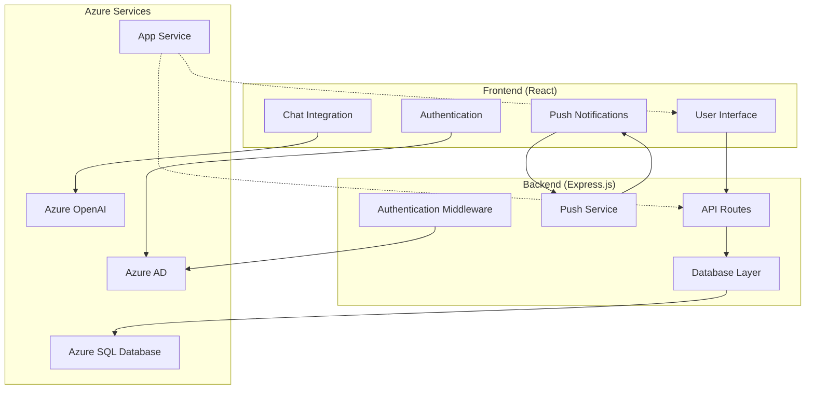

# IPL Play-Along Application

A comprehensive React-based application for IPL (Indian Premier League) fans to participate in match predictions, live voting, and real-time notifications during cricket matches. This application integrates with Azure services for AI-powered chat functionality, secure authentication, and push notifications.

## 🏏 Features

- **Live Match Voting**: Real-time team prediction and voting system
- **Push Notifications**: Web push notifications for match updates and reminders
- **AI Chat Integration**: Azure OpenAI-powered chat functionality for match discussions
- **User Authentication**: Secure Azure AD integration for user management
- **Score Tracking**: Dynamic leaderboard and scoring system
- **Real-time Updates**: Live match data and statistics
- **Responsive Design**: Mobile-friendly interface with React components

## 📋 Table of Contents

- [Quick Start](#quick-start)
- [Documentation](#documentation)
- [Technologies](#technologies)
- [Architecture](#architecture)
- [Contributing](#contributing)
- [License](#license)

## 🚀 Quick Start

### Prerequisites

- Node.js 16+ and npm
- Azure SQL Database access
- Azure OpenAI service account
- Azure AD application registration

### Installation

1. Clone the repository:
```bash
git clone <repository-url>
cd ipl-react-with-node
```

2. Install dependencies:
```bash
npm install
```

3. Configure environment variables (see [Configuration Guide](docs/DEVELOPMENT.md#environment-configuration))

4. Start development server:
```bash
npm start
```

The application will open at [http://localhost:3000](http://localhost:3000)

## 📖 Documentation

Our comprehensive documentation is organized into specialized guides:

### Core Documentation
- **[Frontend Documentation](docs/FRONTEND.md)** - Complete React frontend architecture, components, and features
- **[Development Guide](docs/DEVELOPMENT.md)** - Setup instructions, coding standards, and best practices
- **[Database Documentation](docs/DATABASE.md)** - Azure SQL database schema, queries, and data management

### Service Integration
- **[Azure Integration Guide](docs/AZURE.md)** - Azure AD, OpenAI, and cloud services configuration
- **[Notifications System](docs/NOTIFICATIONS.md)** - Web push notifications and service worker implementation

### Operations & Security
- **[Deployment Guide](docs/DEPLOYMENT.md)** - Production deployment, CI/CD, and infrastructure
- **[Development Guide](docs/DEVELOPMENT.md)** - Setup instructions, coding standards, and best practices
- **[Security Documentation](docs/SECURITY.md)** - Security measures, authentication, and data protection

Each documentation file contains:
- ✅ Detailed technical specifications
- 🔧 Configuration examples
- 🛠️ Troubleshooting guides
- 📝 Code samples and best practices
- 🚨 Common issues and solutions

## 🛠️ Technologies

### Frontend
- **React 18.2.0** - Modern UI library with hooks
- **Microsoft Authentication Library (MSAL)** - Azure AD integration
- **Service Workers** - Push notifications and offline support
- **CSS Modules** - Scoped styling and component-based design

### Backend
- **Express.js 4.18.2** - RESTful API server
- **Tedious** - Azure SQL Database connectivity
- **Web-Push** - Push notification delivery
- **Helmet** - Security middleware and headers

### Azure Services
- **Azure SQL Database** - Primary data storage
- **Azure OpenAI** - AI chat functionality
- **Azure AD** - Authentication and user management
- **Azure App Service** - Application hosting
- **Azure Application Insights** - Monitoring and analytics

## 🏗️ Architecture



## 🎯 Available Scripts

### Development

In the project directory, you can run:

### `npm start`


Runs the app in the development mode.<br />
Open [http://localhost:3000](http://localhost:3000) to view it in the browser.

The page will reload if you make edits.<br />
You will also see any lint errors in the console.

### `npm test`

Launches the test runner in the interactive watch mode.<br />
See the section about [running tests](https://facebook.github.io/create-react-app/docs/running-tests) for more information.

### `npm run build`

Builds the app for production to the `build` folder.<br />
It correctly bundles React in production mode and optimizes the build for the best performance.

The build is minified and the filenames include the hashes.<br />
Your app is ready to be deployed!

See the section about [deployment](https://facebook.github.io/create-react-app/docs/deployment) for more information.

### `npm run eject`

**Note: this is a one-way operation. Once you `eject`, you can’t go back!**

If you aren’t satisfied with the build tool and configuration choices, you can `eject` at any time. This command will remove the single build dependency from your project.

Instead, it will copy all the configuration files and the transitive dependencies (webpack, Babel, ESLint, etc) right into your project so you have full control over them. All of the commands except `eject` will still work, but they will point to the copied scripts so you can tweak them. At this point you’re on your own.

You don’t have to ever use `eject`. The curated feature set is suitable for small and middle deployments, and you shouldn’t feel obligated to use this feature. However we understand that this tool wouldn’t be useful if you couldn’t customize it when you are ready for it.

## Learn More

You can learn more in the [Create React App documentation](https://facebook.github.io/create-react-app/docs/getting-started).

To learn React, check out the [React documentation](https://reactjs.org/).

### Code Splitting

This section has moved here: https://facebook.github.io/create-react-app/docs/code-splitting

### Analyzing the Bundle Size

This section has moved here: https://facebook.github.io/create-react-app/docs/analyzing-the-bundle-size

### Making a Progressive Web App

This section has moved here: https://facebook.github.io/create-react-app/docs/making-a-progressive-web-app

### Advanced Configuration

This section has moved here: https://facebook.github.io/create-react-app/docs/advanced-configuration

### Deployment

This section has moved here: https://facebook.github.io/create-react-app/docs/deployment

### `npm run build` fails to minify

This section has moved here: https://facebook.github.io/create-react-app/docs/troubleshooting#npm-run-build-fails-to-minify
