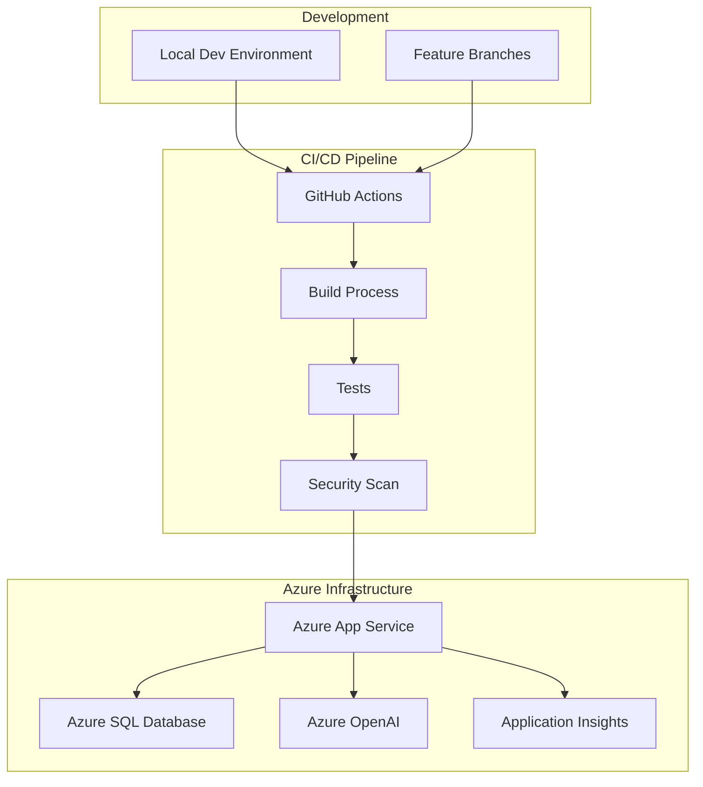

# Deployment Guide

## Overview
This guide covers deployment strategies for the IPL Play-Along application across different environments including Azure App Service, local development, and alternative cloud platforms.

## Deployment Architecture



## Environment Configuration

### Development Environment
```bash
# .env.development
NODE_ENV=development
PORT=3000
REACT_APP_API_URL=http://localhost:3000/api

# Database Configuration
DB_SERVER=localhost
DB_USER=sa
DB_PASSWORD=YourPassword123!
DB_NAME=ipldev

# Azure Services (Development)
AZURE_OPENAI_ENDPOINT=https://myopenaieus.openai.azure.com/
AZURE_OPENAI_API_KEY=dev-api-key

# Push Notifications (Development)
VAPID_PUBLIC_KEY=BGQnf5Xe5PXvLwVLjoQpeO6WKdTB9oYs2E-DQEstSaXXTD0RExIrP1YUA3W2fGf9Un0Re3Rx_SIhUdJ3uJudxS4
VAPID_PRIVATE_KEY=Nim6fzW67Og-2wGMC0EQ3gbyGAkf8HDpUh-5EtloXOo
```

### Staging Environment
```bash
# .env.staging
NODE_ENV=staging
PORT=80
REACT_APP_API_URL=https://dmoipl-staging.azurewebsites.net/api

# Database Configuration (Staging)
DB_SERVER=iplserver-staging.database.windows.net
DB_USER=myadmin
DB_PASSWORD=StagingPassword123!
DB_NAME=backenddb_staging

# Azure Services (Staging)
AZURE_OPENAI_ENDPOINT=https://myopenaieus-staging.openai.azure.com/
AZURE_OPENAI_API_KEY=staging-api-key

# Monitoring
APPINSIGHTS_INSTRUMENTATIONKEY=staging-insights-key
```

### Production Environment
```bash
# .env.production
NODE_ENV=production
PORT=80
REACT_APP_API_URL=https://dmoipl.azurewebsites.net/api

# Database Configuration (Production)
DB_SERVER=iplserver.database.windows.net
DB_USER=myadmin
DB_PASSWORD=ProductionPassword123!
DB_NAME=backenddb_Copy

# Azure Services (Production)
AZURE_OPENAI_ENDPOINT=https://myopenaieus.openai.azure.com/
AZURE_OPENAI_API_KEY=production-api-key

# Monitoring
APPINSIGHTS_INSTRUMENTATIONKEY=production-insights-key

# Security
HELMET_CSP_ENABLED=true
CORS_ORIGIN=https://dmoipl.azurewebsites.net
```

## Azure App Service Deployment

### Prerequisites
1. **Azure Subscription** with appropriate permissions
2. **Resource Group** created (`IPL-PlayAlong-RG`)
3. **App Service Plan** (Basic B1 or higher recommended)
4. **Azure SQL Database** configured and accessible
5. **GitHub repository** with deployment workflows

### Manual Deployment Steps

#### 1. Create Azure Resources
```bash
# Login to Azure
az login

# Create resource group
az group create \
    --name IPL-PlayAlong-RG \
    --location "East US"

# Create App Service plan
az appservice plan create \
    --name ipl-app-service-plan \
    --resource-group IPL-PlayAlong-RG \
    --sku B1 \
    --is-linux

# Create App Service
az webapp create \
    --resource-group IPL-PlayAlong-RG \
    --plan ipl-app-service-plan \
    --name dmoipl \
    --runtime "NODE|18-lts" \
    --deployment-local-git
```

#### 2. Configure App Service Settings
```bash
# Set Node.js version
az webapp config set \
    --resource-group IPL-PlayAlong-RG \
    --name dmoipl \
    --startup-file "node app.js"

# Configure environment variables
az webapp config appsettings set \
    --resource-group IPL-PlayAlong-RG \
    --name dmoipl \
    --settings \
    NODE_ENV=production \
    DB_SERVER=iplserver.database.windows.net \
    DB_USER=myadmin \
    DB_PASSWORD="A@12345678" \
    DB_NAME=backenddb_Copy \
    AZURE_OPENAI_ENDPOINT="https://myopenaieus.openai.azure.com/" \
    AZURE_OPENAI_API_KEY="your-api-key" \
    VAPID_PUBLIC_KEY="BGQnf5Xe5PXvLwVLjoQpeO6WKdTB9oYs2E-DQEstSaXXTD0RExIrP1YUA3W2fGf9Un0Re3Rx_SIhUdJ3uJudxS4" \
    VAPID_PRIVATE_KEY="Nim6fzW67Og-2wGMC0EQ3gbyGAkf8HDpUh-5EtloXOo"

# Enable HTTPS only
az webapp update \
    --resource-group IPL-PlayAlong-RG \
    --name dmoipl \
    --https-only true
```

#### 3. Deploy Application Code
```bash
# Build the application locally
npm install
npm run build

# Deploy via Git (if using local git)
git remote add azure <azure-git-url>
git push azure main

# Or deploy via ZIP
az webapp deployment source config-zip \
    --resource-group IPL-PlayAlong-RG \
    --name dmoipl \
    --src ./build.zip
```

### GitHub Actions CI/CD Pipeline

#### Workflow Configuration
**File:** `.github/workflows/deploy_dmoipl.yml`

```yaml
name: Deploy to Azure App Service

on:
  push:
    branches: [ main ]
  pull_request:
    branches: [ main ]

env:
  AZURE_WEBAPP_NAME: dmoipl
  AZURE_WEBAPP_PACKAGE_PATH: '.'
  NODE_VERSION: '18.x'

permissions:
  contents: read

jobs:
  build:
    runs-on: ubuntu-latest
    
    steps:
    - name: Checkout repository
      uses: actions/checkout@v4

    - name: Set up Node.js
      uses: actions/setup-node@v3
      with:
        node-version: ${{ env.NODE_VERSION }}
        cache: 'npm'

    - name: Install dependencies
      run: npm ci

    - name: Run tests
      run: npm test -- --coverage --watchAll=false

    - name: Build application
      run: npm run build --if-present

    - name: Upload build artifacts
      uses: actions/upload-artifact@v3
      with:
        name: node-app
        path: .

  security-scan:
    runs-on: ubuntu-latest
    needs: build
    
    steps:
    - name: Checkout repository
      uses: actions/checkout@v4

    - name: Run security audit
      run: npm audit --audit-level high

    - name: Run dependency check
      uses: dependency-check/Dependency-Check_Action@main
      with:
        project: 'IPL-PlayAlong'
        path: '.'
        format: 'HTML'

  deploy-staging:
    runs-on: ubuntu-latest
    needs: [build, security-scan]
    if: github.ref == 'refs/heads/main'
    environment: staging
    
    steps:
    - name: Download build artifacts
      uses: actions/download-artifact@v3
      with:
        name: node-app

    - name: Deploy to Azure App Service (Staging)
      uses: azure/webapps-deploy@v2
      with:
        app-name: 'dmoipl-staging'
        publish-profile: ${{ secrets.AZUREAPPSERVICE_PUBLISHPROFILE_STAGING }}
        package: ${{ env.AZURE_WEBAPP_PACKAGE_PATH }}

    - name: Run integration tests
      run: |
        npm run test:integration
      env:
        API_URL: https://dmoipl-staging.azurewebsites.net/api

  deploy-production:
    runs-on: ubuntu-latest
    needs: deploy-staging
    if: github.ref == 'refs/heads/main'
    environment: production
    
    steps:
    - name: Download build artifacts
      uses: actions/download-artifact@v3
      with:
        name: node-app

    - name: Deploy to Azure App Service (Production)
      uses: azure/webapps-deploy@v2
      with:
        app-name: ${{ env.AZURE_WEBAPP_NAME }}
        publish-profile: ${{ secrets.AZUREAPPSERVICE_PUBLISHPROFILE }}
        package: ${{ env.AZURE_WEBAPP_PACKAGE_PATH }}

    - name: Run smoke tests
      run: |
        npm run test:smoke
      env:
        API_URL: https://dmoipl.azurewebsites.net/api

    - name: Notify deployment
      uses: 8398a7/action-slack@v3
      with:
        status: ${{ job.status }}
        channel: '#deployments'
        webhook_url: ${{ secrets.SLACK_WEBHOOK }}
      if: always()
```

#### Environment Secrets Configuration
In GitHub repository settings, add these secrets:

```bash
# Azure Deployment
AZUREAPPSERVICE_PUBLISHPROFILE        # Production publish profile
AZUREAPPSERVICE_PUBLISHPROFILE_STAGING # Staging publish profile

# Database
DB_PASSWORD                           # Production database password
DB_PASSWORD_STAGING                   # Staging database password

# Azure OpenAI
AZURE_OPENAI_API_KEY                 # Production OpenAI API key
AZURE_OPENAI_API_KEY_STAGING         # Staging OpenAI API key

# Push Notifications
VAPID_PRIVATE_KEY                    # Production VAPID private key
VAPID_PRIVATE_KEY_STAGING            # Staging VAPID private key

# Monitoring
APPINSIGHTS_INSTRUMENTATIONKEY       # Production App Insights key
APPINSIGHTS_INSTRUMENTATIONKEY_STAGING # Staging App Insights key

# Notifications
SLACK_WEBHOOK                        # Slack webhook for deployment notifications
```

### Post-Deployment Configuration

#### 1. Verify Deployment
```bash
# Health check script
#!/bin/bash

WEBAPP_URL="https://dmoipl.azurewebsites.net"

echo "Checking application health..."

# Test API endpoints
curl -f "$WEBAPP_URL/api/matches" || exit 1
curl -f "$WEBAPP_URL/api/players" || exit 1
curl -f "$WEBAPP_URL/api/subs" || exit 1

# Test frontend
curl -f "$WEBAPP_URL" | grep -q "IPL Play-Along" || exit 1

echo "Application is healthy!"
```

#### 2. Database Migration
```bash
# Run database migrations after deployment
#!/bin/bash

echo "Running database migrations..."

# Connect to Azure SQL Database
sqlcmd -S iplserver.database.windows.net \
       -d backenddb_Copy \
       -U myadmin \
       -P "A@12345678" \
       -i ./migrations/latest.sql

echo "Database migration completed!"
```

#### 3. Warm-up Script
```bash
# Warm up the application
#!/bin/bash

WEBAPP_URL="https://dmoipl.azurewebsites.net"

echo "Warming up application..."

# Make initial requests to warm up the app
curl -s "$WEBAPP_URL" > /dev/null
curl -s "$WEBAPP_URL/api/matches" > /dev/null
curl -s "$WEBAPP_URL/api/players" > /dev/null

echo "Application warmed up!"
```

## Alternative Deployment Options

### Docker Containerization

#### Dockerfile
```dockerfile
# Multi-stage build for optimal image size
FROM node:18-alpine AS builder

# Set working directory
WORKDIR /app

# Copy package files
COPY package*.json ./

# Install dependencies
RUN npm ci --only=production

# Copy source code
COPY . .

# Build the application
RUN npm run build

# Production stage
FROM node:18-alpine AS production

# Create app directory
WORKDIR /app

# Copy built application from builder stage
COPY --from=builder /app .

# Create non-root user
RUN addgroup -g 1001 -S nodejs
RUN adduser -S nodejs -u 1001

# Change ownership of the app directory
RUN chown -R nodejs:nodejs /app
USER nodejs

# Expose port
EXPOSE 3000

# Health check
HEALTHCHECK --interval=30s --timeout=3s --start-period=5s --retries=3 \
  CMD curl -f http://localhost:3000/api/matches || exit 1

# Start the application
CMD ["node", "app.js"]
```

#### Docker Compose for Development
```yaml
version: '3.8'

services:
  app:
    build:
      context: .
      dockerfile: Dockerfile
    ports:
      - "3000:3000"
    environment:
      - NODE_ENV=development
      - DB_SERVER=db
      - DB_USER=sa
      - DB_PASSWORD=YourPassword123!
      - DB_NAME=ipldev
    depends_on:
      - db
    volumes:
      - ./src:/app/src
      - ./public:/app/public
    restart: unless-stopped

  db:
    image: mcr.microsoft.com/mssql/server:2019-latest
    environment:
      - ACCEPT_EULA=Y
      - SA_PASSWORD=YourPassword123!
      - MSSQL_PID=Express
    ports:
      - "1433:1433"
    volumes:
      - sqldata:/var/opt/mssql
    restart: unless-stopped

volumes:
  sqldata:
```

### Azure Container Instances Deployment
```bash
# Deploy to Azure Container Instances
az container create \
    --resource-group IPL-PlayAlong-RG \
    --name ipl-container \
    --image your-registry/ipl-app:latest \
    --cpu 2 \
    --memory 4 \
    --registry-login-server your-registry.azurecr.io \
    --registry-username your-username \
    --registry-password your-password \
    --dns-name-label ipl-app \
    --ports 3000 \
    --environment-variables \
        NODE_ENV=production \
        DB_SERVER=iplserver.database.windows.net \
        DB_USER=myadmin \
        DB_PASSWORD=A@12345678 \
        DB_NAME=backenddb_Copy \
    --secure-environment-variables \
        AZURE_OPENAI_API_KEY=your-api-key \
        VAPID_PRIVATE_KEY=your-private-key
```

### Kubernetes Deployment

#### Deployment Configuration
```yaml
apiVersion: apps/v1
kind: Deployment
metadata:
  name: ipl-app
  labels:
    app: ipl-app
spec:
  replicas: 3
  selector:
    matchLabels:
      app: ipl-app
  template:
    metadata:
      labels:
        app: ipl-app
    spec:
      containers:
      - name: ipl-app
        image: your-registry/ipl-app:latest
        ports:
        - containerPort: 3000
        env:
        - name: NODE_ENV
          value: "production"
        - name: DB_SERVER
          value: "iplserver.database.windows.net"
        - name: DB_USER
          valueFrom:
            secretKeyRef:
              name: database-secret
              key: username
        - name: DB_PASSWORD
          valueFrom:
            secretKeyRef:
              name: database-secret
              key: password
        livenessProbe:
          httpGet:
            path: /api/matches
            port: 3000
          initialDelaySeconds: 30
          periodSeconds: 10
        readinessProbe:
          httpGet:
            path: /api/matches
            port: 3000
          initialDelaySeconds: 5
          periodSeconds: 5
        resources:
          requests:
            memory: "256Mi"
            cpu: "250m"
          limits:
            memory: "512Mi"
            cpu: "500m"
---
apiVersion: v1
kind: Service
metadata:
  name: ipl-app-service
spec:
  selector:
    app: ipl-app
  ports:
  - protocol: TCP
    port: 80
    targetPort: 3000
  type: LoadBalancer
```

## Monitoring and Maintenance

### Application Insights Configuration
```javascript
// In app.js
const appInsights = require('applicationinsights');

if (process.env.NODE_ENV === 'production') {
    appInsights.setup(process.env.APPINSIGHTS_INSTRUMENTATIONKEY)
        .setAutoDependencyCorrelation(true)
        .setAutoCollectRequests(true)
        .setAutoCollectPerformance(true, true)
        .setAutoCollectExceptions(true)
        .setAutoCollectDependencies(true)
        .setAutoCollectConsole(true, true)
        .start();

    // Custom telemetry
    const client = appInsights.defaultClient;
    
    app.use((req, res, next) => {
        client.trackNodeHttpRequest({
            request: req,
            response: res
        });
        next();
    });
}
```

### Health Check Endpoints
```javascript
// Add health check endpoints
app.get('/health', (req, res) => {
    const healthCheck = {
        uptime: process.uptime(),
        message: 'OK',
        timestamp: Date.now(),
        database: connection.connected ? 'connected' : 'disconnected',
        subscriptions: subs ? subs.length : 0,
        environment: process.env.NODE_ENV
    };
    
    try {
        res.status(200).json(healthCheck);
    } catch (error) {
        healthCheck.message = error;
        res.status(503).json(healthCheck);
    }
});

app.get('/ready', (req, res) => {
    // Check if all dependencies are ready
    if (connection && connection.connected) {
        res.status(200).json({ status: 'ready' });
    } else {
        res.status(503).json({ status: 'not ready' });
    }
});
```

### Log Management
```javascript
// Configure logging
const winston = require('winston');

const logger = winston.createLogger({
    level: process.env.LOG_LEVEL || 'info',
    format: winston.format.combine(
        winston.format.timestamp(),
        winston.format.errors({ stack: true }),
        winston.format.json()
    ),
    defaultMeta: { service: 'ipl-app' },
    transports: [
        new winston.transports.File({ filename: 'logs/error.log', level: 'error' }),
        new winston.transports.File({ filename: 'logs/combined.log' }),
    ],
});

if (process.env.NODE_ENV !== 'production') {
    logger.add(new winston.transports.Console({
        format: winston.format.simple()
    }));
}
```

## Rollback Procedures

### Automated Rollback Script
```bash
#!/bin/bash

# Rollback to previous deployment
WEBAPP_NAME="dmoipl"
RESOURCE_GROUP="IPL-PlayAlong-RG"
PREVIOUS_DEPLOYMENT_ID="previous-deployment-id"

echo "Starting rollback procedure..."

# Get deployment history
az webapp deployment list \
    --name $WEBAPP_NAME \
    --resource-group $RESOURCE_GROUP \
    --output table

# Rollback to previous deployment
az webapp deployment source config-zip \
    --resource-group $RESOURCE_GROUP \
    --name $WEBAPP_NAME \
    --src ./previous-build.zip

# Wait for deployment to complete
az webapp deployment operation show \
    --name $WEBAPP_NAME \
    --resource-group $RESOURCE_GROUP \
    --operation-ids $PREVIOUS_DEPLOYMENT_ID

# Verify rollback
curl -f https://$WEBAPP_NAME.azurewebsites.net/health

echo "Rollback completed successfully!"
```

### Database Rollback
```sql
-- Database rollback script
BEGIN TRANSACTION;

-- Restore from backup if needed
RESTORE DATABASE backenddb_Copy 
FROM URL = 'https://storage.blob.core.windows.net/backups/previous-backup.bacpac';

-- Or revert specific changes
-- Example: Revert schema changes
ALTER TABLE iplTest DROP COLUMN IF EXISTS new_column;

-- Verify data integrity
SELECT COUNT(*) FROM matches;
SELECT COUNT(*) FROM iplTest;
SELECT COUNT(*) FROM subscriptions;

COMMIT TRANSACTION;
```

## Performance Optimization

### Build Optimization
```json
{
  "scripts": {
    "build:prod": "NODE_ENV=production npm run build",
    "analyze": "npm run build && npx webpack-bundle-analyzer build/static/js/*.js"
  }
}
```

### CDN Configuration
```bash
# Configure Azure CDN for static assets
az cdn profile create \
    --resource-group IPL-PlayAlong-RG \
    --name ipl-cdn-profile \
    --sku Standard_Microsoft

az cdn endpoint create \
    --resource-group IPL-PlayAlong-RG \
    --profile-name ipl-cdn-profile \
    --name ipl-assets \
    --origin dmoipl.azurewebsites.net \
    --origin-path "/build/static"
```

### Caching Configuration
```javascript
// Configure caching headers
app.use('/build/static', express.static(path.join(__dirname, 'build/static'), {
    maxAge: '1y',
    etag: true,
    setHeaders: (res, path) => {
        if (path.endsWith('.js') || path.endsWith('.css')) {
            res.setHeader('Cache-Control', 'public, max-age=31536000, immutable');
        }
    }
}));
```

## Security Considerations

### SSL/TLS Configuration
```bash
# Force HTTPS redirect
az webapp config set \
    --resource-group IPL-PlayAlong-RG \
    --name dmoipl \
    --http20-enabled true \
    --https-only true
```

### Environment Variable Security
```bash
# Store sensitive values in Azure Key Vault
az keyvault secret set \
    --vault-name ipl-keyvault \
    --name db-password \
    --value "A@12345678"

az keyvault secret set \
    --vault-name ipl-keyvault \
    --name openai-api-key \
    --value "your-api-key"
```

### Content Security Policy
```javascript
// Enhanced CSP for production
app.use(helmet({
    contentSecurityPolicy: {
        directives: {
            defaultSrc: ["'self'"],
            connectSrc: [
                "'self'", 
                "https://login.microsoftonline.com",
                "https://myopenaieus.openai.azure.com"
            ],
            imgSrc: ["'self'", "data:", "https:"],
            scriptSrc: ["'self'", "'unsafe-inline'"],
            styleSrc: ["'self'", "'unsafe-inline'"]
        }
    }
}));
```

This deployment guide provides comprehensive instructions for deploying the IPL Play-Along application across different environments and platforms, with emphasis on Azure App Service as the primary deployment target.