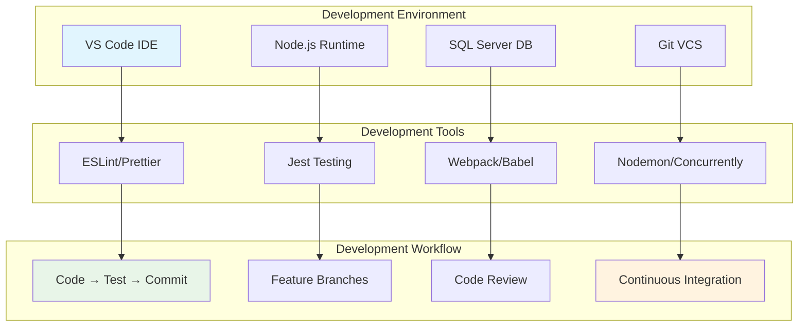

# Development Guide

## 👨‍💻 Development Overview

This comprehensive development guide provides everything needed to set up, develop, test, and contribute to the IPL Play-Along application. Each module covers specific aspects of the development workflow.

### 📚 Development Modules
- [**Environment Setup & Configuration**](./development/EnvironmentSetup.md) - Complete development environment setup, prerequisites, database configuration, and startup procedures
- [**Coding Standards & Best Practices**](./development/CodingStandards.md) - Code style guidelines, naming conventions, component structure, and testing standards

## 🏗️ Development Architecture



## 🚀 Quick Start Guide

### Essential Setup Steps
| Step | Action | Time | Documentation |
|------|--------|------|---------------|
| **1** | Install Prerequisites | 15min | [📖 Environment Setup](./development/EnvironmentSetup.md#prerequisites) |
| **2** | Clone & Install | 10min | [📖 Installation](./development/EnvironmentSetup.md#project-installation) |
| **3** | Configure Environment | 10min | [📖 Configuration](./development/EnvironmentSetup.md#environment-configuration) |
| **4** | Setup Database | 15min | [📖 Database Setup](./development/EnvironmentSetup.md#database-setup) |
| **5** | Start Development | 5min | [📖 Startup](./development/EnvironmentSetup.md#development-server-startup) |

### First-Time Developer Checklist
- [ ] Node.js 18.x+ installed
- [ ] SQL Server Express configured
- [ ] VS Code with recommended extensions
- [ ] Environment variables configured
- [ ] Database schema initialized
- [ ] Development servers running
- [ ] ESLint and Prettier configured

## 🛠️ Development Stack

### Frontend Technologies
| Technology | Version | Purpose | Documentation |
|------------|---------|---------|---------------|
| **React** | 18.2.0 | UI Framework | [📖 React Patterns](./development/CodingStandards.md#javascriptreact-standards) |
| **React Router** | 6.8.0 | Client-side routing | Built-in navigation |
| **Bootstrap** | 5.3.2 | CSS framework | Responsive design |
| **Azure MSAL** | 3.5.0 | Authentication | Microsoft identity |
| **Service Workers** | Native | Push notifications | Background processing |

### Backend Technologies  
| Technology | Version | Purpose | Documentation |
|------------|---------|---------|---------------|
| **Node.js** | 18.x+ | Runtime environment | JavaScript execution |
| **Express.js** | 4.18.2 | Web framework | API server |
| **SQL Server** | 2019+ | Database | Data persistence |
| **Azure OpenAI** | Latest | Chat functionality | AI integration |
| **Web Push** | 3.6.6 | Push notifications | Real-time alerts |

### Development Tools
| Tool | Purpose | Configuration |
|------|---------|---------------|
| **ESLint** | Code linting | [📖 Standards](./development/CodingStandards.md#javascript-react-standards) |
| **Prettier** | Code formatting | Auto-format on save |
| **Jest** | Unit testing | [📖 Testing](./development/CodingStandards.md#testing-standards) |
| **Nodemon** | Hot reloading | Development server |
| **Concurrently** | Multi-process | Run frontend + backend |

## 📁 Project Structure Overview

```
ipl-react-with-node/
├── 📁 src/                          # React frontend source
│   ├── 📁 components/               # Reusable UI components
│   │   ├── EntryForm.js            # Vote submission form
│   │   ├── NotificationComponent.js # Push notification handler
│   │   ├── PageLayout.jsx          # Main layout wrapper
│   │   └── Authentication/         # Auth components
│   ├── 📄 App.js                   # Main application component
│   ├── 📄 auth.js                  # Azure MSAL configuration
│   └── 📄 index.js                 # Application entry point
│
├── 📁 server/                       # Backend server files
│   └── 📄 cronjob.js               # Scheduled tasks
│
├── 📁 api/                         # Express.js API routes
│   └── 📄 index.js                 # API endpoint definitions
│
├── 📁 public/                      # Static assets
│   ├── 📄 manifest.json           # PWA manifest
│   ├── 📄 service-worker.js       # Service worker
│   └── 🖼️ images/                 # Static images
│
├── 📁 build/                       # Production build output
├── 📁 docs/                        # Documentation files
├── 📁 node_modules/                # Dependencies
├── 📄 package.json                 # Project configuration
├── 📄 server.js                    # Express server entry
└── 📄 app.js                       # Express app configuration
```

## 🔄 Development Workflow

### Branch Strategy
```mermaid
gitgraph:
    options:
        mainBranchName: main
    commit id: "Initial"
    
    branch feature/match-system
    commit id: "Add matches API"
    commit id: "Add vote system"
    
    checkout main
    merge feature/match-system
    commit id: "Merge matches"
    
    branch feature/notifications
    commit id: "Add push notifications"
    commit id: "Add service worker"
    
    checkout main
    merge feature/notifications
    commit id: "Release v1.2"
```

### Feature Development Process
1. **Create Feature Branch** - `git checkout -b feature/feature-name`
2. **Develop & Test** - Follow coding standards and write tests
3. **Commit Changes** - Use conventional commit messages
4. **Create Pull Request** - Request code review
5. **Code Review** - Address feedback and concerns
6. **Merge to Main** - Deploy to staging for testing
7. **Deploy to Production** - Release when stable

### Daily Development Commands
```bash
# Start development environment
npm run dev                  # Start both frontend and backend

# Code quality checks
npm run lint                 # Check code style
npm run lint:fix            # Auto-fix linting issues
npm run format              # Format code with Prettier

# Testing
npm test                     # Run unit tests
npm run test:coverage       # Run tests with coverage report

# Database operations
npm run init-db             # Initialize database schema
npm run seed-db             # Add sample data

# Health checks
npm run health-check        # Verify all services running
npm run validate-env        # Check environment variables
```

## 🧪 Testing Strategy

### Test Pyramid
```mermaid
pyramid:
    Unit Tests (70%)
    Integration Tests (20%)
    E2E Tests (10%)
```

### Testing Guidelines
- **Unit Tests** - Test individual components and functions
- **Integration Tests** - Test API endpoints and database interactions  
- **E2E Tests** - Test complete user workflows
- **Coverage Target** - Maintain >80% code coverage
- **Test Files** - Co-locate with source files or in `__tests__/`

### Running Tests
```bash
# Run all tests
npm test

# Run tests in watch mode
npm test -- --watch

# Run specific test file
npm test MatchCard.test.js

# Generate coverage report
npm run test:coverage

# Run E2E tests (if configured)
npm run test:e2e
```

## 🔧 Development Configuration

### Package.json Scripts
```json
{
  "scripts": {
    "start": "react-scripts start",
    "build": "react-scripts build",
    "serve": "node server.js",
    "dev": "concurrently \"npm start\" \"npm run serve\"",
    "dev:debug": "concurrently \"npm start\" \"nodemon --inspect server.js\"",
    "test": "react-scripts test",
    "test:coverage": "npm test -- --coverage",
    "lint": "eslint src/ --ext .js,.jsx",
    "lint:fix": "eslint src/ --ext .js,.jsx --fix",
    "format": "prettier --write src/**/*.{js,jsx,css,md}",
    "validate-env": "node scripts/validate-env.js",
    "init-db": "node scripts/init-db.js",
    "setup": "npm run validate-env && npm run init-db"
  }
}
```

### Git Hooks (Husky)
```json
{
  "husky": {
    "hooks": {
      "pre-commit": "lint-staged",
      "pre-push": "npm test",
      "commit-msg": "commitlint -E HUSKY_GIT_PARAMS"
    }
  },
  "lint-staged": {
    "src/**/*.{js,jsx}": [
      "eslint --fix",
      "prettier --write",
      "git add"
    ]
  }
}
```

## 📊 Development Metrics

### Code Quality Indicators
| Metric | Target | Current | Trend |
|--------|--------|---------|-------|
| **Test Coverage** | >80% | 📈 Tracking | ⬆️ |
| **ESLint Warnings** | 0 | ✅ Clean | ➡️ |
| **Build Time** | <2min | 📊 Measuring | ⬆️ |
| **Bundle Size** | <500KB | 📊 Optimizing | ⬇️ |

### Performance Targets
- **Development Build** - <30 seconds
- **Production Build** - <2 minutes  
- **Hot Reload** - <1 second
- **Test Suite** - <30 seconds
- **Lint Check** - <10 seconds

## 🤝 Contributing Guidelines

### Code Review Checklist
- [ ] Follows coding standards and conventions
- [ ] Includes appropriate tests with good coverage
- [ ] Has clear, descriptive commit messages
- [ ] Documentation updated if needed
- [ ] No console.log statements in production code
- [ ] Error handling implemented properly
- [ ] Performance considerations addressed

### Pull Request Template
```markdown
## Description
Brief description of changes made

## Type of Change
- [ ] Bug fix
- [ ] New feature  
- [ ] Breaking change
- [ ] Documentation update

## Testing
- [ ] Unit tests added/updated
- [ ] Manual testing completed
- [ ] All existing tests pass

## Checklist
- [ ] Code follows style guidelines
- [ ] Self-review completed
- [ ] Documentation updated
```

## 🚀 Deployment Pipeline

### Environment Progression
1. **Local Development** - Feature development and testing
2. **Staging** - Integration testing and reviews
3. **Production** - Live application deployment

### Automated Checks
- Code quality validation (ESLint/Prettier)
- Test suite execution (Jest)
- Build verification (Webpack)
- Security scanning (npm audit)
- Dependency checking (outdated packages)

---

> 📌 **Note:** This modular development guide ensures consistent development practices across the team. Each module provides detailed implementation guidance and best practices for efficient development workflow.