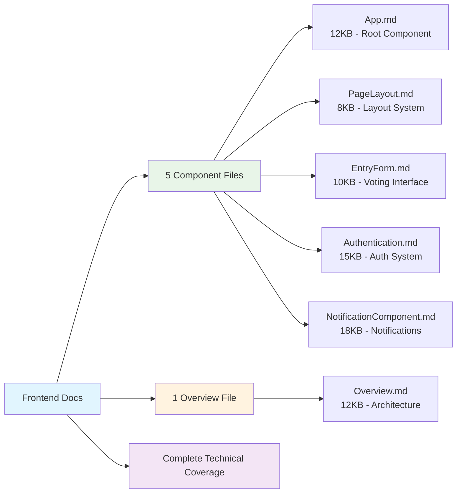
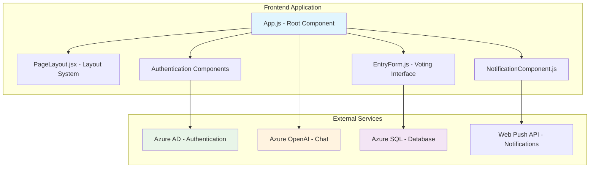

# Frontend Documentation

## 🚀 Quick Navigation

This documentation has been modularized for better maintainability and navigation. Choose your path:

### 📋 Overview & Architecture
- [**Frontend Overview**](./frontend/Overview.md) - Complete architectural overview, tech stack, and system design

### 🧩 Component Documentation
- [**App Component**](./frontend/components/App.md) - Root component with state management and Azure integrations
- [**PageLayout Component**](./frontend/components/PageLayout.md) - Main layout wrapper with responsive design
- [**EntryForm Component**](./frontend/components/EntryForm.md) - Voting interface with form validation
- [**Authentication Components**](./frontend/components/Authentication.md) - Sign-in, sign-out, login flow, and profile management
- [**NotificationComponent**](./frontend/components/NotificationComponent.md) - Push notifications and Service Worker management

## 📊 Documentation Statistics



## 🏗️ System Architecture



## 🔧 Technology Stack

| Category | Technology | Version | Purpose |
|----------|------------|---------|---------|
| **Framework** | React | 18.2.0 | Frontend framework |
| **UI Library** | Bootstrap | 5.3.2 | Responsive design |
| **Authentication** | Azure MSAL | Latest | Azure AD integration |
| **Notifications** | Service Workers | Native | Push notifications |
| **AI Integration** | Azure OpenAI | GPT-4 | Chat functionality |
| **State Management** | React Hooks | Built-in | Component state |

## 📱 Key Features Summary

### 🏏 Core Functionality
- **Real-time Match Voting** - Interactive voting interface with time restrictions
- **Live Score Updates** - Real-time match data integration
- **AI-Powered Chat** - Azure OpenAI integration for match discussions
- **GIF Rotation System** - Dynamic visual content based on match state

### 🔐 Security & Authentication  
- **Azure AD Integration** - Microsoft account authentication
- **JWT Token Management** - Secure token handling with auto-refresh
- **Input Validation** - Client and server-side validation
- **XSS Protection** - React's built-in security features

### 📢 Notifications & PWA
- **Push Notifications** - Real-time match and vote notifications  
- **Service Worker** - Background processing and caching
- **PWA Support** - App-like experience with offline capabilities
- **VAPID Authentication** - Secure push notification delivery

### 📊 User Experience
- **Responsive Design** - Mobile-first responsive layout
- **Accessibility** - WCAG guidelines compliance
- **Performance Optimization** - Code splitting and lazy loading
- **Error Handling** - Comprehensive error management

## 🚦 Getting Started

### Prerequisites
- Node.js 16+ 
- npm or yarn
- Azure AD tenant for authentication
- Valid VAPID keys for notifications

### Quick Setup
1. **Install Dependencies**
   ```bash
   npm install
   ```

2. **Environment Configuration**
   ```bash
   # Copy and configure environment variables
   cp .env.example .env
   ```

3. **Start Development Server**
   ```bash
   npm start
   ```

4. **Access Application**
   - Development: `http://localhost:3000`
   - Production: `https://your-domain.com`

## 🧪 Testing Strategy

### Test Coverage
- **Unit Tests** - Individual component testing
- **Integration Tests** - Component interaction testing
- **E2E Tests** - Complete user journey testing
- **Performance Tests** - Load and rendering performance

### Testing Tools
- **Jest** - Test runner and assertions
- **React Testing Library** - Component testing utilities
- **Cypress** - End-to-end testing framework
- **React DevTools Profiler** - Performance analysis

## 📈 Performance Metrics

### Bundle Analysis
- **Main Bundle** - Core application code (~200KB gzipped)
- **Vendor Bundle** - Third-party libraries (~150KB gzipped)
- **Async Chunks** - Lazy-loaded components (~50KB each)
- **Total Size** - <500KB for initial load

### Optimization Features
- **Code Splitting** - Dynamic imports for components
- **Tree Shaking** - Unused code elimination
- **Memoization** - React.memo and useMemo optimization
- **Asset Optimization** - Image compression and WebP support

## 🔍 Troubleshooting

### Common Issues
1. **Authentication Failures** - Check Azure AD configuration
2. **Notification Blocks** - Verify browser permissions
3. **API Connectivity** - Confirm backend endpoint availability  
4. **Service Worker Issues** - Check HTTPS requirement

### Debug Resources
- Browser Developer Tools
- React Developer Tools extension
- Azure Portal for authentication logs
- Network tab for API call monitoring

## 🛠️ Maintenance

### Regular Tasks
- **Dependency Updates** - Monthly security updates
- **Bundle Analysis** - Quarterly performance reviews
- **Test Coverage** - Continuous improvement targets
- **Accessibility Audits** - Bi-annual compliance checks

### Monitoring
- **Application Insights** - Performance and error tracking
- **Bundle Analyzer** - Size monitoring and optimization
- **Lighthouse Scores** - Performance, accessibility, SEO metrics
- **User Analytics** - Usage patterns and engagement metrics

## 📚 Additional Resources

### Documentation Links
- [React Official Documentation](https://react.dev/)
- [Bootstrap 5 Documentation](https://getbootstrap.com/docs/5.3/)
- [Azure MSAL Documentation](https://docs.microsoft.com/en-us/azure/active-directory/develop/msal-overview)
- [Service Workers Guide](https://developer.mozilla.org/en-US/docs/Web/API/Service_Worker_API)

### Code Examples
Each component documentation includes:
- Complete implementation examples
- Code snippets with explanations  
- Testing strategies and examples
- Troubleshooting guides
- Performance optimization tips

---

> 📌 **Note:** This modular documentation structure makes it easier to maintain and navigate. Each component has its own comprehensive documentation with technical details, code examples, and troubleshooting guides.

## Technology Stack

### Core Technologies
- **React 18.2.0** - Main UI framework with hooks
- **React Bootstrap 2.10.1** - UI component library
- **@azure/msal-react 1.5.16** - Microsoft Authentication Library
- **Service Workers** - Push notifications and offline capabilities

### Key Dependencies
```json
{
  "react": "^18.2.0",
  "react-dom": "^18.2.0",
  "react-bootstrap": "^2.10.1",
  "@azure/msal-react": "^1.5.16",
  "@azure/msal-browser": "^2.38.4",
  "bootstrap": "^5.3.2"
}
```

## Component Architecture

### Main Components

#### 1. App.js - Root Component
**Location:** [`src/App.js`](../src/App.js)

**Purpose:** Main application container that handles:
- Match data fetching
- Team voting logic
- Azure OpenAI chat integration
- Global state management

**Key Features:**
```javascript
// GIF rotation for visual appeal
const gifs = [gif1, gif2, gif3, gif4, gif5, gif6, gif7, gif8];

// Azure OpenAI integration
function chatGpt() {
  var raw = JSON.stringify({
    "model": "mychatbot",
    "messages": [
      {
        "role": "system", 
        "content": "You are a helpful assistant having information about IPL teams"
      }
    ]
  });
}

// Vote submission with time restrictions
function sendEntry(name, team) {
  const currentTime = new Date();
  const currentHour = currentTime.getHours();
  
  if (currentHour >= 19) { // 7 PM IST restriction
    alert("Voting time is over");
    return;
  }
  
  // Submit vote via API
}
```

**State Management:**
- `entries` - Current match vote entries
- `players` - Player statistics and scores
- `match` - Current match information
- `help` - Chat/help system visibility

#### 2. EntryForm.js - Voting Interface
**Location:** [`src/components/EntryForm.js`](../src/components/EntryForm.js)

**Purpose:** Handles team selection and vote submission

**Features:**
- Team selection buttons
- Player name input
- Form validation
- Real-time feedback

**Props Interface:**
```javascript
interface EntryFormProps {
  onSubmit: (name: string, team: string) => void;
  teams: {
    team1: string;
    team2: string;
  };
  isVotingOpen: boolean;
}
```

**Usage Example:**
```jsx
<EntryForm
  onSubmit={handleVoteSubmission}
  teams={{ team1: "Gujarat Titans", team2: "Delhi Capitals" }}
  isVotingOpen={currentHour < 19}
/>
```

#### 3. PageLayout.jsx - Main Layout
**Location:** [`src/components/PageLayout.jsx`](../src/components/PageLayout.jsx)

**Purpose:** Provides consistent page structure and navigation

**Current Implementation:**
```jsx
export const PageLayout = (props) => {
  const [isPanicClicked, setIsPanicClicked] = useState(false);

  return (
    <>
      <div className="App">
        <div className="center-content">
          <h4>CareHarbor</h4>
          {/* Emergency services interface */}
        </div>
      </div>
      {props.children}
    </>
  );
}
```

**Note:** The current implementation shows a CareHarbor emergency services interface, which appears to be from a different application context. This should be updated for IPL functionality.

#### 4. NotificationComponent.js - Push Notifications
**Location:** [`src/components/NotificationComponent.js`](../src/components/NotificationComponent.js)

**Purpose:** Manages push notification subscription and display

**Key Features:**
```javascript
// Service worker registration
const registerServiceWorker = async () => {
  const registration = await navigator.serviceWorker.register('/service-worker.js');
  return registration;
};

// Push subscription
const subscribeToPush = async (registration) => {
  const subscription = await registration.pushManager.subscribe({
    userVisibleOnly: true,
    applicationServerKey: 'BGQnf5Xe5PXvLwVLjoQpeO6WKdTB9oYs2E-DQEstSaXXTD0RExIrP1YUA3W2fGf9Un0Re3Rx_SIhUdJ3uJudxS4'
  });
  
  // Save subscription to backend
  await fetch('/api/save-subscription', {
    method: 'POST',
    headers: { 'Content-Type': 'application/json' },
    body: JSON.stringify(subscription)
  });
};
```

#### 5. Authentication Components

**SignInButton.jsx**
```jsx
export const SignInButton = () => {
  const { instance } = useMsal();
  
  const handleLogin = () => {
    instance.loginPopup({
      scopes: ["User.Read"]
    });
  };

  return <Button onClick={handleLogin}>Sign In</Button>;
};
```

**SignOutButton.jsx**
```jsx
export const SignOutButton = () => {
  const { instance } = useMsal();
  
  const handleLogout = () => {
    instance.logoutPopup();
  };

  return <Button onClick={handleLogout}>Sign Out</Button>;
};
```

**ProfileData.jsx**
```jsx
export const ProfileData = () => {
  const { accounts } = useMsal();
  
  return (
    <div>
      <h5>Welcome, {accounts[0]?.name}</h5>
      <p>Email: {accounts[0]?.username}</p>
    </div>
  );
};
```

## State Management

### Local Component State
The application uses React hooks for state management:

```javascript
// In App.js
const [entries, setEntries] = useState([]);
const [players, setPlayers] = useState([]);  
const [match, setMatch] = useState({});
const [help, setHelp] = useState("none");
```

### Data Flow Pattern
1. **Mount Phase:** Components fetch initial data from API
2. **User Interaction:** State updates trigger re-renders
3. **API Communication:** Changes persist to backend
4. **Real-time Updates:** Push notifications update UI

## API Integration

### HTTP Client Configuration
```javascript
// Standard fetch with error handling
const apiCall = async (endpoint, options = {}) => {
  try {
    const response = await fetch(`/api/${endpoint}`, {
      headers: {
        'Content-Type': 'application/json',
      },
      ...options
    });
    
    if (!response.ok) {
      throw new Error(`HTTP error! status: ${response.status}`);
    }
    
    return await response.json();
  } catch (error) {
    console.error('API call failed:', error);
    throw error;
  }
};
```

### Key API Integrations

#### Match Data
```javascript
// Fetch current match
const fetchMatch = async () => {
  const match = await apiCall('matches');
  setMatch(match);
};

// Fetch vote entries
const fetchEntries = async () => {
  const entries = await apiCall('entries');
  setEntries(entries);
};

// Fetch player statistics
const fetchPlayers = async () => {
  const players = await apiCall('players');
  setPlayers(players);
};
```

#### Vote Submission
```javascript
const submitVote = async (name, team) => {
  await apiCall('entries', {
    method: 'POST',
    body: JSON.stringify({ name, team })
  });
  
  // Refresh data after submission
  await fetchEntries();
};
```

## Styling and Theming

### CSS Structure
```
src/
├── App.css              # Global application styles
├── index.css            # Root and reset styles  
└── components/
    ├── EntryForm.module.css     # Component-specific styles
    └── PageLayout.module.css    # Layout styles
```

### Key Style Features

#### Responsive Design
```css
/* Mobile-first approach */
.container {
  width: 100%;
  max-width: 1200px;
  margin: 0 auto;
  padding: 0 1rem;
}

@media (min-width: 768px) {
  .container {
    padding: 0 2rem;
  }
}
```

#### Theme Colors
```css
:root {
  --primary-color: #007bff;
  --secondary-color: #6c757d;
  --success-color: #28a745;
  --danger-color: #dc3545;
  --warning-color: #ffc107;
}
```

#### Animation Effects
```css
/* GIF rotation animation */
.team-gif {
  transition: transform 0.3s ease;
  border-radius: 8px;
}

.team-gif:hover {
  transform: scale(1.05);
}

/* Button hover effects */
.vote-button {
  transition: all 0.2s ease;
}

.vote-button:hover {
  background-color: var(--primary-color);
  transform: translateY(-2px);
  box-shadow: 0 4px 8px rgba(0,0,0,0.2);
}
```

## Service Worker Integration

### Registration
```javascript
// In public/service-worker.js or src/service-worker.js
self.addEventListener('install', (event) => {
  console.log('Service Worker installing');
  self.skipWaiting();
});

self.addEventListener('activate', (event) => {
  console.log('Service Worker activating');
  event.waitUntil(self.clients.claim());
});
```

### Push Notification Handling
```javascript
self.addEventListener('push', (event) => {
  const options = {
    body: event.data ? event.data.text() : 'New IPL update available!',
    icon: '/logo192.png',
    badge: '/logo192.png',
    vibrate: [100, 50, 100],
    data: {
      dateOfArrival: Date.now(),
      primaryKey: 1
    },
    actions: [
      {
        action: 'explore',
        title: 'View Details',
        icon: '/logo192.png'
      },
      {
        action: 'close',
        title: 'Close',
        icon: '/logo192.png'
      }
    ]
  };

  event.waitUntil(
    self.registration.showNotification('IPL Play-Along', options)
  );
});
```

## Error Handling

### Component Error Boundaries
```jsx
class ErrorBoundary extends React.Component {
  constructor(props) {
    super(props);
    this.state = { hasError: false };
  }

  static getDerivedStateFromError(error) {
    return { hasError: true };
  }

  componentDidCatch(error, errorInfo) {
    console.error('Component error:', error, errorInfo);
  }

  render() {
    if (this.state.hasError) {
      return (
        <div className="error-boundary">
          <h2>Something went wrong.</h2>
          <p>Please refresh the page or contact support.</p>
        </div>
      );
    }

    return this.props.children;
  }
}
```

### API Error Handling
```javascript
const handleApiError = (error) => {
  if (error.name === 'NetworkError') {
    showNotification('Network error. Please check your connection.', 'error');
  } else if (error.status === 401) {
    // Redirect to login
    window.location.href = '/login';
  } else if (error.status >= 500) {
    showNotification('Server error. Please try again later.', 'error');
  } else {
    showNotification('An unexpected error occurred.', 'error');
  }
};
```

## Performance Optimization

### Code Splitting
```javascript
// Lazy load components
const EntryForm = React.lazy(() => import('./components/EntryForm'));
const NotificationComponent = React.lazy(() => import('./components/NotificationComponent'));

// Usage with Suspense
<Suspense fallback={<div>Loading...</div>}>
  <EntryForm />
</Suspense>
```

### Memoization
```javascript
// Memoize expensive calculations
const sortedPlayers = useMemo(() => {
  return players.sort((a, b) => b.score - a.score);
}, [players]);

// Memoize callback functions
const handleVoteSubmission = useCallback((name, team) => {
  submitVote(name, team);
}, []);
```

### Asset Optimization
- **Images:** Compressed GIFs and PNGs
- **Bundle Splitting:** Separate vendor and app bundles
- **Caching:** Service worker caching for static assets

## Testing Strategy

### Unit Testing
```javascript
// Example test for EntryForm component
import { render, fireEvent, screen } from '@testing-library/react';
import EntryForm from './EntryForm';

test('submits vote when form is filled and submitted', () => {
  const mockSubmit = jest.fn();
  render(<EntryForm onSubmit={mockSubmit} teams={{team1: 'GT', team2: 'DC'}} />);
  
  fireEvent.change(screen.getByPlaceholderText('Player Name'), {
    target: { value: 'John Doe' }
  });
  
  fireEvent.click(screen.getByText('GT'));
  
  expect(mockSubmit).toHaveBeenCalledWith('John Doe', 'GT');
});
```

### Integration Testing
```javascript
// Test API integration
test('fetches and displays match data', async () => {
  // Mock API response
  global.fetch = jest.fn().mockResolvedValue({
    ok: true,
    json: async () => ({
      team1: 'Gujarat Titans',
      team2: 'Delhi Capitals'
    })
  });

  render(<App />);
  
  await waitFor(() => {
    expect(screen.getByText('Gujarat Titans')).toBeInTheDocument();
    expect(screen.getByText('Delhi Capitals')).toBeInTheDocument();
  });
});
```

## Build and Deployment

### Build Configuration
```json
{
  "scripts": {
    "start": "react-scripts start",
    "build": "react-scripts build", 
    "test": "react-scripts test",
    "eject": "react-scripts eject"
  }
}
```

### Environment Variables
```javascript
// Access environment variables
const API_URL = process.env.REACT_APP_API_URL || '/api';
const AZURE_CLIENT_ID = process.env.REACT_APP_AZURE_CLIENT_ID;
```

### Production Build Optimization
- **Minification:** JavaScript and CSS minification
- **Tree Shaking:** Remove unused code
- **Asset Hashing:** Cache busting for static files
- **Compression:** Gzip compression for served files

## Browser Compatibility

### Supported Browsers
- Chrome 88+
- Firefox 85+
- Safari 14+
- Edge 88+

### Polyfills and Fallbacks
```javascript
// Service Worker feature detection
if ('serviceWorker' in navigator) {
  registerServiceWorker();
} else {
  console.warn('Service Workers not supported');
  // Provide fallback notification system
}

// Push notification feature detection
if ('PushManager' in window) {
  setupPushNotifications();
} else {
  console.warn('Push notifications not supported');
}
```

## Security Considerations

### Content Security Policy
The application implements CSP headers to prevent XSS attacks:
```javascript
app.use(expressCspHeader({
  directives: {
    'default-src': [SELF],
    'connect-src': [SELF, "https://login.microsoftonline.com"],
    'img-src': ['data:', SELF] 
  },
}));
```

### Authentication Security
- JWT token validation
- Secure session management
- HTTPS enforcement in production

## Future Enhancements

### Planned Features
1. **Real-time Updates:** WebSocket integration for live scores
2. **Progressive Web App:** Enhanced PWA features
3. **Offline Support:** Better offline functionality
4. **Dark Mode:** Theme switching capability
5. **Accessibility:** WCAG 2.1 compliance improvements

### Performance Improvements
1. **Virtual Scrolling:** For large player lists
2. **Image Lazy Loading:** Optimize GIF loading
3. **Bundle Optimization:** Further reduce bundle size
4. **Caching Strategy:** Enhanced service worker caching