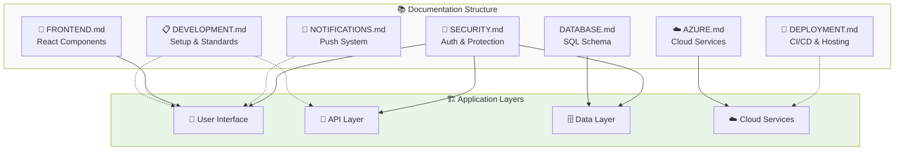

# IPL Play-Along Documentation Index

Welcome to the comprehensive documentation suite for the IPL Play-Along application. This index provides an overview of all available documentation and guides you to the right resource based on your needs.

## 📚 Documentation Overview

Our documentation is organized into 7 comprehensive guides with modular sub-documentation for easy navigation:

### 🎯 For Getting Started
- **[Development Guide](DEVELOPMENT.md)** - Start here for setup, configuration, and development workflows
  - [Environment Setup](development/EnvironmentSetup.md) - Complete development environment configuration
  - [Coding Standards](development/CodingStandards.md) - Best practices and coding conventions

### 🔧 Technical Implementation
- **[Frontend Documentation](FRONTEND.md)** - React components, UI architecture, and client-side functionality
  - [Frontend Overview](frontend/Overview.md) - Architecture and component overview
  - [App Component](frontend/components/App.md) - Main application component
  - [Entry Form](frontend/components/EntryForm.md) - Vote submission form component
  - [Page Layout](frontend/components/PageLayout.md) - Layout and navigation component
  - [Authentication Components](frontend/components/Authentication.md) - Login/logout components
  - [Notifications](frontend/components/NotificationComponent.md) - Push notification display
- **[Database Documentation](DATABASE.md)** - SQL schema, queries, and data management

### ☁️ Cloud Services
- **[Azure Integration](AZURE.md)** - Azure AD, OpenAI, and cloud service configurations
- **[Notifications System](NOTIFICATIONS.md)** - Push notifications and service worker implementation
  - [Service Worker](notifications/ServiceWorker.md) - Service worker implementation and management
  - [Push Subscriptions](notifications/PushSubscription.md) - Subscription handling and management
  - [Message Formats](notifications/MessageFormats.md) - Notification payload and formatting

### 🚀 Operations
- **[Deployment Guide](DEPLOYMENT.md)** - Production deployment, CI/CD pipelines, and infrastructure
- **[Security Documentation](SECURITY.md)** - Security measures, authentication, and data protection
  - [Authentication](security/Authentication.md) - Azure AD integration and user authentication
  - [Data Protection](security/DataProtection.md) - Security policies and data encryption

## 🎯 Quick Navigation

### I want to...

**Set up the development environment**
→ Start with [Development Guide](DEVELOPMENT.md#quick-setup)

**Understand the application architecture**
→ See [Frontend](FRONTEND.md#architecture-overview) and [Development Guide](DEVELOPMENT.md#application-architecture) documentation

**Configure Azure services**
→ Follow [Azure Integration Guide](AZURE.md#service-configuration)

**Deploy to production**
→ Use [Deployment Guide](DEPLOYMENT.md#production-deployment)

**Implement new features**
→ Check [Frontend](FRONTEND.md#component-development) for UI changes, [Development Guide](DEVELOPMENT.md#api-development) for server changes

**Troubleshoot issues**
→ Each guide has comprehensive troubleshooting sections

**Understand security requirements**
→ Review [Security Documentation](SECURITY.md)

**Set up notifications**
→ Follow [Notifications System](NOTIFICATIONS.md#setup-guide)

**Work with the database**
→ See [Database Documentation](DATABASE.md#getting-started)

## 📖 Documentation Features

Each documentation file includes:

### ✅ Complete Technical Specifications
- Detailed architecture explanations
- Component and module documentation
- API endpoint specifications
- Database schema and relationships

### 🔧 Configuration Examples
- Environment variable setup
- Service configuration templates
- Code examples and snippets
- Best practices implementation

### 🛠️ Troubleshooting Guides
- Common issues and solutions
- Error message explanations
- Debugging techniques
- Performance optimization tips

### 📝 Development Guidelines
- Coding standards and conventions
- Testing strategies
- Security considerations
- Deployment procedures

### 🚨 Operational Insights
- Monitoring and logging setup
- Performance metrics
- Security alerts and responses
- Maintenance procedures

## 🏗️ Application Architecture Overview



### Documentation Flow (Text Alternative)
```
📚 Documentation Structure          🏗️ Application Layers
├── 📋 DEVELOPMENT.md            ──→ 👤 User Interface & 📡 API Layer
├── 🎨 FRONTEND.md              ──→ 👤 User Interface  
├── 💾 DATABASE.md              ──→ 🗄️ Data Layer
├── ☁️ AZURE.md                 ──→ ☁️ Cloud Services
├── 🔔 NOTIFICATIONS.md         ──→ 👤 User Interface
├── 🚀 DEPLOYMENT.md            ──→ ☁️ Cloud Services
└── 🔐 SECURITY.md              ──→ All Layers (UI/API/Data)
```

## 📋 Documentation Statistics

| Document | Size | Status | Modules | Coverage |
|----------|------|--------|---------|----------|
| DEVELOPMENT.md | 10.90KB | ✅ Modularized | 2 modules | Setup & Standards |
| FRONTEND.md | 5.84KB | ✅ Modularized | 6 modules | Components & Architecture |
| NOTIFICATIONS.md | 7.59KB | ✅ Modularized | 3 modules | Push System & Workers |
| SECURITY.md | 7.61KB | ✅ Modularized | 2 modules | Auth & Protection |
| DATABASE.md | 22.50KB | 📄 Comprehensive | Single file | Schema & Queries |
| AZURE.md | 23.24KB | 📄 Comprehensive | Single file | Cloud Services |
| DEPLOYMENT.md | 19.82KB | 📄 Comprehensive | Single file | CI/CD & Infrastructure |

**Total: 13 modular files + 4 comprehensive files = Complete coverage**

### Modular File Structure
```
📁 docs/
├── 📁 development/         (2 modules - Environment & Standards)
├── 📁 frontend/           (6 modules - Overview + 5 Components)
├── 📁 notifications/      (3 modules - Worker, Push, Formats)
├── 📁 security/          (2 modules - Auth & Data Protection)
└── 📄 Core documentation files
```

## 🎓 Learning Path

### For New Developers
1. **[Development Guide](DEVELOPMENT.md)** - Environment setup and project overview
2. **[Frontend Documentation](FRONTEND.md)** - Understanding the user interface
3. **[Database Documentation](DATABASE.md)** - Data structures and queries
4. **[Azure Integration](AZURE.md)** - Cloud services and APIs

### For DevOps Engineers
1. **[Deployment Guide](DEPLOYMENT.md)** - Infrastructure and deployment
2. **[Security Documentation](SECURITY.md)** - Security measures and compliance
3. **[Azure Integration](AZURE.md)** - Cloud service management
4. **[Notifications System](NOTIFICATIONS.md)** - Push notification infrastructure

### For System Administrators
1. **[Security Documentation](SECURITY.md)** - Security policies and monitoring
2. **[Deployment Guide](DEPLOYMENT.md)** - Production operations
3. **[Database Documentation](DATABASE.md)** - Database administration
4. **[Azure Integration](AZURE.md)** - Cloud resource management

## 🔄 Documentation Updates

This documentation is maintained and updated regularly. Each file includes:
- Last updated timestamp
- Version information
- Change log for major updates
- Contributors and maintainers

## 📞 Support and Feedback

If you need additional information not covered in these guides:
1. Check the troubleshooting sections in relevant documents
2. Review the FAQ sections in each guide
3. Consult the code comments in the source files
4. Refer to the architecture diagrams and flowcharts

## 🏷️ Document Conventions

### Icons and Symbols
- ✅ **Completed/Required items**
- 🔧 **Configuration/Setup steps**
- 🛠️ **Troubleshooting information**
- 📝 **Code examples and snippets**
- 🚨 **Important warnings and alerts**
- 💡 **Tips and best practices**
- 🎯 **Key objectives and goals**
- 📊 **Metrics and monitoring**

### Code Formatting
- `Inline code` - File names, variables, short code snippets
- ```Code blocks``` - Full code examples, configuration files
- **Bold text** - Important concepts and headings
- *Italic text* - Emphasis and notes

---

*This documentation suite provides comprehensive technical coverage through a combination of modular components (13 focused modules) and comprehensive guides (4 detailed files), offering both detailed technical specifications and easy navigation for specific topics.*