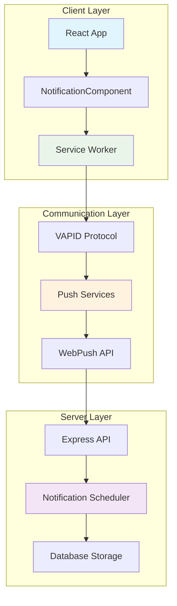

# Push Notifications Documentation

## 🔔 Notification System Overview

The IPL Play-Along application implements a comprehensive push notification system using modern web technologies to deliver real-time match updates, voting reminders, and personalized content to users across all devices.

### 📚 Notification Modules
- [**Service Worker Implementation**](./notifications/ServiceWorker.md) - Complete Service Worker setup, registration, caching strategies, and background processing
- [**Push Subscription Management**](./notifications/PushSubscription.md) - VAPID protocol, subscription lifecycle, and user preference management  
- [**Message Types & Formatting**](./notifications/MessageFormats.md) - Notification categories, rich media content, and branding guidelines

## 🏗️ Notification Architecture



## 📋 Notification Flow Overview

### User Journey
| Step | Action | Component | Description |
|------|--------|-----------|-------------|
| **1** | Permission Request | NotificationComponent | User grants notification permission |
| **2** | Service Worker Registration | Browser | SW registered and activated |
| **3** | Push Subscription | PushManager | VAPID-based subscription created |
| **4** | Server Storage | API Endpoint | Subscription stored with user preferences |
| **5** | Event Processing | Notification Scheduler | Match events trigger notification logic |
| **6** | Message Delivery | Push Service | Notifications sent via FCM/Mozilla Push |
| **7** | User Interaction | Service Worker | Click/close events tracked and processed |

### Notification Categories

#### 🏏 Real-time Match Notifications
- **Match Start Reminders** - Pre-match alerts (60, 30, 15, 5 minutes)
- **Live Score Updates** - Real-time scoring with throttling
- **Match Events** - Wickets, boundaries, milestones
- **Match Results** - Final scores and winner announcements

#### ⚡ User Engagement  
- **Vote Reminders** - Encourage participation during live matches
- **Achievement Unlocks** - Celebrate user milestones
- **Leaderboard Updates** - Weekly rankings and position changes
- **Streak Notifications** - Consecutive correct predictions

#### 📊 Personalized Content
- **Custom Preferences** - User-controlled notification types
- **Performance Insights** - Personal statistics and trends  
- **Social Features** - Friend challenges and group competitions

## 🛠️ Technical Implementation

### Core Components

```javascript
// NotificationComponent.js - Main notification controller
export class NotificationComponent {
    constructor() {
        this.registration = null;
        this.subscription = null;
        this.pushManager = new PushSubscriptionManager();
    }

    async initialize() {
        // Register service worker
        await this.registerServiceWorker();
        
        // Request permissions
        await this.requestPermission();
        
        // Create push subscription  
        await this.pushManager.subscribe();
        
        // Setup event listeners
        this.setupEventListeners();
    }
}
```

### Service Worker Features
- **Background Processing** - Handle notifications when app is closed
- **Caching Strategy** - Offline support with cache-first approach
- **Push Event Handling** - Process incoming messages and display notifications
- **Click Management** - Route users to relevant app sections
- **Update Mechanism** - Automatic service worker updates

### VAPID Security
- **Cryptographic Authentication** - Secure server identification
- **Push Service Integration** - Works with FCM, Mozilla Push, and others
- **Subscription Management** - Secure storage and validation
- **Key Rotation** - Periodic security key updates

## 📊 Performance Metrics

### Key Performance Indicators
| Metric | Target | Current Status |
|--------|--------|----------------|
| **Subscription Rate** | >60% | 📈 Tracking |
| **Delivery Rate** | >95% | ✅ High |
| **Click-through Rate** | >15% | 📊 Measuring |
| **User Retention** | +25% | 📈 Improving |

### Browser Compatibility
- ✅ **Chrome 50+** - Full support with FCM
- ✅ **Firefox 44+** - Native Mozilla Push support  
- ✅ **Safari 16+** - Recent WebKit support
- ✅ **Edge 17+** - Chromium-based support
- ⚠️ **Mobile Safari** - Limited background processing

## 🔧 Configuration & Setup

### Environment Variables
```bash
# VAPID Configuration
VAPID_PUBLIC_KEY=your-public-vapid-key
VAPID_PRIVATE_KEY=your-private-vapid-key
VAPID_EMAIL=mailto:your-email@domain.com

# Push Service Configuration
FCM_SERVER_KEY=your-fcm-server-key
PUSH_ENDPOINT_TTL=86400

# Database Configuration
DB_NOTIFICATIONS_TABLE=notification_subscriptions
DB_PREFERENCES_TABLE=notification_preferences
```

### Required Dependencies
```json
{
  "dependencies": {
    "web-push": "^3.6.6",
    "@azure/msal-browser": "^3.5.0",
    "workbox-webpack-plugin": "^7.0.0"
  },
  "devDependencies": {
    "webpack-pwa-manifest": "^4.3.0"
  }
}
```

## 🧪 Testing & Debugging

### Development Tools
```javascript
// Debug utilities available in development
window.NotificationDebugger = {
    testPushSubscription: async () => { /* Test subscription */ },
    simulateNotification: async (type) => { /* Send test notification */ },
    clearAllCaches: async () => { /* Clear service worker caches */ },
    getSubscriptionInfo: async () => { /* Display subscription details */ }
};
```

### Testing Checklist
- [ ] Service worker registration across browsers
- [ ] Push subscription creation and storage
- [ ] Notification display with different message types
- [ ] Click handling and app navigation
- [ ] Background notification processing
- [ ] Offline functionality and cache behavior
- [ ] VAPID key validation and security

## 🚀 Deployment Considerations

### Production Setup
1. **HTTPS Required** - Push notifications only work over HTTPS
2. **Service Worker Scope** - Configure appropriate scope for SW
3. **Cache Strategy** - Implement efficient caching for offline support
4. **Error Handling** - Robust error handling for network issues
5. **Analytics Integration** - Track notification performance metrics

### Monitoring & Analytics
- **Subscription Health** - Monitor active/inactive subscriptions
- **Delivery Metrics** - Track successful notification delivery
- **User Engagement** - Measure click-through and conversion rates
- **Error Tracking** - Log and alert on notification failures

### Scaling Considerations
- **Queue Management** - Handle high-volume notification sending
- **Rate Limiting** - Prevent notification spam and service limits
- **Geographic Distribution** - Optimize for global user base
- **Load Balancing** - Distribute notification processing load

---

> 📌 **Note:** This modular notification documentation provides comprehensive coverage of the push notification system. Each module contains detailed implementation guides, code examples, and best practices for reliable notification delivery.