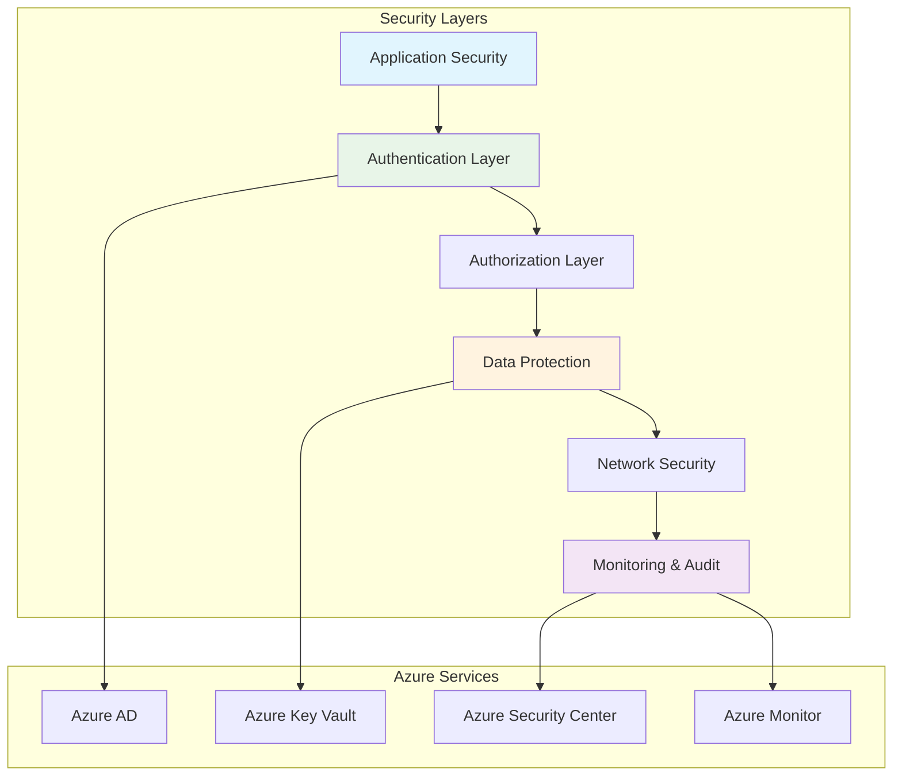
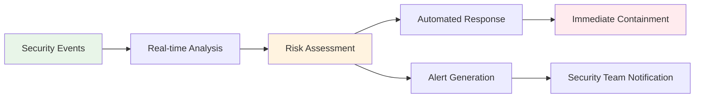

# Security Documentation

## 🔐 Security Overview

This comprehensive security documentation has been modularized for better organization and maintenance. Choose your security domain:

### 📚 Security Modules
- [**Authentication & Authorization**](./security/Authentication.md) - Azure AD integration, token management, RBAC, and session security
- [**Data Protection & Privacy**](./security/DataProtection.md) - GDPR compliance, encryption, data classification, and breach response

## 🏗️ Security Architecture



## 🛡️ Security Domains

### Authentication & Authorization
| Component | Purpose | Documentation |
|-----------|---------|---------------|
| **Azure AD Integration** | Microsoft account authentication | [📖 Authentication Guide](./security/Authentication.md#azure-ad-integration) |
| **Token Management** | JWT token handling and refresh | [📖 Token Security](./security/Authentication.md#token-management) |
| **RBAC System** | Role-based access control | [📖 Authorization](./security/Authentication.md#authorization-patterns) |
| **Session Management** | Secure session handling | [📖 Session Security](./security/Authentication.md#session-management) |

### Data Protection & Privacy
| Component | Purpose | Documentation |
|-----------|---------|---------------|
| **Data Classification** | Sensitive data identification | [📖 Data Protection](./security/DataProtection.md#data-classification) |
| **GDPR Compliance** | Privacy rights implementation | [📖 GDPR Rights](./security/DataProtection.md#gdpr-compliance) |
| **Encryption Strategy** | Multi-layer encryption | [📖 Encryption](./security/DataProtection.md#data-encryption) |
| **Breach Response** | Security incident handling | [📖 Incident Response](./security/DataProtection.md#data-breach-response) |

## 🔍 Security Monitoring

### Real-time Security Monitoring


### Key Security Metrics
| Metric | Monitoring Frequency | Alert Threshold |
|--------|---------------------|-----------------|
| **Failed Login Attempts** | Real-time | >3 attempts/hour |
| **Token Refresh Failures** | Real-time | >5 failures/hour |
| **Unauthorized Data Access** | Real-time | Any occurrence |
| **Anomalous User Behavior** | Continuous | Risk score >0.7 |
| **System Vulnerabilities** | Daily scan | Any critical finding |

## 🚨 Security Alerts & Response

### Alert Categories
- **🔴 Critical** - Immediate security threats requiring instant response
- **🟠 High** - Significant security events needing prompt attention  
- **🟡 Medium** - Security concerns requiring investigation
- **🟢 Low** - Routine security events for monitoring

### Response Times
- **Critical Alerts**: <15 minutes
- **High Priority**: <1 hour  
- **Medium Priority**: <4 hours
- **Low Priority**: <24 hours

## 📊 Security Compliance

### Compliance Standards
- ✅ **GDPR** - Full compliance with EU data protection regulation
- ✅ **Azure Security** - Following Microsoft security best practices
- ✅ **OWASP Top 10** - Protection against common web vulnerabilities
- ✅ **ISO 27001** - Information security management standards

### Regular Security Assessments
| Assessment Type | Frequency | Last Conducted | Next Due |
|----------------|-----------|----------------|----------|
| **Vulnerability Scan** | Weekly | Current | Ongoing |
| **Penetration Test** | Quarterly | Q4 2023 | Q1 2024 |
| **Security Audit** | Annually | 2023 | 2024 |
| **Compliance Review** | Bi-annually | H2 2023 | H1 2024 |

## 🔧 Security Configuration

### Environment Security Settings
```javascript
// Production Security Configuration
const SECURITY_CONFIG = {
  // Authentication
  JWT_EXPIRY: '1h',
  REFRESH_TOKEN_EXPIRY: '7d',
  MAX_LOGIN_ATTEMPTS: 3,
  ACCOUNT_LOCKOUT_DURATION: '30m',
  
  // Session Management
  SESSION_TIMEOUT: '30m',
  IDLE_TIMEOUT: '15m',
  FORCE_LOGOUT_INACTIVE: true,
  
  // Data Protection
  ENCRYPTION_ALGORITHM: 'AES-256-GCM',
  KEY_ROTATION_INTERVAL: '90d',
  DATA_RETENTION_PERIOD: '2y',
  
  // Monitoring
  AUDIT_LOG_RETENTION: '7y',
  SECURITY_EVENT_RETENTION: '1y',
  ALERT_COOLDOWN: '5m'
};
```

### Required Environment Variables
```bash
# Authentication
AZURE_CLIENT_ID=your-azure-client-id
AZURE_TENANT_ID=your-azure-tenant-id
AZURE_CLIENT_SECRET=your-azure-client-secret

# Encryption
MASTER_ENCRYPTION_KEY=your-master-key
ENCRYPTION_SALT=your-salt-value
VOTE_SALT=your-vote-salt

# Monitoring
SECURITY_WEBHOOK_URL=your-monitoring-url
AZURE_KEYVAULT_URL=your-keyvault-url
```

## 🛠️ Security Tools & Services

### Azure Security Services
- **Azure Active Directory** - Identity and access management
- **Azure Key Vault** - Secrets and key management
- **Azure Security Center** - Security posture management
- **Azure Monitor** - Security event monitoring
- **Azure Application Insights** - Performance and security analytics

### Third-party Security Tools
- **Snyk** - Vulnerability scanning for dependencies
- **OWASP ZAP** - Web application security testing
- **SonarQube** - Code security analysis
- **Lighthouse** - Security audit for web applications

## 📋 Security Checklist

### Development Security
- [ ] Code security review completed
- [ ] Dependency vulnerability scan passed
- [ ] Authentication flow tested
- [ ] Authorization controls validated
- [ ] Input validation implemented
- [ ] Error handling secured

### Deployment Security
- [ ] HTTPS enforced
- [ ] Security headers configured
- [ ] Environment variables secured
- [ ] Database connections encrypted
- [ ] API endpoints protected
- [ ] Monitoring alerts configured

### Operational Security
- [ ] Access controls reviewed
- [ ] Security logs monitored
- [ ] Incident response tested
- [ ] Backup procedures verified
- [ ] Disaster recovery planned
- [ ] Security training completed

## 🚀 Security Roadmap

### Short-term Improvements (Q1 2024)
- Enhanced threat detection algorithms
- Advanced user behavior analytics
- Automated security response workflows
- Security dashboard improvements

### Medium-term Goals (Q2-Q3 2024)
- Zero-trust architecture implementation
- Advanced persistent threat detection
- Machine learning-based anomaly detection
- Security orchestration automation

### Long-term Vision (Q4 2024+)
- AI-powered security operations
- Predictive security analytics
- Advanced threat intelligence integration
- Continuous compliance monitoring

---

> 📌 **Note:** This modular security documentation provides comprehensive coverage of all security aspects. Each module contains detailed implementation guides, code examples, and best practices for maintaining robust security posture.