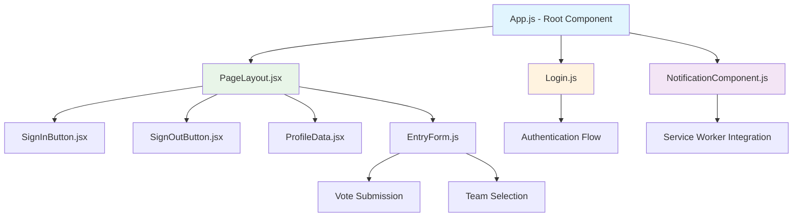
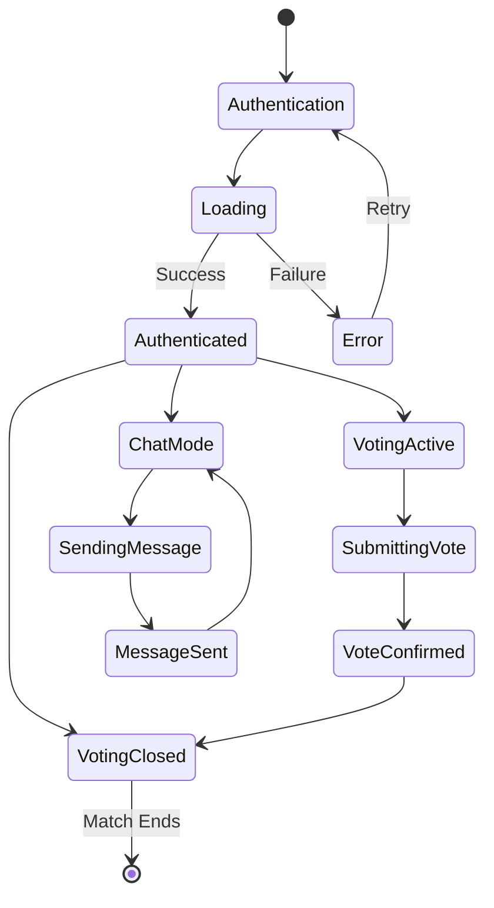
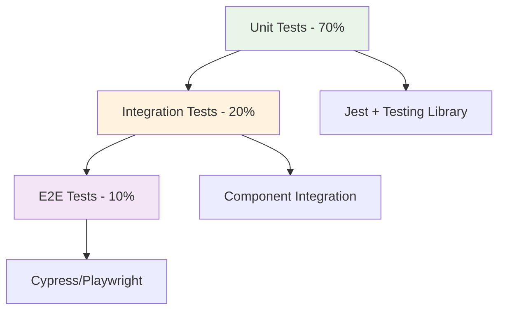

# Frontend Overview

## Architecture Summary
The IPL Play-Along React application is built with modern React 18.2.0, featuring component-based architecture, Azure integrations, and real-time notifications.

**Technology Stack:**
- **React 18.2.0** - Modern hooks-based components
- **Bootstrap 5.3.2** - Responsive UI framework
- **Azure MSAL** - Authentication and authorization
- **Service Workers** - Push notifications and offline support
- **Azure OpenAI** - AI-powered chat integration

## Component Hierarchy



## Component Documentation

### Core Components
| Component | Purpose | Documentation |
|-----------|---------|---------------|
| **App.js** | Root application component with state management | [📖 App Component](./components/App.md) |
| **PageLayout.jsx** | Main layout wrapper with responsive design | [📖 PageLayout Component](./components/PageLayout.md) |
| **EntryForm.js** | Voting interface with form validation | [📖 EntryForm Component](./components/EntryForm.md) |

### Authentication System
| Component | Purpose | Documentation |
|-----------|---------|---------------|
| **Login.js** | Authentication flow orchestration | [📖 Authentication Components](./components/Authentication.md#login-controller-component) |
| **SignInButton.jsx** | Azure AD sign-in interface | [📖 Authentication Components](./components/Authentication.md#signinbutton-component) |
| **SignOutButton.jsx** | User sign-out functionality | [📖 Authentication Components](./components/Authentication.md#signoutbutton-component) |
| **ProfileData.jsx** | User profile display | [📖 Authentication Components](./components/Authentication.md#profiledata-component) |

### Notification System
| Component | Purpose | Documentation |
|-----------|---------|---------------|
| **NotificationComponent.js** | Push notifications and Service Worker management | [📖 NotificationComponent](./components/NotificationComponent.md) |

## Key Features

### 🏏 Real-Time Match Tracking
- Live score updates via Azure SignalR
- Match state management with voting windows
- GIF rotation system based on match progress
- Time-based voting restrictions

### 🔐 Azure AD Authentication
- Microsoft account integration
- Token management with automatic refresh
- Role-based access control
- Cross-tab logout synchronization

### 📱 Progressive Web App (PWA)
- Service Worker implementation
- Push notification support
- Offline functionality
- App-like user experience

### 🤖 AI Chat Integration
- Azure OpenAI GPT-4 integration
- Real-time chat interface
- Context-aware responses
- Match-specific AI insights

### 📊 Data Visualization
- Bootstrap-based responsive charts
- Real-time vote tracking
- Match statistics display
- User engagement metrics

## State Management

### Global State Flow


### Component State Patterns

**App.js State:**
```javascript
const [user, setUser] = useState(null);
const [currentMatch, setCurrentMatch] = useState(null);
const [votingEnabled, setVotingEnabled] = useState(false);
const [gifIndex, setGifIndex] = useState(0);
const [messages, setMessages] = useState([]);
```

**EntryForm.js State:**
```javascript
const [selectedTeam, setSelectedTeam] = useState('');
const [confidence, setConfidence] = useState(50);
const [isSubmitting, setIsSubmitting] = useState(false);
const [error, setError] = useState(null);
```

**NotificationComponent.js State:**
```javascript
const [permission, setPermission] = useState(Notification.permission);
const [subscription, setSubscription] = useState(null);
const [serviceWorker, setServiceWorker] = useState(null);
```

## API Integration

### Backend Communication
```javascript
// API service pattern used throughout components
const ApiService = {
  baseURL: process.env.REACT_APP_API_URL || '/api',
  
  async get(endpoint) {
    const token = await getAccessToken();
    const response = await fetch(`${this.baseURL}${endpoint}`, {
      headers: {
        'Authorization': `Bearer ${token}`,
        'Content-Type': 'application/json'
      }
    });
    return response.json();
  },
  
  async post(endpoint, data) {
    const token = await getAccessToken();
    const response = await fetch(`${this.baseURL}${endpoint}`, {
      method: 'POST',
      headers: {
        'Authorization': `Bearer ${token}`,
        'Content-Type': 'application/json'
      },
      body: JSON.stringify(data)
    });
    return response.json();
  }
};
```

### Key API Endpoints
| Endpoint | Component | Purpose |
|----------|-----------|---------|
| `GET /api/matches/current` | App.js | Get current match data |
| `POST /api/votes` | EntryForm.js | Submit vote |
| `POST /api/chat` | App.js | Send chat message |
| `POST /api/notifications/subscribe` | NotificationComponent.js | Register for notifications |
| `GET /api/profile-photo` | ProfileData.jsx | Get user profile picture |

## Styling Architecture

### CSS Organization
```
src/
├── index.css          # Global styles and CSS variables
├── App.css            # App-specific styles
└── components/
    ├── EntryForm.module.css    # Component-specific modules
    └── PageLayout.module.css   # Scoped component styles
```

### Design System
```css
/* CSS Variables in index.css */
:root {
  --primary-color: #007bff;
  --secondary-color: #6c757d;
  --success-color: #28a745;
  --danger-color: #dc3545;
  --warning-color: #ffc107;
  
  --font-family-sans: -apple-system, BlinkMacSystemFont, 'Segoe UI', Roboto;
  --border-radius: 0.375rem;
  --box-shadow: 0 0.125rem 0.25rem rgba(0, 0, 0, 0.075);
}
```

### Responsive Breakpoints
```css
/* Bootstrap 5 breakpoints used throughout */
/* xs: <576px */
/* sm: ≥576px */
/* md: ≥768px */
/* lg: ≥992px */
/* xl: ≥1200px */
/* xxl: ≥1400px */
```

## Performance Optimization

### Code Splitting
```javascript
// Lazy loading implementation
const EntryForm = lazy(() => import('./components/EntryForm'));
const NotificationComponent = lazy(() => import('./components/NotificationComponent'));

// Usage in App.js
<Suspense fallback={<LoadingSpinner />}>
  <EntryForm />
</Suspense>
```

### Memoization Patterns
```javascript
// React.memo for expensive renders
const ExpensiveComponent = React.memo(({ data }) => {
  return <ComplexVisualization data={data} />;
}, (prevProps, nextProps) => {
  return prevProps.data.id === nextProps.data.id;
});

// useMemo for expensive calculations
const votingStats = useMemo(() => {
  return calculateVotingStatistics(votes);
}, [votes]);
```

### Bundle Optimization
```javascript
// webpack-bundle-analyzer configuration
module.exports = {
  resolve: {
    alias: {
      '@': path.resolve(__dirname, 'src'),
      'components': path.resolve(__dirname, 'src/components')
    }
  },
  optimization: {
    splitChunks: {
      chunks: 'all',
      cacheGroups: {
        vendor: {
          test: /[\\/]node_modules[\\/]/,
          name: 'vendors',
          chunks: 'all',
        }
      }
    }
  }
};
```

## Testing Strategy

### Testing Pyramid


### Test Utilities
```javascript
// Common test utilities
import { render, screen, fireEvent, waitFor } from '@testing-library/react';
import { MsalProvider } from '@azure/msal-react';
import { BrowserRouter } from 'react-router-dom';

const renderWithProviders = (component, { msal, router = true } = {}) => {
  const Wrapper = ({ children }) => (
    <>
      {msal && <MsalProvider instance={msal}>{children}</MsalProvider>}
      {router && <BrowserRouter>{children}</BrowserRouter>}
      {!msal && !router && children}
    </>
  );
  
  return render(component, { wrapper: Wrapper });
};
```

## Security Considerations

### Authentication Security
- JWT token validation on all API calls
- Automatic token refresh before expiry
- Secure token storage (memory only, not localStorage)
- Cross-tab logout synchronization

### Data Protection
- Input validation and sanitization
- XSS prevention through React's built-in protection
- HTTPS enforcement for all API communications
- Content Security Policy (CSP) headers

### Service Worker Security
- VAPID key authentication for push notifications
- Secure service worker registration
- Message validation and sanitization
- Origin verification for push messages

## Deployment Considerations

### Build Configuration
```javascript
// package.json scripts
{
  "scripts": {
    "build": "react-scripts build",
    "build:prod": "NODE_ENV=production react-scripts build",
    "analyze": "npm run build && npx webpack-bundle-analyzer build/static/js/*.js"
  }
}
```

### Environment Variables
```javascript
// Required environment variables
REACT_APP_API_URL=https://your-api.azurewebsites.net
REACT_APP_AZURE_CLIENT_ID=your-client-id
REACT_APP_AZURE_TENANT_ID=your-tenant-id
REACT_APP_VAPID_PUBLIC_KEY=your-vapid-public-key
REACT_APP_ENVIRONMENT=production
```

### Static Asset Optimization
- Image optimization with WebP format support
- Gzip compression for static assets
- CDN integration for global asset delivery
- Service Worker caching strategies

## Troubleshooting Guide

### Common Issues

**Authentication Problems:**
```javascript
// Debug authentication state
console.log('MSAL Accounts:', instance.getAllAccounts());
console.log('Current User:', user);
console.log('Token Valid:', !isTokenExpired(token));
```

**Notification Issues:**
```javascript
// Check notification prerequisites
console.log('Permission:', Notification.permission);
console.log('SW Support:', 'serviceWorker' in navigator);
console.log('Push Support:', 'PushManager' in window);
```

**API Communication:**
```javascript
// Debug API calls
const debugApi = async (endpoint, options) => {
  console.log(`🔍 API Call: ${endpoint}`, options);
  const response = await fetch(endpoint, options);
  console.log(`📡 Response: ${response.status}`, await response.clone().json());
  return response;
};
```

### Performance Issues
- Use React DevTools Profiler
- Monitor bundle size with webpack-bundle-analyzer
- Check network requests in Browser DevTools
- Analyze rendering performance with React DevTools

### Browser Compatibility
- Modern browser support (ES6+)
- Progressive enhancement for older browsers
- Polyfills for missing features
- Graceful degradation of advanced features

## Future Roadmap

### Planned Features
- **Real-time Updates** - WebSocket integration for live match data
- **Offline Support** - Enhanced PWA capabilities with offline voting
- **Social Features** - User-to-user interaction and leagues
- **Advanced Analytics** - Detailed voting pattern analysis
- **Mobile App** - React Native mobile application
- **Voice Integration** - Voice commands for voting

### Technical Improvements
- **TypeScript Migration** - Gradual migration to TypeScript
- **Micro-frontends** - Component federation architecture
- **GraphQL Integration** - Replace REST APIs with GraphQL
- **Enhanced Testing** - Visual regression testing
- **Accessibility** - WCAG 2.1 AA compliance
- **Internationalization** - Multi-language support

### Infrastructure Enhancements
- **Edge Computing** - Azure CDN with edge functions
- **Advanced Monitoring** - Application Insights integration
- **CI/CD Pipeline** - Automated testing and deployment
- **A/B Testing** - Feature flag management
- **Performance Monitoring** - Real-time performance analytics