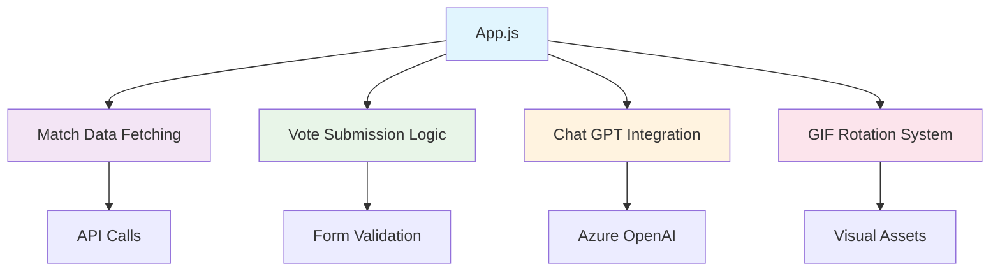
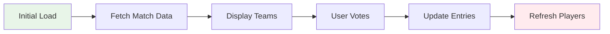
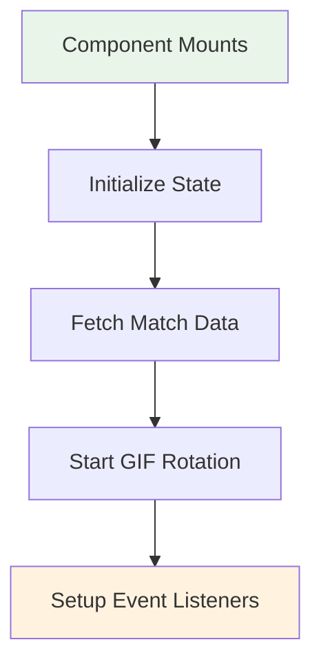

# App Component Documentation

## Overview
The root component of the IPL Play-Along application that orchestrates match voting, real-time updates, and chat functionality.

**Location:** `src/App.js`  
**Type:** Functional Component  
**Dependencies:** React hooks, Azure OpenAI, Bootstrap

## Purpose & Responsibilities

### Primary Functions
- **Match Data Management** - Fetches and displays current match information
- **Voting System** - Handles team selection and vote submission
- **Chat Integration** - Azure OpenAI powered chat functionality
- **Visual Effects** - GIF rotation and animations
- **Time Restrictions** - Enforces voting deadlines

## Component Structure



## State Management

### Core State Variables
```javascript
const [entries, setEntries] = useState([]);        // Match vote entries
const [players, setPlayers] = useState([]);        // Player statistics
const [match, setMatch] = useState({});            // Current match info
const [help, setHelp] = useState(false);          // Chat visibility
```

### State Flow


## Key Features

### 1. GIF Rotation System
```javascript
const gifs = [gif1, gif2, gif3, gif4, gif5, gif6, gif7, gif8];
const [currentGif, setCurrentGif] = useState(0);

useEffect(() => {
  const gifInterval = setInterval(() => {
    setCurrentGif(prev => (prev + 1) % gifs.length);
  }, 2000); // Change every 2 seconds
  
  return () => clearInterval(gifInterval);
}, []);
```

**Purpose:** Creates engaging visual experience with rotating IPL-themed animations

### 2. Vote Submission Logic
```javascript
function sendEntry(name, team) {
  const currentTime = new Date();
  const currentHour = currentTime.getHours();
  
  // Time restriction: No voting after 7 PM IST
  if (currentHour >= 19) {
    alert("Voting time is over");
    return;
  }
  
  // Validation
  if (!name.trim() || !team) {
    alert("Please enter your name and select a team");
    return;
  }
  
  // Submit to backend
  fetch('/api/entries', {
    method: 'POST',
    headers: { 'Content-Type': 'application/json' },
    body: JSON.stringify({ name, team })
  })
  .then(response => response.json())
  .then(data => {
    console.log('Vote submitted:', data);
    fetchEntries(); // Refresh data
  });
}
```

### 3. Azure OpenAI Integration
```javascript
function chatGpt() {
  const raw = JSON.stringify({
    "model": "mychatbot",
    "messages": [{
      "role": "system", 
      "content": "You are a helpful assistant having information about IPL teams"
    }]
  });

  const requestOptions = {
    method: 'POST',
    headers: {
      'Content-Type': 'application/json',
      'api-key': process.env.REACT_APP_AZURE_OPENAI_KEY
    },
    body: raw
  };

  fetch("https://myopenaieus.openai.azure.com/openai/deployments/mychatbot/chat/completions?api-version=2023-07-01-preview", requestOptions)
    .then(response => response.text())
    .then(result => console.log(result));
}
```

## Props Interface

### Input Props
```typescript
interface AppProps {
  // No props - root component
}
```

### Context Provided
```typescript
interface AppContext {
  currentMatch: {
    team1: string;
    team2: string;
    date: string;
  };
  isVotingOpen: boolean;
  userEntries: Array<VoteEntry>;
}
```

## Lifecycle Management

### Component Mount


### Data Fetching Pattern
```javascript
useEffect(() => {
  const fetchData = async () => {
    try {
      // Fetch current match
      const matchResponse = await fetch('/api/current-match');
      const matchData = await matchResponse.json();
      setMatch(matchData);
      
      // Fetch existing entries
      const entriesResponse = await fetch('/api/entries');
      const entriesData = await entriesResponse.json();
      setEntries(entriesData);
      
      // Fetch player statistics
      const playersResponse = await fetch('/api/players');
      const playersData = await playersResponse.json();
      setPlayers(playersData);
      
    } catch (error) {
      console.error('Data fetching failed:', error);
    }
  };
  
  fetchData();
  
  // Refresh every 30 seconds
  const interval = setInterval(fetchData, 30000);
  return () => clearInterval(interval);
}, []);
```

## Performance Optimization

### Memoization Strategy
```javascript
const memoizedTeamButtons = useMemo(() => {
  return (
    <div className="team-selection">
      <button onClick={() => handleVote(match.team1)}>
        {match.team1}
      </button>
      <button onClick={() => handleVote(match.team2)}>
        {match.team2}
      </button>
    </div>
  );
}, [match.team1, match.team2]);
```

### Callback Optimization
```javascript
const handleVoteCallback = useCallback((team) => {
  sendEntry(playerName, team);
}, [playerName]);
```

## Error Handling

### API Error Management
```javascript
const handleApiError = (error, context) => {
  console.error(`${context} failed:`, error);
  
  // Show user-friendly message
  setErrorMessage(`Failed to ${context.toLowerCase()}. Please try again.`);
  
  // Auto-clear error after 5 seconds
  setTimeout(() => setErrorMessage(''), 5000);
};
```

## Testing Considerations

### Unit Test Coverage
- ✅ Vote submission logic
- ✅ Time restriction validation
- ✅ GIF rotation functionality
- ✅ State management
- ✅ API integration

### Test Example
```javascript
describe('App Component', () => {
  test('prevents voting after 7 PM', () => {
    // Mock current time to 8 PM
    jest.spyOn(global, 'Date').mockImplementation(() => ({
      getHours: () => 20
    }));
    
    const result = sendEntry('TestUser', 'TestTeam');
    expect(result).toBe('Voting time is over');
  });
});
```

## Integration Points

### Child Components
- **EntryForm** - Receives voting handlers and match data
- **NotificationComponent** - Gets notification settings
- **PageLayout** - Wraps entire application layout

### External Services
- **Azure OpenAI** - Chat functionality
- **Backend API** - Data persistence
- **Push Notifications** - Real-time updates

## Troubleshooting

### Common Issues

**Issue:** GIFs not loading
```javascript
// Solution: Check gif imports and file paths
import gif1 from './gifs/ipl1.gif';
// Ensure all 8 gifs are properly imported
```

**Issue:** Vote submission fails
```javascript
// Debug: Check network and validation
console.log('Submitting:', { name, team });
console.log('Time check:', new Date().getHours());
```

**Issue:** Chat not responding
```javascript
// Verify Azure OpenAI configuration
console.log('API Key:', process.env.REACT_APP_AZURE_OPENAI_KEY ? 'Set' : 'Missing');
```

## Future Enhancements

- **Real-time Updates** - WebSocket integration for live data
- **Improved Chat** - Enhanced conversation history
- **Better Animations** - CSS-based transitions
- **Mobile Optimization** - Touch-friendly interactions
- **Offline Support** - Service worker caching