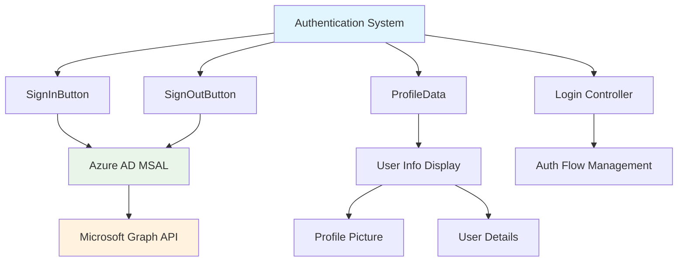
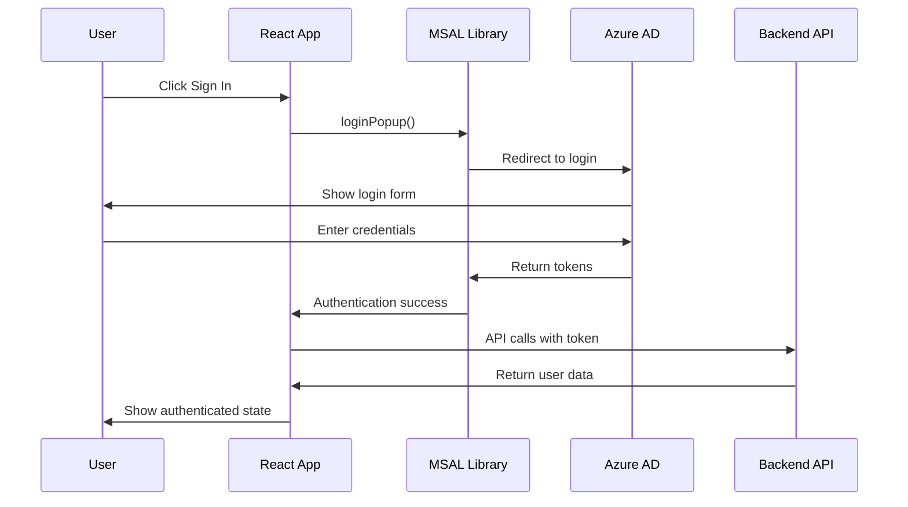

# Authentication Components Documentation

## Overview
A collection of authentication-related components that handle Azure AD integration, user sign-in/sign-out, and profile management.

**Components Included:**
- `SignInButton.jsx` - Azure AD sign-in interface
- `SignOutButton.jsx` - Sign-out functionality  
- `ProfileData.jsx` - User profile display
- `Login.js` - Login flow orchestration

## Architecture Overview



## SignInButton Component

### Purpose
Provides Azure AD authentication entry point with Microsoft branding and error handling.

### Props Interface
```typescript
interface SignInButtonProps {
  onSignInSuccess?: (account: AccountInfo) => void;
  onSignInError?: (error: AuthenticationError) => void;
  disabled?: boolean;
  variant?: 'primary' | 'secondary' | 'outline';
}
```

### Implementation
```javascript
import { useMsal } from '@azure/msal-react';
import { loginRequest } from '../auth';

const SignInButton = ({ 
  onSignInSuccess, 
  onSignInError, 
  disabled = false,
  variant = 'primary' 
}) => {
  const { instance } = useMsal();
  const [isLoading, setIsLoading] = useState(false);

  const handleSignIn = async () => {
    setIsLoading(true);
    
    try {
      const response = await instance.loginPopup(loginRequest);
      onSignInSuccess?.(response.account);
    } catch (error) {
      console.error('Sign-in failed:', error);
      onSignInError?.(error);
    } finally {
      setIsLoading(false);
    }
  };

  return (
    <button
      onClick={handleSignIn}
      disabled={disabled || isLoading}
      className={`sign-in-btn ${variant} ${isLoading ? 'loading' : ''}`}
      aria-label="Sign in with Microsoft"
    >
      {isLoading ? (
        <>
          <span className="spinner" /> Signing in...
        </>
      ) : (
        <>
          <MicrosoftIcon />
          Sign in with Microsoft
        </>
      )}
    </button>
  );
};
```

### Styling
```css
.sign-in-btn {
  display: flex;
  align-items: center;
  gap: 0.5rem;
  padding: 0.75rem 1.5rem;
  background: #0078d4;
  color: white;
  border: none;
  border-radius: 4px;
  font-weight: 500;
  cursor: pointer;
  transition: all 0.2s ease;
}

.sign-in-btn:hover:not(:disabled) {
  background: #106ebe;
  transform: translateY(-1px);
}

.sign-in-btn.loading {
  opacity: 0.7;
  cursor: not-allowed;
}

.spinner {
  width: 16px;
  height: 16px;
  border: 2px solid transparent;
  border-top: 2px solid currentColor;
  border-radius: 50%;
  animation: spin 1s linear infinite;
}
```

## SignOutButton Component

### Purpose
Handles user sign-out process and session cleanup.

### Implementation
```javascript
const SignOutButton = ({ 
  onSignOutComplete,
  variant = 'outline',
  showConfirmation = true 
}) => {
  const { instance, accounts } = useMsal();
  const [isSigningOut, setIsSigningOut] = useState(false);

  const handleSignOut = async () => {
    if (showConfirmation) {
      const confirmed = window.confirm('Are you sure you want to sign out?');
      if (!confirmed) return;
    }

    setIsSigningOut(true);

    try {
      await instance.logoutPopup({
        account: accounts[0],
        postLogoutRedirectUri: window.location.origin
      });
      
      // Clear local storage
      localStorage.clear();
      sessionStorage.clear();
      
      onSignOutComplete?.();
    } catch (error) {
      console.error('Sign-out failed:', error);
    } finally {
      setIsSigningOut(false);
    }
  };

  return (
    <button
      onClick={handleSignOut}
      disabled={isSigningOut}
      className={`sign-out-btn ${variant}`}
      aria-label="Sign out"
    >
      {isSigningOut ? 'Signing out...' : 'Sign Out'}
    </button>
  );
};
```

## ProfileData Component

### Purpose
Displays authenticated user information and profile picture.

### Props Interface
```typescript
interface ProfileDataProps {
  account?: AccountInfo;
  showFullProfile?: boolean;
  onProfileClick?: () => void;
  size?: 'small' | 'medium' | 'large';
}
```

### Implementation
```javascript
const ProfileData = ({ 
  account, 
  showFullProfile = false, 
  onProfileClick,
  size = 'medium' 
}) => {
  const [profilePhoto, setProfilePhoto] = useState(null);
  const [loading, setLoading] = useState(true);

  useEffect(() => {
    if (account) {
      fetchProfilePhoto();
    }
  }, [account]);

  const fetchProfilePhoto = async () => {
    try {
      // Fetch from Microsoft Graph API
      const response = await fetch('/api/profile-photo');
      if (response.ok) {
        const photoBlob = await response.blob();
        const photoUrl = URL.createObjectURL(photoBlob);
        setProfilePhoto(photoUrl);
      }
    } catch (error) {
      console.error('Failed to fetch profile photo:', error);
    } finally {
      setLoading(false);
    }
  };

  if (!account) {
    return <div className="profile-placeholder">Not signed in</div>;
  }

  return (
    <div 
      className={`profile-data ${size}`}
      onClick={onProfileClick}
      role={onProfileClick ? 'button' : undefined}
      tabIndex={onProfileClick ? 0 : undefined}
    >
      <div className="profile-avatar">
        {loading ? (
          <div className="avatar-skeleton" />
        ) : profilePhoto ? (
          
        ) : (
          <div className="avatar-fallback">
            {account.name?.charAt(0).toUpperCase()}
          </div>
        )}
      </div>

      {showFullProfile && (
        <div className="profile-info">
          <div className="profile-name">{account.name}</div>
          <div className="profile-email">{account.username}</div>
        </div>
      )}
    </div>
  );
};
```

### Styling
```css
.profile-data {
  display: flex;
  align-items: center;
  gap: 0.75rem;
  cursor: pointer;
}

.profile-avatar {
  position: relative;
}

.profile-image {
  width: 32px;
  height: 32px;
  border-radius: 50%;
  object-fit: cover;
}

.profile-data.small .profile-image { width: 24px; height: 24px; }
.profile-data.large .profile-image { width: 48px; height: 48px; }

.avatar-fallback {
  width: 32px;
  height: 32px;
  border-radius: 50%;
  background: #0078d4;
  color: white;
  display: flex;
  align-items: center;
  justify-content: center;
  font-weight: 600;
}

.profile-info {
  display: flex;
  flex-direction: column;
}

.profile-name {
  font-weight: 500;
  color: #323130;
}

.profile-email {
  font-size: 0.875rem;
  color: #605e5c;
}
```

## Login Controller Component

### Purpose
Orchestrates the overall login flow and handles authentication state.

### Implementation
```javascript
const Login = () => {
  const { instance, accounts, inProgress } = useMsal();
  const [authError, setAuthError] = useState(null);

  const isAuthenticated = accounts.length > 0;
  const isLoading = inProgress !== 'none';

  const handleLoginSuccess = (account) => {
    console.log('Login successful:', account);
    setAuthError(null);
    
    // Redirect to main app or refresh data
    window.location.reload();
  };

  const handleLoginError = (error) => {
    console.error('Login error:', error);
    setAuthError(error.message || 'An error occurred during sign-in');
  };

  if (isLoading) {
    return (
      <div className="login-loading">
        <div className="spinner-large" />
        <p>Authenticating...</p>
      </div>
    );
  }

  if (isAuthenticated) {
    return (
      <div className="login-success">
        <ProfileData 
          account={accounts[0]} 
          showFullProfile={true}
          size="large"
        />
        <SignOutButton />
      </div>
    );
  }

  return (
    <div className="login-container">
      <div className="login-header">
        <h2>Welcome to IPL Play-Along</h2>
        <p>Sign in to start voting and tracking your favorite teams</p>
      </div>

      <div className="login-form">
        <SignInButton
          onSignInSuccess={handleLoginSuccess}
          onSignInError={handleLoginError}
        />
        
        {authError && (
          <div className="auth-error">
            <span className="error-icon">⚠️</span>
            {authError}
          </div>
        )}
      </div>

      <div className="login-footer">
        <p>
          By signing in, you agree to our{' '}
          <a href="#terms">Terms of Service</a> and{' '}
          <a href="#privacy">Privacy Policy</a>
        </p>
      </div>
    </div>
  );
};
```

## Authentication Flow

### Login Flow Diagram


### Token Management
```javascript
const TokenManager = {
  async getAccessToken() {
    const { instance, accounts } = useMsal();
    
    if (accounts.length === 0) {
      throw new Error('No authenticated account found');
    }

    try {
      const response = await instance.acquireTokenSilent({
        scopes: ['User.Read', 'profile'],
        account: accounts[0]
      });
      
      return response.accessToken;
    } catch (error) {
      if (error instanceof InteractionRequiredAuthError) {
        // Fallback to interactive method
        const response = await instance.acquireTokenPopup({
          scopes: ['User.Read', 'profile'],
          account: accounts[0]
        });
        
        return response.accessToken;
      }
      
      throw error;
    }
  },

  isTokenExpired(token) {
    if (!token) return true;
    
    try {
      const payload = JSON.parse(atob(token.split('.')[1]));
      return payload.exp * 1000 < Date.now();
    } catch {
      return true;
    }
  }
};
```

## Error Handling

### Authentication Errors
```javascript
const AuthErrorHandler = {
  handleError(error) {
    switch (error.errorCode) {
      case 'user_cancelled':
        return 'Sign-in was cancelled';
      
      case 'consent_required':
        return 'Additional permissions required';
      
      case 'interaction_required':
        return 'Please sign in again';
      
      case 'login_required':
        return 'Authentication required';
      
      default:
        return error.message || 'An authentication error occurred';
    }
  },

  isRetryableError(error) {
    const retryableCodes = [
      'network_error',
      'timeout',
      'temporary_unavailable'
    ];
    
    return retryableCodes.includes(error.errorCode);
  }
};
```

## Testing Strategy

### Unit Tests
```javascript
describe('Authentication Components', () => {
  test('SignInButton triggers login flow', async () => {
    const mockInstance = {
      loginPopup: jest.fn().mockResolvedValue({
        account: { name: 'Test User' }
      })
    };
    
    render(
      <MsalProvider instance={mockInstance}>
        <SignInButton />
      </MsalProvider>
    );
    
    fireEvent.click(screen.getByText('Sign in with Microsoft'));
    
    expect(mockInstance.loginPopup).toHaveBeenCalled();
  });

  test('ProfileData displays user information', () => {
    const mockAccount = {
      name: 'John Doe',
      username: 'john@example.com'
    };
    
    render(
      <ProfileData 
        account={mockAccount} 
        showFullProfile={true} 
      />
    );
    
    expect(screen.getByText('John Doe')).toBeInTheDocument();
    expect(screen.getByText('john@example.com')).toBeInTheDocument();
  });
});
```

### Integration Tests
```javascript
describe('Authentication Flow', () => {
  test('complete sign-in flow', async () => {
    const { user } = renderAuthenticatedApp();
    
    // User should see sign-in button
    expect(screen.getByText('Sign in with Microsoft')).toBeInTheDocument();
    
    // Simulate successful authentication
    await user.click(screen.getByText('Sign in with Microsoft'));
    
    // User should see their profile
    await waitFor(() => {
      expect(screen.getByText('John Doe')).toBeInTheDocument();
    });
  });
});
```

## Security Considerations

### Token Security
- Tokens stored in memory only (not localStorage)
- Automatic token refresh before expiry
- Secure token transmission over HTTPS
- Regular token validation

### Session Management  
- Automatic logout on token expiry
- Session timeout warnings
- Secure session cleanup on logout
- Cross-tab logout synchronization

## Troubleshooting

### Common Issues

**Issue:** Login popup blocked
```javascript
// Solution: Use redirect instead of popup
const loginRequest = {
  scopes: ['User.Read'],
  prompt: 'select_account'
};

await instance.loginRedirect(loginRequest);
```

**Issue:** Token acquisition fails
```javascript
// Debug token issues
console.log('Accounts:', accounts);
console.log('Current scopes:', tokenRequest.scopes);
console.log('Token cache:', instance.getAllAccounts());
```

**Issue:** Profile photo not loading
```javascript
// Check Microsoft Graph API permissions
const graphScopes = ['User.Read', 'profile', 'openid'];
// Ensure backend proxy handles /api/profile-photo correctly
```

## Future Enhancements

- **Multi-Factor Authentication** - Support for MFA flows
- **Single Sign-On** - Cross-application SSO
- **Role-Based Access** - User role management
- **Offline Authentication** - Cached authentication state
- **Biometric Authentication** - WebAuthn integration