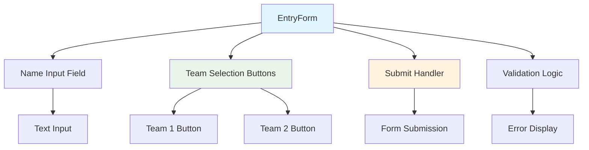
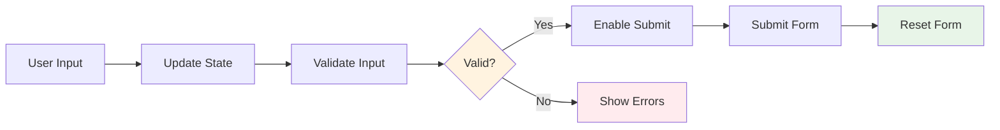

# EntryForm Component Documentation

## Overview
A dedicated voting interface component that handles team selection and vote submission for IPL matches.

**Location:** `src/components/EntryForm.js`  
**Type:** Functional Component  
**Parent:** App.js  
**Styling:** `EntryForm.module.css`

## Purpose & Responsibilities

### Primary Functions
- **Team Selection Interface** - Provides buttons for team voting
- **User Input Collection** - Captures player name and preferences
- **Form Validation** - Ensures data integrity before submission
- **Real-time Feedback** - Shows submission status and errors

## Component Structure



## Props Interface

### Input Props
```typescript
interface EntryFormProps {
  onSubmit: (name: string, team: string) => void;
  teams: {
    team1: string;
    team2: string;
  };
  isVotingOpen: boolean;
  disabled?: boolean;
  currentUserVote?: string;
}
```

### Usage Example
```javascript
<EntryForm 
  onSubmit={handleVoteSubmission}
  teams={{
    team1: "Gujarat Titans",
    team2: "Delhi Capitals"
  }}
  isVotingOpen={currentTime < votingDeadline}
  disabled={isSubmitting}
  currentUserVote={userPreviousVote}
/>
```

## State Management

### Local State
```javascript
const [playerName, setPlayerName] = useState('');
const [selectedTeam, setSelectedTeam] = useState('');
const [errors, setErrors] = useState({});
const [isSubmitting, setIsSubmitting] = useState(false);
```

### State Flow


## Key Features

### 1. Form Validation
```javascript
const validateForm = () => {
  const newErrors = {};
  
  // Name validation
  if (!playerName.trim()) {
    newErrors.name = 'Player name is required';
  } else if (playerName.length < 2) {
    newErrors.name = 'Name must be at least 2 characters';
  } else if (playerName.length > 50) {
    newErrors.name = 'Name must not exceed 50 characters';
  }
  
  // Team selection validation
  if (!selectedTeam) {
    newErrors.team = 'Please select a team';
  }
  
  // Time validation
  if (!isVotingOpen) {
    newErrors.timing = 'Voting is currently closed';
  }
  
  setErrors(newErrors);
  return Object.keys(newErrors).length === 0;
};
```

### 2. Team Selection Interface
```javascript
const TeamSelectionButtons = () => (
  <div className="team-buttons">
    <button
      type="button"
      className={`team-btn ${selectedTeam === teams.team1 ? 'selected' : ''}`}
      onClick={() => setSelectedTeam(teams.team1)}
      disabled={!isVotingOpen}
    >
      <span className="team-logo">🏏</span>
      <span className="team-name">{teams.team1}</span>
    </button>
    
    <button
      type="button"
      className={`team-btn ${selectedTeam === teams.team2 ? 'selected' : ''}`}
      onClick={() => setSelectedTeam(teams.team2)}
      disabled={!isVotingOpen}
    >
      <span className="team-logo">🏏</span>
      <span className="team-name">{teams.team2}</span>
    </button>
  </div>
);
```

### 3. Form Submission Handler
```javascript
const handleSubmit = async (e) => {
  e.preventDefault();
  
  if (!validateForm()) {
    return;
  }
  
  setIsSubmitting(true);
  
  try {
    await onSubmit(playerName.trim(), selectedTeam);
    
    // Success feedback
    setPlayerName('');
    setSelectedTeam('');
    setErrors({});
    
    // Show success message
    setSuccessMessage('Vote submitted successfully!');
    setTimeout(() => setSuccessMessage(''), 3000);
    
  } catch (error) {
    setErrors({
      submit: error.message || 'Failed to submit vote. Please try again.'
    });
  } finally {
    setIsSubmitting(false);
  }
};
```

## Component Layout

### JSX Structure
```javascript
return (
  <div className="entry-form-container">
    <div className="form-header">
      <h2>Cast Your Vote</h2>
      <p>Select your winning team for today's match</p>
    </div>
    
    <form onSubmit={handleSubmit} className="entry-form">
      {/* Name Input */}
      <div className="form-group">
        <label htmlFor="playerName">Your Name:</label>
        <input
          id="playerName"
          type="text"
          value={playerName}
          onChange={(e) => setPlayerName(e.target.value)}
          placeholder="Enter your name"
          disabled={isSubmitting || !isVotingOpen}
          className={errors.name ? 'error' : ''}
        />
        {errors.name && <span className="error-text">{errors.name}</span>}
      </div>
      
      {/* Team Selection */}
      <div className="form-group">
        <label>Choose Your Team:</label>
        <TeamSelectionButtons />
        {errors.team && <span className="error-text">{errors.team}</span>}
      </div>
      
      {/* Submit Button */}
      <div className="form-actions">
        <button
          type="submit"
          disabled={isSubmitting || !isVotingOpen}
          className="submit-btn"
        >
          {isSubmitting ? 'Submitting...' : 'Submit Vote'}
        </button>
      </div>
      
      {/* Error/Success Messages */}
      {errors.submit && (
        <div className="error-message">{errors.submit}</div>
      )}
      {successMessage && (
        <div className="success-message">{successMessage}</div>
      )}
    </form>
  </div>
);
```

## Styling Integration

### CSS Modules Structure
```css
/* EntryForm.module.css */
.entryFormContainer {
  max-width: 500px;
  margin: 0 auto;
  padding: 2rem;
  background: #ffffff;
  border-radius: 12px;
  box-shadow: 0 4px 20px rgba(0,0,0,0.1);
}

.formHeader {
  text-align: center;
  margin-bottom: 2rem;
}

.formHeader h2 {
  color: #1976d2;
  margin-bottom: 0.5rem;
}

.teamButtons {
  display: flex;
  gap: 1rem;
  margin: 1rem 0;
}

.teamBtn {
  flex: 1;
  padding: 1rem;
  border: 2px solid #e0e0e0;
  border-radius: 8px;
  background: #ffffff;
  cursor: pointer;
  transition: all 0.3s ease;
}

.teamBtn.selected {
  border-color: #1976d2;
  background-color: #e3f2fd;
}

.teamBtn:hover:not(:disabled) {
  border-color: #1976d2;
  transform: translateY(-2px);
}
```

## Accessibility Features

### ARIA Support
```javascript
<button
  type="button"
  className="team-btn"
  onClick={() => setSelectedTeam(teams.team1)}
  aria-pressed={selectedTeam === teams.team1}
  aria-label={`Select ${teams.team1} as winning team`}
>
  {teams.team1}
</button>
```

### Keyboard Navigation
```javascript
const handleKeyDown = (e) => {
  if (e.key === 'Enter' || e.key === ' ') {
    e.preventDefault();
    setSelectedTeam(e.target.dataset.team);
  }
};
```

## Performance Optimization

### Memoization
```javascript
const MemoizedEntryForm = memo(EntryForm, (prevProps, nextProps) => {
  return (
    prevProps.teams.team1 === nextProps.teams.team1 &&
    prevProps.teams.team2 === nextProps.teams.team2 &&
    prevProps.isVotingOpen === nextProps.isVotingOpen &&
    prevProps.disabled === nextProps.disabled
  );
});
```

### Debounced Validation
```javascript
const debouncedValidation = useMemo(
  () => debounce(validateForm, 300),
  [playerName, selectedTeam]
);

useEffect(() => {
  if (playerName || selectedTeam) {
    debouncedValidation();
  }
}, [playerName, selectedTeam, debouncedValidation]);
```

## Testing Strategy

### Unit Tests
```javascript
describe('EntryForm Component', () => {
  test('validates empty name input', () => {
    render(<EntryForm {...defaultProps} />);
    
    const submitButton = screen.getByText('Submit Vote');
    fireEvent.click(submitButton);
    
    expect(screen.getByText('Player name is required')).toBeInTheDocument();
  });
  
  test('prevents submission when voting is closed', () => {
    render(<EntryForm {...defaultProps} isVotingOpen={false} />);
    
    const nameInput = screen.getByPlaceholderText('Enter your name');
    const submitButton = screen.getByText('Submit Vote');
    
    expect(nameInput).toBeDisabled();
    expect(submitButton).toBeDisabled();
  });
  
  test('calls onSubmit with correct parameters', () => {
    const mockOnSubmit = jest.fn();
    render(<EntryForm {...defaultProps} onSubmit={mockOnSubmit} />);
    
    fireEvent.change(screen.getByPlaceholderText('Enter your name'), {
      target: { value: 'Test Player' }
    });
    fireEvent.click(screen.getByText('Gujarat Titans'));
    fireEvent.click(screen.getByText('Submit Vote'));
    
    expect(mockOnSubmit).toHaveBeenCalledWith('Test Player', 'Gujarat Titans');
  });
});
```

## Integration Points

### Parent Communication
- Receives team data and voting status from App.js
- Calls parent's submission handler with form data
- Responds to global state changes (voting open/closed)

### Styling Dependencies
- Uses CSS Modules for scoped styling
- Integrates with Bootstrap for responsive design
- Supports theme customization through CSS variables

## Error Handling

### Input Validation Errors
- Name field validation (length, required)
- Team selection validation
- Timing validation (voting window)

### Submission Errors
- Network failure handling
- Server validation error display
- Retry mechanism implementation

## Troubleshooting

### Common Issues

**Issue:** Form not submitting
```javascript
// Check validation logic and error states
console.log('Validation errors:', errors);
console.log('Form valid:', Object.keys(errors).length === 0);
```

**Issue:** Team buttons not responding
```javascript
// Verify props and state
console.log('Teams prop:', teams);
console.log('Voting open:', isVotingOpen);
console.log('Selected team:', selectedTeam);
```

**Issue:** Styling not applied
```javascript
// Check CSS module import
import styles from './EntryForm.module.css';
// Use: className={styles.entryFormContainer}
```

## Future Enhancements

- **Multi-match Support** - Handle multiple concurrent matches
- **Advanced Validation** - Real-time name uniqueness checking
- **Enhanced UX** - Loading animations and micro-interactions
- **Accessibility** - Screen reader optimization
- **Internationalization** - Multi-language support