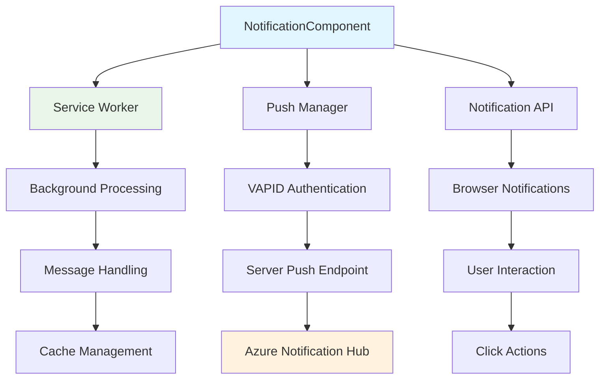

# NotificationComponent Documentation

## Overview
Handles push notifications for IPL match updates, vote confirmations, and real-time announcements using Service Worker API and Web Push notifications.

**Key Features:**
- Service Worker registration and management
- Push notification subscription handling
- VAPID key authentication
- Real-time match notifications
- Notification permission management

## Architecture



## Component Structure

### Core Implementation
```javascript
import React, { useState, useEffect } from 'react';

const NotificationComponent = ({ 
  userId, 
  onSubscriptionChange,
  showPermissionPrompt = true 
}) => {
  const [permission, setPermission] = useState(Notification.permission);
  const [subscription, setSubscription] = useState(null);
  const [serviceWorker, setServiceWorker] = useState(null);
  const [isSupported, setIsSupported] = useState(false);

  useEffect(() => {
    checkBrowserSupport();
    initializeServiceWorker();
  }, []);

  const checkBrowserSupport = () => {
    const supported = (
      'serviceWorker' in navigator &&
      'PushManager' in window &&
      'Notification' in window
    );
    
    setIsSupported(supported);
    
    if (!supported) {
      console.warn('Push notifications not supported in this browser');
    }
  };

  const initializeServiceWorker = async () => {
    if (!isSupported) return;

    try {
      const registration = await navigator.serviceWorker.register(
        '/service-worker.js',
        { scope: '/' }
      );

      console.log('Service Worker registered:', registration);
      setServiceWorker(registration);

      // Check for existing subscription
      const existingSubscription = await registration.pushManager.getSubscription();
      if (existingSubscription) {
        setSubscription(existingSubscription);
        await updateServerSubscription(existingSubscription);
      }

      // Listen for service worker messages
      navigator.serviceWorker.addEventListener('message', handleServiceWorkerMessage);

    } catch (error) {
      console.error('Service Worker registration failed:', error);
    }
  };

  return (
    <div className="notification-component">
      {renderNotificationSettings()}
      {renderSubscriptionStatus()}
      {renderTestingControls()}
    </div>
  );
};
```

### Permission Management
```javascript
const requestNotificationPermission = async () => {
  if (!isSupported) {
    alert('Notifications are not supported in this browser');
    return false;
  }

  try {
    const permission = await Notification.requestPermission();
    setPermission(permission);

    if (permission === 'granted') {
      await subscribeToPushNotifications();
      return true;
    } else if (permission === 'denied') {
      console.warn('Notification permission denied');
      return false;
    } else {
      console.log('Notification permission dismissed');
      return false;
    }
  } catch (error) {
    console.error('Error requesting notification permission:', error);
    return false;
  }
};

const subscribeToPushNotifications = async () => {
  if (!serviceWorker) {
    console.error('Service Worker not available');
    return;
  }

  try {
    const subscription = await serviceWorker.pushManager.subscribe({
      userVisibleOnly: true,
      applicationServerKey: urlBase64ToUint8Array(process.env.REACT_APP_VAPID_PUBLIC_KEY)
    });

    console.log('Push subscription created:', subscription);
    setSubscription(subscription);

    // Send subscription to server
    await updateServerSubscription(subscription);
    
    onSubscriptionChange?.(subscription);

  } catch (error) {
    console.error('Failed to subscribe to push notifications:', error);
    
    if (error.name === 'NotAllowedError') {
      alert('Please enable notifications in your browser settings');
    }
  }
};
```

### Server Communication
```javascript
const updateServerSubscription = async (subscription) => {
  try {
    const response = await fetch('/api/notifications/subscribe', {
      method: 'POST',
      headers: {
        'Content-Type': 'application/json',
        'Authorization': `Bearer ${getAuthToken()}`
      },
      body: JSON.stringify({
        userId: userId,
        subscription: subscription,
        userAgent: navigator.userAgent,
        timestamp: new Date().toISOString()
      })
    });

    if (!response.ok) {
      throw new Error(`HTTP error! status: ${response.status}`);
    }

    const result = await response.json();
    console.log('Subscription updated on server:', result);

  } catch (error) {
    console.error('Failed to update subscription on server:', error);
  }
};

const unsubscribeFromNotifications = async () => {
  if (!subscription) return;

  try {
    // Unsubscribe from push manager
    await subscription.unsubscribe();
    
    // Remove from server
    await fetch('/api/notifications/unsubscribe', {
      method: 'POST',
      headers: {
        'Content-Type': 'application/json',
        'Authorization': `Bearer ${getAuthToken()}`
      },
      body: JSON.stringify({
        userId: userId,
        endpoint: subscription.endpoint
      })
    });

    setSubscription(null);
    onSubscriptionChange?.(null);
    
    console.log('Successfully unsubscribed from notifications');

  } catch (error) {
    console.error('Failed to unsubscribe:', error);
  }
};
```

## Service Worker Integration

### Service Worker Registration
```javascript
// In public/service-worker.js
const CACHE_NAME = 'ipl-app-v1';
const VAPID_PUBLIC_KEY = 'YOUR_VAPID_PUBLIC_KEY';

self.addEventListener('install', (event) => {
  console.log('Service Worker installing');
  
  event.waitUntil(
    caches.open(CACHE_NAME).then((cache) => {
      return cache.addAll([
        '/',
        '/static/js/bundle.js',
        '/static/css/main.css',
        '/manifest.json'
      ]);
    })
  );
});

self.addEventListener('push', (event) => {
  console.log('Push event received:', event);

  if (!event.data) {
    console.log('Push event but no data');
    return;
  }

  const data = event.data.json();
  
  const options = {
    body: data.body,
    icon: data.icon || '/logo192.png',
    badge: '/logo192.png',
    image: data.image,
    data: data.data,
    actions: data.actions || [],
    requireInteraction: data.requireInteraction || false,
    silent: data.silent || false,
    timestamp: Date.now(),
    tag: data.tag || 'ipl-notification'
  };

  event.waitUntil(
    self.registration.showNotification(data.title, options)
  );
});

self.addEventListener('notificationclick', (event) => {
  console.log('Notification clicked:', event);
  
  event.notification.close();

  const data = event.notification.data;
  let targetUrl = '/';

  // Determine target URL based on notification type
  if (data.type === 'match_update') {
    targetUrl = `/match/${data.matchId}`;
  } else if (data.type === 'vote_reminder') {
    targetUrl = '/vote';
  } else if (data.type === 'score_update') {
    targetUrl = `/scoreboard`;
  }

  event.waitUntil(
    clients.matchAll().then((clientList) => {
      // Check if app is already open
      for (const client of clientList) {
        if (client.url.includes(targetUrl) && 'focus' in client) {
          return client.focus();
        }
      }
      
      // Open new window/tab
      if (clients.openWindow) {
        return clients.openWindow(targetUrl);
      }
    })
  );
});
```

### Message Handling
```javascript
const handleServiceWorkerMessage = (event) => {
  console.log('Message from Service Worker:', event.data);

  const { type, payload } = event.data;

  switch (type) {
    case 'NOTIFICATION_DISPLAYED':
      console.log('Notification displayed:', payload.title);
      break;
      
    case 'NOTIFICATION_CLICKED':
      console.log('Notification clicked:', payload);
      handleNotificationClick(payload);
      break;
      
    case 'SUBSCRIPTION_EXPIRED':
      console.log('Push subscription expired');
      resubscribeToNotifications();
      break;
      
    default:
      console.log('Unknown message type:', type);
  }
};

const sendMessageToServiceWorker = (message) => {
  if (serviceWorker) {
    serviceWorker.active?.postMessage(message);
  }
};
```

## Notification Types

### Match Notifications
```javascript
const MatchNotifications = {
  matchStarting: (matchData) => ({
    title: '🏏 Match Starting Soon!',
    body: `${matchData.team1} vs ${matchData.team2} starts in 15 minutes`,
    icon: '/logo192.png',
    data: {
      type: 'match_starting',
      matchId: matchData.id,
      teams: [matchData.team1, matchData.team2]
    },
    actions: [
      {
        action: 'vote',
        title: 'Cast Your Vote',
        icon: '/icons/vote.png'
      },
      {
        action: 'remind',
        title: 'Remind Me Later',
        icon: '/icons/remind.png'
      }
    ]
  }),

  scoreUpdate: (scoreData) => ({
    title: '🎯 Score Update',
    body: `${scoreData.team}: ${scoreData.runs}/${scoreData.wickets} (${scoreData.overs} overs)`,
    icon: '/logo192.png',
    image: scoreData.teamLogo,
    data: {
      type: 'score_update',
      matchId: scoreData.matchId,
      score: scoreData
    },
    requireInteraction: false,
    silent: true
  }),

  matchResult: (resultData) => ({
    title: '🏆 Match Result',
    body: `${resultData.winner} won by ${resultData.margin}`,
    icon: '/logo192.png',
    image: resultData.winnerLogo,
    data: {
      type: 'match_result',
      matchId: resultData.matchId,
      result: resultData
    },
    requireInteraction: true
  })
};
```

### User Notifications
```javascript
const UserNotifications = {
  voteConfirmation: (voteData) => ({
    title: '✅ Vote Confirmed',
    body: `Your vote for ${voteData.team} has been recorded`,
    icon: '/logo192.png',
    data: {
      type: 'vote_confirmation',
      vote: voteData
    }
  }),

  voteReminder: (matchData) => ({
    title: '⏰ Vote Reminder',
    body: `Don't forget to vote for ${matchData.team1} vs ${matchData.team2}`,
    icon: '/logo192.png',
    data: {
      type: 'vote_reminder',
      matchId: matchData.id
    },
    actions: [
      {
        action: 'vote_now',
        title: 'Vote Now',
        icon: '/icons/vote.png'
      }
    ]
  }),

  achievementUnlocked: (achievement) => ({
    title: '🏅 Achievement Unlocked!',
    body: achievement.description,
    icon: '/logo192.png',
    image: achievement.badge,
    data: {
      type: 'achievement',
      achievement: achievement
    },
    requireInteraction: true
  })
};
```

## UI Components

### Notification Settings Panel
```javascript
const renderNotificationSettings = () => (
  <div className="notification-settings">
    <h3>🔔 Notification Settings</h3>
    
    <div className="setting-row">
      <label>Browser Support:</label>
      <span className={`status ${isSupported ? 'supported' : 'not-supported'}`}>
        {isSupported ? '✅ Supported' : '❌ Not Supported'}
      </span>
    </div>

    <div className="setting-row">
      <label>Permission:</label>
      <span className={`status ${permission}`}>
        {permission === 'granted' ? '✅ Granted' : 
         permission === 'denied' ? '❌ Denied' : 
         '⚠️ Default'}
      </span>
    </div>

    <div className="setting-row">
      <label>Subscription:</label>
      <span className={`status ${subscription ? 'active' : 'inactive'}`}>
        {subscription ? '✅ Active' : '❌ Inactive'}
      </span>
    </div>

    <div className="notification-actions">
      {permission !== 'granted' && (
        <button 
          onClick={requestNotificationPermission}
          className="btn btn-primary"
          disabled={!isSupported}
        >
          Enable Notifications
        </button>
      )}
      
      {subscription && (
        <button 
          onClick={unsubscribeFromNotifications}
          className="btn btn-outline-danger"
        >
          Disable Notifications
        </button>
      )}
    </div>
  </div>
);
```

### Testing Controls
```javascript
const renderTestingControls = () => {
  if (process.env.NODE_ENV !== 'development') return null;

  const sendTestNotification = (type) => {
    const notifications = {
      match: MatchNotifications.matchStarting({
        id: '1',
        team1: 'Mumbai Indians',
        team2: 'Chennai Super Kings'
      }),
      score: MatchNotifications.scoreUpdate({
        team: 'Mumbai Indians',
        runs: 156,
        wickets: 4,
        overs: '18.2',
        matchId: '1'
      }),
      vote: UserNotifications.voteConfirmation({
        team: 'Mumbai Indians',
        confidence: 85
      })
    };

    if (subscription) {
      fetch('/api/notifications/test', {
        method: 'POST',
        headers: {
          'Content-Type': 'application/json',
          'Authorization': `Bearer ${getAuthToken()}`
        },
        body: JSON.stringify({
          subscription: subscription,
          notification: notifications[type]
        })
      });
    }
  };

  return (
    <div className="testing-controls">
      <h4>🧪 Testing Controls</h4>
      <div className="test-buttons">
        <button onClick={() => sendTestNotification('match')}>
          Test Match Notification
        </button>
        <button onClick={() => sendTestNotification('score')}>
          Test Score Update
        </button>
        <button onClick={() => sendTestNotification('vote')}>
          Test Vote Confirmation
        </button>
      </div>
    </div>
  );
};
```

## Styling

```css
.notification-component {
  background: white;
  border-radius: 8px;
  padding: 1.5rem;
  box-shadow: 0 2px 8px rgba(0,0,0,0.1);
  margin-bottom: 1rem;
}

.notification-settings h3 {
  margin-bottom: 1rem;
  color: #333;
  font-weight: 600;
}

.setting-row {
  display: flex;
  justify-content: space-between;
  align-items: center;
  padding: 0.5rem 0;
  border-bottom: 1px solid #eee;
}

.setting-row:last-child {
  border-bottom: none;
}

.status {
  font-weight: 500;
  padding: 0.25rem 0.5rem;
  border-radius: 4px;
  font-size: 0.875rem;
}

.status.supported,
.status.granted,
.status.active {
  background: #d4edda;
  color: #155724;
}

.status.not-supported,
.status.denied,
.status.inactive {
  background: #f8d7da;
  color: #721c24;
}

.status.default {
  background: #fff3cd;
  color: #856404;
}

.notification-actions {
  margin-top: 1rem;
  display: flex;
  gap: 0.5rem;
}

.testing-controls {
  margin-top: 2rem;
  padding-top: 1rem;
  border-top: 2px dashed #ddd;
}

.test-buttons {
  display: flex;
  gap: 0.5rem;
  flex-wrap: wrap;
}

.test-buttons button {
  padding: 0.5rem 1rem;
  background: #f8f9fa;
  border: 1px solid #dee2e6;
  border-radius: 4px;
  cursor: pointer;
  font-size: 0.875rem;
}

.test-buttons button:hover {
  background: #e9ecef;
}
```

## Error Handling

### Common Issues and Solutions
```javascript
const ErrorHandler = {
  handleSubscriptionError(error) {
    console.error('Subscription error:', error);
    
    const errorMessages = {
      'NotAllowedError': 'Notifications are blocked. Please enable them in browser settings.',
      'AbortError': 'Subscription was cancelled. Please try again.',
      'NotSupportedError': 'Push messaging is not supported in this browser.',
      'InvalidStateError': 'Service Worker is in an invalid state.'
    };

    const message = errorMessages[error.name] || 'An unknown error occurred.';
    
    this.showErrorToUser(message);
  },

  showErrorToUser(message) {
    // Show user-friendly error message
    const errorDiv = document.createElement('div');
    errorDiv.className = 'notification-error';
    errorDiv.textContent = message;
    
    document.querySelector('.notification-component').prepend(errorDiv);
    
    setTimeout(() => {
      errorDiv.remove();
    }, 5000);
  },

  async retrySubscription(maxRetries = 3) {
    for (let attempt = 1; attempt <= maxRetries; attempt++) {
      try {
        await subscribeToPushNotifications();
        return true;
      } catch (error) {
        console.log(`Subscription attempt ${attempt} failed:`, error);
        
        if (attempt < maxRetries) {
          await new Promise(resolve => setTimeout(resolve, 1000 * attempt));
        }
      }
    }
    
    return false;
  }
};
```

## Testing Strategy

### Unit Tests
```javascript
describe('NotificationComponent', () => {
  beforeEach(() => {
    // Mock browser APIs
    global.Notification = {
      permission: 'default',
      requestPermission: jest.fn()
    };
    
    global.navigator.serviceWorker = {
      register: jest.fn(),
      addEventListener: jest.fn()
    };
  });

  test('checks browser support on mount', () => {
    render(<NotificationComponent userId="123" />);
    
    expect(screen.getByText(/Browser Support/)).toBeInTheDocument();
  });

  test('requests permission when button clicked', async () => {
    Notification.requestPermission.mockResolvedValue('granted');
    
    render(<NotificationComponent userId="123" />);
    
    fireEvent.click(screen.getByText('Enable Notifications'));
    
    await waitFor(() => {
      expect(Notification.requestPermission).toHaveBeenCalled();
    });
  });

  test('handles subscription changes', () => {
    const mockOnChange = jest.fn();
    
    render(
      <NotificationComponent 
        userId="123" 
        onSubscriptionChange={mockOnChange}
      />
    );
    
    // Simulate subscription change
    // ... test implementation
  });
});
```

### Integration Tests
```javascript
describe('Notification Integration', () => {
  test('end-to-end notification flow', async () => {
    const mockSubscription = {
      endpoint: 'https://example.com/push',
      keys: { p256dh: 'key1', auth: 'key2' }
    };

    // Mock service worker registration
    navigator.serviceWorker.register.mockResolvedValue({
      pushManager: {
        subscribe: jest.fn().mockResolvedValue(mockSubscription),
        getSubscription: jest.fn().mockResolvedValue(null)
      }
    });

    render(<NotificationComponent userId="123" />);
    
    // Enable notifications
    fireEvent.click(screen.getByText('Enable Notifications'));
    
    // Verify subscription was created
    await waitFor(() => {
      expect(screen.getByText('✅ Active')).toBeInTheDocument();
    });
  });
});
```

## Troubleshooting

### Common Issues

**Issue:** Notifications not appearing
```javascript
// Debug checklist
console.log('Permission:', Notification.permission);
console.log('Service Worker:', navigator.serviceWorker);
console.log('Subscription:', subscription);

// Check service worker status
navigator.serviceWorker.ready.then(registration => {
  console.log('SW Ready:', registration);
});
```

**Issue:** Service Worker not registering
```javascript
// Check service worker file exists
fetch('/service-worker.js').then(response => {
  console.log('SW file status:', response.status);
});

// Register with error handling
navigator.serviceWorker.register('/service-worker.js')
  .then(registration => console.log('Success:', registration))
  .catch(error => console.error('Failed:', error));
```

**Issue:** Push subscription fails
```javascript
// Check VAPID key format
const vapidKey = 'YOUR_VAPID_PUBLIC_KEY';
console.log('VAPID key length:', vapidKey.length); // Should be 88

// Verify server endpoint
fetch('/api/notifications/subscribe', {
  method: 'POST',
  body: JSON.stringify({ test: true })
}).then(r => console.log('Server status:', r.status));
```

## Performance Optimization

### Efficient Subscription Management
```javascript
const SubscriptionManager = {
  cache: new Map(),
  
  async getSubscription(force = false) {
    if (!force && this.cache.has('subscription')) {
      return this.cache.get('subscription');
    }
    
    const registration = await navigator.serviceWorker.ready;
    const subscription = await registration.pushManager.getSubscription();
    
    this.cache.set('subscription', subscription);
    return subscription;
  },
  
  clearCache() {
    this.cache.clear();
  }
};
```

### Batch Notification Updates
```javascript
const NotificationQueue = {
  queue: [],
  processing: false,
  
  add(notification) {
    this.queue.push(notification);
    this.process();
  },
  
  async process() {
    if (this.processing || this.queue.length === 0) return;
    
    this.processing = true;
    
    try {
      const batch = this.queue.splice(0, 5); // Process 5 at a time
      await this.sendBatch(batch);
    } finally {
      this.processing = false;
      
      if (this.queue.length > 0) {
        setTimeout(() => this.process(), 1000);
      }
    }
  },
  
  async sendBatch(notifications) {
    const promises = notifications.map(n => this.sendNotification(n));
    await Promise.allSettled(promises);
  }
};
```

## Future Enhancements

- **Rich Notifications** - Custom layouts and interactive elements
- **Notification Scheduling** - Schedule notifications for future delivery
- **Sound Customization** - Custom notification sounds
- **Badge Integration** - App icon badge counts
- **Offline Notifications** - Queue notifications when offline
- **A/B Testing** - Test different notification formats
- **Analytics Integration** - Track notification engagement metrics