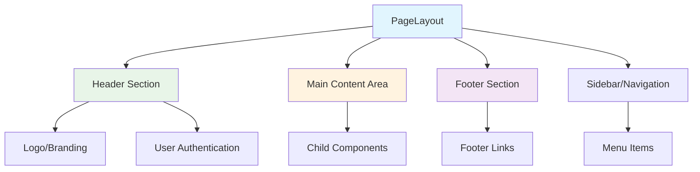
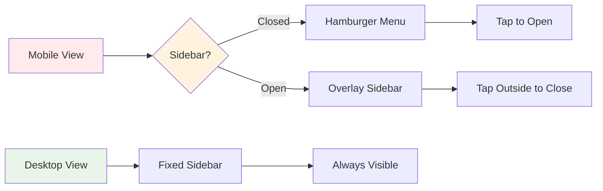

# PageLayout Component Documentation

## Overview
The main layout wrapper component that provides consistent structure, navigation, and responsive design for the entire application.

**Location:** `src/components/PageLayout.jsx`  
**Type:** Functional Component  
**Styling:** `PageLayout.module.css`  
**Framework:** React with Bootstrap integration

## Purpose & Responsibilities

### Primary Functions
- **Layout Structure** - Provides consistent page structure
- **Navigation Management** - Header and navigation elements
- **Responsive Design** - Mobile and desktop optimization
- **Theme Integration** - Consistent styling across application

## Component Architecture



## Props Interface

### Input Props
```typescript
interface PageLayoutProps {
  children: React.ReactNode;
  title?: string;
  showSidebar?: boolean;
  className?: string;
  headerActions?: React.ReactNode;
  footerContent?: React.ReactNode;
}
```

### Usage Example
```javascript
<PageLayout 
  title="IPL Play-Along"
  showSidebar={true}
  headerActions={<UserProfileButton />}
>
  <App />
</PageLayout>
```

## Component Structure

### JSX Layout
```javascript
return (
  <div className={`page-layout ${className || ''}`}>
    <Header 
      title={title}
      actions={headerActions}
      onMenuToggle={toggleSidebar}
    />
    
    <div className="layout-body">
      {showSidebar && (
        <Sidebar 
          isOpen={sidebarOpen}
          onClose={() => setSidebarOpen(false)}
        />
      )}
      
      <main className="main-content">
        <div className="content-wrapper">
          {children}
        </div>
      </main>
    </div>
    
    <Footer content={footerContent} />
  </div>
);
```

## Sub-Components

### 1. Header Component
```javascript
const Header = ({ title, actions, onMenuToggle }) => (
  <header className="app-header">
    <div className="header-left">
      <button 
        className="menu-toggle"
        onClick={onMenuToggle}
        aria-label="Toggle navigation menu"
      >
        ☰
      </button>
      <div className="logo-section">
        
        <h1 className="app-title">{title}</h1>
      </div>
    </div>
    
    <div className="header-right">
      {actions}
      <UserProfileSection />
    </div>
  </header>
);
```

### 2. Sidebar Component
```javascript
const Sidebar = ({ isOpen, onClose }) => (
  <aside className={`sidebar ${isOpen ? 'open' : ''}`}>
    <div className="sidebar-header">
      <h3>Navigation</h3>
      <button 
        className="close-btn"
        onClick={onClose}
        aria-label="Close sidebar"
      >
        ×
      </button>
    </div>
    
    <nav className="sidebar-nav">
      <ul>
        <li><a href="#matches">Current Match</a></li>
        <li><a href="#leaderboard">Leaderboard</a></li>
        <li><a href="#stats">Statistics</a></li>
        <li><a href="#profile">My Profile</a></li>
      </ul>
    </nav>
  </aside>
);
```

### 3. Footer Component
```javascript
const Footer = ({ content }) => (
  <footer className="app-footer">
    <div className="footer-content">
      {content || (
        <>
          <p>&copy; 2025 IPL Play-Along. All rights reserved.</p>
          <div className="footer-links">
            <a href="#privacy">Privacy Policy</a>
            <a href="#terms">Terms of Service</a>
            <a href="#support">Support</a>
          </div>
        </>
      )}
    </div>
  </footer>
);
```

## State Management

### Local State
```javascript
const [sidebarOpen, setSidebarOpen] = useState(false);
const [isMobile, setIsMobile] = useState(false);
const [headerHeight, setHeaderHeight] = useState(0);
```

### Responsive Behavior
```javascript
useEffect(() => {
  const handleResize = () => {
    const mobile = window.innerWidth < 768;
    setIsMobile(mobile);
    
    // Auto-close sidebar on mobile when screen size changes
    if (!mobile && sidebarOpen) {
      setSidebarOpen(false);
    }
  };
  
  window.addEventListener('resize', handleResize);
  handleResize(); // Initial check
  
  return () => window.removeEventListener('resize', handleResize);
}, [sidebarOpen]);
```

## Responsive Design

### Breakpoint Management
```css
/* PageLayout.module.css */
.pageLayout {
  display: flex;
  flex-direction: column;
  min-height: 100vh;
}

.layoutBody {
  display: flex;
  flex: 1;
}

.mainContent {
  flex: 1;
  padding: 1rem;
  transition: margin-left 0.3s ease;
}

/* Mobile responsive */
@media (max-width: 768px) {
  .sidebar {
    position: fixed;
    left: -300px;
    transition: left 0.3s ease;
    z-index: 1000;
  }
  
  .sidebar.open {
    left: 0;
  }
  
  .mainContent {
    margin-left: 0;
  }
}

/* Desktop responsive */
@media (min-width: 769px) {
  .sidebar {
    position: relative;
    width: 250px;
  }
  
  .mainContent {
    margin-left: 250px;
  }
}
```

### Mobile-First Approach
```javascript
const ResponsiveGrid = ({ children }) => (
  <div className="responsive-grid">
    <div className="container-fluid">
      <div className="row">
        <div className="col-12 col-md-8 col-lg-9">
          {children}
        </div>
        <div className="col-12 col-md-4 col-lg-3 d-none d-md-block">
          <SideContent />
        </div>
      </div>
    </div>
  </div>
);
```

## Navigation Integration

### Navigation State


### Navigation Handler
```javascript
const NavigationManager = () => {
  const handleNavigation = (path) => {
    // Close mobile sidebar after navigation
    if (isMobile) {
      setSidebarOpen(false);
    }
    
    // Handle navigation logic
    window.location.hash = path;
  };
  
  return { handleNavigation };
};
```

## Theme Integration

### CSS Variables
```css
:root {
  --header-height: 60px;
  --sidebar-width: 250px;
  --primary-color: #1976d2;
  --secondary-color: #dc004e;
  --background-color: #f5f5f5;
  --text-color: #333333;
  --border-color: #e0e0e0;
}

.pageLayout {
  --header-bg: var(--primary-color);
  --sidebar-bg: #ffffff;
  --content-bg: var(--background-color);
}
```

### Dark Mode Support
```javascript
const [darkMode, setDarkMode] = useState(false);

useEffect(() => {
  const savedTheme = localStorage.getItem('theme');
  if (savedTheme === 'dark') {
    setDarkMode(true);
    document.body.classList.add('dark-mode');
  }
}, []);

const toggleTheme = () => {
  setDarkMode(!darkMode);
  document.body.classList.toggle('dark-mode');
  localStorage.setItem('theme', !darkMode ? 'dark' : 'light');
};
```

## Accessibility Features

### ARIA Landmarks
```javascript
<div className="page-layout" role="application">
  <header role="banner">
    <nav role="navigation" aria-label="Main navigation">
      {/* Navigation items */}
    </nav>
  </header>
  
  <main role="main" aria-label="Main content">
    {children}
  </main>
  
  <footer role="contentinfo">
    {/* Footer content */}
  </footer>
</div>
```

### Keyboard Navigation
```javascript
const handleKeyDown = (e) => {
  if (e.key === 'Escape' && sidebarOpen) {
    setSidebarOpen(false);
  }
  
  if (e.key === 'Tab') {
    // Handle focus trapping in sidebar
    trapFocus(e);
  }
};

useEffect(() => {
  document.addEventListener('keydown', handleKeyDown);
  return () => document.removeEventListener('keydown', handleKeyDown);
}, [sidebarOpen]);
```

## Performance Optimization

### Lazy Loading
```javascript
const LazyUserProfile = lazy(() => import('./UserProfile'));
const LazySettings = lazy(() => import('./Settings'));

const HeaderActions = () => (
  <Suspense fallback={<div>Loading...</div>}>
    <LazyUserProfile />
    <LazySettings />
  </Suspense>
);
```

### Virtual Scrolling for Navigation
```javascript
const VirtualizedSidebar = ({ items }) => {
  const [visibleItems, setVisibleItems] = useState([]);
  
  useEffect(() => {
    // Only render visible navigation items
    const visible = items.slice(0, 20); // Limit initial render
    setVisibleItems(visible);
  }, [items]);
  
  return (
    <div className="virtualized-nav">
      {visibleItems.map(item => (
        <NavigationItem key={item.id} {...item} />
      ))}
    </div>
  );
};
```

## Integration Points

### Authentication Integration
```javascript
const AuthenticatedLayout = ({ children, ...props }) => {
  const { isAuthenticated, user } = useAuth();
  
  return (
    <PageLayout
      {...props}
      headerActions={
        isAuthenticated ? (
          <UserDropdown user={user} />
        ) : (
          <SignInButton />
        )
      }
    >
      {children}
    </PageLayout>
  );
};
```

### Notification Integration
```javascript
const LayoutWithNotifications = ({ children, ...props }) => {
  const notifications = useNotifications();
  
  return (
    <PageLayout {...props}>
      <NotificationContainer notifications={notifications} />
      {children}
    </PageLayout>
  );
};
```

## Error Boundaries

### Layout Error Handling
```javascript
class LayoutErrorBoundary extends Component {
  constructor(props) {
    super(props);
    this.state = { hasError: false };
  }
  
  static getDerivedStateFromError(error) {
    return { hasError: true };
  }
  
  componentDidCatch(error, errorInfo) {
    console.error('Layout error:', error, errorInfo);
  }
  
  render() {
    if (this.state.hasError) {
      return (
        <div className="error-layout">
          <h1>Something went wrong with the page layout.</h1>
          <button onClick={() => window.location.reload()}>
            Reload Page
          </button>
        </div>
      );
    }
    
    return this.props.children;
  }
}
```

## Testing Strategy

### Component Testing
```javascript
describe('PageLayout Component', () => {
  test('renders children correctly', () => {
    render(
      <PageLayout title="Test App">
        <div>Test Content</div>
      </PageLayout>
    );
    
    expect(screen.getByText('Test Content')).toBeInTheDocument();
    expect(screen.getByText('Test App')).toBeInTheDocument();
  });
  
  test('toggles sidebar on mobile', () => {
    // Mock mobile viewport
    Object.defineProperty(window, 'innerWidth', {
      writable: true,
      configurable: true,
      value: 500,
    });
    
    render(<PageLayout showSidebar={true}>Content</PageLayout>);
    
    const menuToggle = screen.getByLabelText('Toggle navigation menu');
    fireEvent.click(menuToggle);
    
    expect(screen.getByRole('navigation')).toHaveClass('open');
  });
});
```

## Troubleshooting

### Common Issues

**Issue:** Sidebar not responsive
```css
/* Check media queries and flexbox */
.sidebar {
  flex-shrink: 0;
  transition: all 0.3s ease;
}

@media (max-width: 768px) {
  .sidebar {
    position: fixed;
    transform: translateX(-100%);
  }
  
  .sidebar.open {
    transform: translateX(0);
  }
}
```

**Issue:** Content overflow on mobile
```css
.mainContent {
  overflow-x: hidden;
  word-wrap: break-word;
}
```

**Issue:** Z-index conflicts
```css
.sidebar {
  z-index: 1000;
}

.header {
  z-index: 1001;
}

.modal {
  z-index: 1050;
}
```

## Future Enhancements

- **Advanced Theming** - Multiple color schemes and themes
- **Layout Persistence** - Remember sidebar state across sessions
- **Breadcrumb Navigation** - Dynamic breadcrumb generation
- **Search Integration** - Global search functionality in header
- **Progressive Enhancement** - Better offline experience
- **Animation Framework** - Smooth page transitions