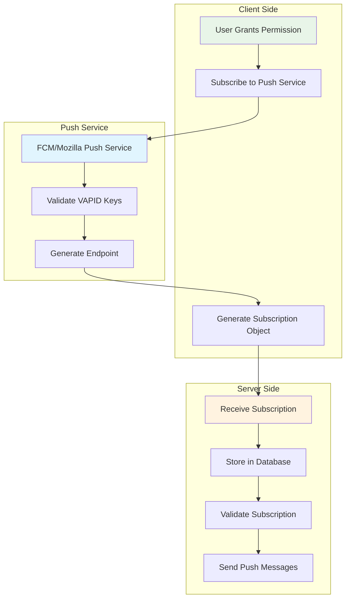

# Push Subscription Management

## 🔐 VAPID Protocol Implementation

VAPID (Voluntary Application Server Identification) provides a secure way to send push notifications without relying on proprietary services. It uses cryptographic keys to identify your application to push services.

## 📊 Subscription Architecture



## 🔑 VAPID Key Generation

### Server-Side Key Generation

```javascript
// Generate VAPID keys (run once)
const webpush = require('web-push');

function generateVAPIDKeys() {
    const vapidKeys = webpush.generateVAPIDKeys();
    
    console.log('VAPID Keys Generated:');
    console.log('Public Key:', vapidKeys.publicKey);
    console.log('Private Key:', vapidKeys.privateKey);
    
    // Store these securely in environment variables
    return vapidKeys;
}

// Configure web-push with VAPID details
webpush.setVAPIDDetails(
    'mailto:your-email@example.com', // Contact email
    process.env.VAPID_PUBLIC_KEY,    // Public key
    process.env.VAPID_PRIVATE_KEY    // Private key
);
```

### Environment Configuration

```bash
# .env file
VAPID_PUBLIC_KEY=BK8tJW9T4P7sF8hX2L3mN9q4R5vW7yZ1A2b3C4d5E6f7G8h9I0j1K2l3M4n5O6p7Q8r9S0t1U2v3W4x5Y6z7A8b
VAPID_PRIVATE_KEY=your-private-vapid-key-here
VAPID_EMAIL=mailto:your-email@example.com
```

## 📝 Subscription Process

### Client-Side Subscription

```javascript
class PushSubscriptionManager {
    constructor() {
        this.publicKey = process.env.REACT_APP_VAPID_PUBLIC_KEY;
        this.subscription = null;
        this.registration = null;
    }

    // Convert VAPID key to Uint8Array
    urlBase64ToUint8Array(base64String) {
        const padding = '='.repeat((4 - base64String.length % 4) % 4);
        const base64 = (base64String + padding)
            .replace(/-/g, '+')
            .replace(/_/g, '/');

        const rawData = window.atob(base64);
        const outputArray = new Uint8Array(rawData.length);

        for (let i = 0; i < rawData.length; ++i) {
            outputArray[i] = rawData.charCodeAt(i);
        }
        return outputArray;
    }

    async subscribe() {
        try {
            // Get service worker registration
            this.registration = await navigator.serviceWorker.getRegistration();
            
            if (!this.registration) {
                throw new Error('Service worker not registered');
            }

            // Check if already subscribed
            const existingSubscription = await this.registration.pushManager.getSubscription();
            
            if (existingSubscription) {
                console.log('✅ Already subscribed:', existingSubscription);
                this.subscription = existingSubscription;
                return existingSubscription;
            }

            // Subscribe to push notifications
            const subscription = await this.registration.pushManager.subscribe({
                userVisibleOnly: true, // Must be true for web push
                applicationServerKey: this.urlBase64ToUint8Array(this.publicKey)
            });

            console.log('✅ Push subscription created:', subscription);
            this.subscription = subscription;

            // Send subscription to server
            await this.sendSubscriptionToServer(subscription);
            
            return subscription;
        } catch (error) {
            console.error('❌ Push subscription failed:', error);
            throw error;
        }
    }

    async sendSubscriptionToServer(subscription) {
        try {
            const response = await fetch('/api/notifications/subscribe', {
                method: 'POST',
                headers: {
                    'Content-Type': 'application/json',
                    'Authorization': `Bearer ${localStorage.getItem('authToken')}`
                },
                body: JSON.stringify({
                    subscription: subscription,
                    userAgent: navigator.userAgent,
                    timestamp: new Date().toISOString()
                })
            });

            if (!response.ok) {
                throw new Error(`Subscription failed: ${response.statusText}`);
            }

            const result = await response.json();
            console.log('✅ Subscription sent to server:', result);
            
            // Store subscription locally for future reference
            localStorage.setItem('pushSubscription', JSON.stringify({
                subscription: subscription,
                timestamp: new Date().toISOString()
            }));
            
            return result;
        } catch (error) {
            console.error('❌ Failed to send subscription to server:', error);
            throw error;
        }
    }

    async unsubscribe() {
        try {
            if (this.subscription) {
                const success = await this.subscription.unsubscribe();
                
                if (success) {
                    console.log('✅ Successfully unsubscribed');
                    
                    // Notify server
                    await fetch('/api/notifications/unsubscribe', {
                        method: 'POST',
                        headers: {
                            'Content-Type': 'application/json',
                            'Authorization': `Bearer ${localStorage.getItem('authToken')}`
                        },
                        body: JSON.stringify({
                            endpoint: this.subscription.endpoint
                        })
                    });
                    
                    // Clear local storage
                    localStorage.removeItem('pushSubscription');
                    this.subscription = null;
                    
                    return true;
                }
            }
            return false;
        } catch (error) {
            console.error('❌ Unsubscribe failed:', error);
            throw error;
        }
    }

    async getSubscriptionInfo() {
        if (!this.subscription) {
            const registration = await navigator.serviceWorker.getRegistration();
            this.subscription = await registration?.pushManager.getSubscription();
        }

        if (this.subscription) {
            return {
                endpoint: this.subscription.endpoint,
                keys: this.subscription.toJSON().keys,
                expirationTime: this.subscription.expirationTime
            };
        }
        return null;
    }
}
```

### React Component Integration

```javascript
// NotificationComponent.js
import { PushSubscriptionManager } from './PushSubscriptionManager';

export default function NotificationComponent() {
    const [subscriptionStatus, setSubscriptionStatus] = useState('unknown');
    const [subscriptionManager] = useState(() => new PushSubscriptionManager());

    useEffect(() => {
        checkSubscriptionStatus();
    }, []);

    const checkSubscriptionStatus = async () => {
        try {
            const info = await subscriptionManager.getSubscriptionInfo();
            setSubscriptionStatus(info ? 'subscribed' : 'not-subscribed');
        } catch (error) {
            setSubscriptionStatus('error');
        }
    };

    const handleSubscribe = async () => {
        try {
            setSubscriptionStatus('subscribing');
            await subscriptionManager.subscribe();
            setSubscriptionStatus('subscribed');
            
            // Show success message
            alert('🔔 Push notifications enabled! You\'ll receive match updates.');
        } catch (error) {
            setSubscriptionStatus('error');
            alert('❌ Failed to enable notifications. Please try again.');
        }
    };

    const handleUnsubscribe = async () => {
        try {
            setSubscriptionStatus('unsubscribing');
            await subscriptionManager.unsubscribe();
            setSubscriptionStatus('not-subscribed');
            
            alert('🔕 Push notifications disabled.');
        } catch (error) {
            setSubscriptionStatus('error');
            alert('❌ Failed to disable notifications.');
        }
    };

    const getStatusMessage = () => {
        switch (subscriptionStatus) {
            case 'subscribed':
                return '🔔 Notifications enabled';
            case 'not-subscribed':
                return '🔕 Notifications disabled';
            case 'subscribing':
                return '⏳ Enabling notifications...';
            case 'unsubscribing':
                return '⏳ Disabling notifications...';
            case 'error':
                return '❌ Notification error';
            default:
                return '❓ Checking status...';
        }
    };

    return (
        <div className="notification-controls">
            <div className="status-indicator">
                <span className={`status-badge status-${subscriptionStatus}`}>
                    {getStatusMessage()}
                </span>
            </div>
            
            <div className="control-buttons">
                {subscriptionStatus === 'not-subscribed' && (
                    <button 
                        onClick={handleSubscribe}
                        className="btn btn-primary"
                        disabled={!('serviceWorker' in navigator)}
                    >
                        🔔 Enable Notifications
                    </button>
                )}
                
                {subscriptionStatus === 'subscribed' && (
                    <button 
                        onClick={handleUnsubscribe}
                        className="btn btn-secondary"
                    >
                        🔕 Disable Notifications
                    </button>
                )}
            </div>

            {!('serviceWorker' in navigator) && (
                <div className="alert alert-warning">
                    ⚠️ Push notifications are not supported in this browser.
                </div>
            )}
        </div>
    );
}
```

## 🗄️ Server-Side Subscription Management

### Database Schema

```sql
-- Notification Subscriptions Table
CREATE TABLE notification_subscriptions (
    id INT PRIMARY KEY IDENTITY(1,1),
    user_id NVARCHAR(255) NOT NULL,
    endpoint NVARCHAR(MAX) NOT NULL,
    p256dh_key NVARCHAR(255) NOT NULL,
    auth_key NVARCHAR(255) NOT NULL,
    user_agent NVARCHAR(MAX),
    created_at DATETIME2 DEFAULT GETUTCDATE(),
    updated_at DATETIME2 DEFAULT GETUTCDATE(),
    is_active BIT DEFAULT 1,
    expiration_time DATETIME2,
    
    -- Indexes
    INDEX IX_notification_subscriptions_user_id (user_id),
    INDEX IX_notification_subscriptions_endpoint (endpoint(255)),
    INDEX IX_notification_subscriptions_active (is_active)
);

-- Subscription preferences
CREATE TABLE notification_preferences (
    id INT PRIMARY KEY IDENTITY(1,1),
    user_id NVARCHAR(255) NOT NULL,
    match_start_reminders BIT DEFAULT 1,
    vote_reminders BIT DEFAULT 1,
    result_updates BIT DEFAULT 1,
    leaderboard_updates BIT DEFAULT 0,
    marketing_notifications BIT DEFAULT 0,
    created_at DATETIME2 DEFAULT GETUTCDATE(),
    updated_at DATETIME2 DEFAULT GETUTCDATE(),
    
    CONSTRAINT UK_notification_preferences_user_id UNIQUE (user_id)
);
```

### Subscription API Endpoints

```javascript
// api/notifications/subscribe.js
const { sql, poolPromise } = require('../../config/database');
const jwt = require('jsonwebtoken');

async function subscribeUser(req, res) {
    try {
        const { subscription, userAgent } = req.body;
        const token = req.headers.authorization?.replace('Bearer ', '');
        
        if (!token) {
            return res.status(401).json({ error: 'Authentication required' });
        }

        const decoded = jwt.verify(token, process.env.JWT_SECRET);
        const userId = decoded.user_id;

        // Validate subscription object
        if (!subscription?.endpoint || !subscription?.keys) {
            return res.status(400).json({ error: 'Invalid subscription object' });
        }

        const pool = await poolPromise;
        
        // Check if subscription already exists
        const existingResult = await pool.request()
            .input('endpoint', sql.NVarChar, subscription.endpoint)
            .query(`
                SELECT id, is_active 
                FROM notification_subscriptions 
                WHERE endpoint = @endpoint
            `);

        if (existingResult.recordset.length > 0) {
            // Update existing subscription
            const subscriptionId = existingResult.recordset[0].id;
            
            await pool.request()
                .input('id', sql.Int, subscriptionId)
                .input('user_id', sql.NVarChar, userId)
                .input('is_active', sql.Bit, 1)
                .input('user_agent', sql.NVarChar, userAgent)
                .input('updated_at', sql.DateTime2, new Date())
                .query(`
                    UPDATE notification_subscriptions 
                    SET user_id = @user_id, 
                        is_active = @is_active,
                        user_agent = @user_agent,
                        updated_at = @updated_at
                    WHERE id = @id
                `);

            console.log('✅ Updated existing subscription for user:', userId);
        } else {
            // Create new subscription
            await pool.request()
                .input('user_id', sql.NVarChar, userId)
                .input('endpoint', sql.NVarChar, subscription.endpoint)
                .input('p256dh_key', sql.NVarChar, subscription.keys.p256dh)
                .input('auth_key', sql.NVarChar, subscription.keys.auth)
                .input('user_agent', sql.NVarChar, userAgent)
                .input('expiration_time', sql.DateTime2, subscription.expirationTime ? new Date(subscription.expirationTime) : null)
                .query(`
                    INSERT INTO notification_subscriptions 
                    (user_id, endpoint, p256dh_key, auth_key, user_agent, expiration_time)
                    VALUES 
                    (@user_id, @endpoint, @p256dh_key, @auth_key, @user_agent, @expiration_time)
                `);

            console.log('✅ Created new subscription for user:', userId);
        }

        // Ensure user has notification preferences
        await pool.request()
            .input('user_id', sql.NVarChar, userId)
            .query(`
                IF NOT EXISTS (SELECT 1 FROM notification_preferences WHERE user_id = @user_id)
                BEGIN
                    INSERT INTO notification_preferences (user_id)
                    VALUES (@user_id)
                END
            `);

        res.json({ 
            success: true, 
            message: 'Push subscription saved successfully' 
        });

    } catch (error) {
        console.error('❌ Subscription error:', error);
        res.status(500).json({ error: 'Failed to save subscription' });
    }
}

async function unsubscribeUser(req, res) {
    try {
        const { endpoint } = req.body;
        const token = req.headers.authorization?.replace('Bearer ', '');
        
        if (!token) {
            return res.status(401).json({ error: 'Authentication required' });
        }

        const decoded = jwt.verify(token, process.env.JWT_SECRET);
        const userId = decoded.user_id;

        const pool = await poolPromise;
        
        const result = await pool.request()
            .input('endpoint', sql.NVarChar, endpoint)
            .input('user_id', sql.NVarChar, userId)
            .query(`
                UPDATE notification_subscriptions 
                SET is_active = 0, updated_at = GETUTCDATE()
                WHERE endpoint = @endpoint AND user_id = @user_id
            `);

        if (result.rowsAffected[0] > 0) {
            console.log('✅ Unsubscribed user:', userId);
            res.json({ success: true, message: 'Successfully unsubscribed' });
        } else {
            res.status(404).json({ error: 'Subscription not found' });
        }

    } catch (error) {
        console.error('❌ Unsubscribe error:', error);
        res.status(500).json({ error: 'Failed to unsubscribe' });
    }
}

module.exports = { subscribeUser, unsubscribeUser };
```

## 📊 Subscription Analytics

### Tracking Subscription Metrics

```javascript
class SubscriptionAnalytics {
    static async getSubscriptionStats() {
        try {
            const pool = await poolPromise;
            
            const stats = await pool.request().query(`
                SELECT 
                    COUNT(*) as total_subscriptions,
                    COUNT(CASE WHEN is_active = 1 THEN 1 END) as active_subscriptions,
                    COUNT(CASE WHEN is_active = 0 THEN 1 END) as inactive_subscriptions,
                    COUNT(DISTINCT user_id) as unique_users,
                    AVG(CASE WHEN is_active = 1 THEN 1.0 ELSE 0.0 END) as subscription_rate
                FROM notification_subscriptions
                WHERE created_at >= DATEADD(day, -30, GETUTCDATE())
            `);

            const browserStats = await pool.request().query(`
                SELECT 
                    CASE 
                        WHEN user_agent LIKE '%Chrome%' THEN 'Chrome'
                        WHEN user_agent LIKE '%Firefox%' THEN 'Firefox'
                        WHEN user_agent LIKE '%Safari%' THEN 'Safari'
                        WHEN user_agent LIKE '%Edge%' THEN 'Edge'
                        ELSE 'Other'
                    END as browser,
                    COUNT(*) as count
                FROM notification_subscriptions
                WHERE is_active = 1
                GROUP BY 
                    CASE 
                        WHEN user_agent LIKE '%Chrome%' THEN 'Chrome'
                        WHEN user_agent LIKE '%Firefox%' THEN 'Firefox'
                        WHEN user_agent LIKE '%Safari%' THEN 'Safari'
                        WHEN user_agent LIKE '%Edge%' THEN 'Edge'
                        ELSE 'Other'
                    END
                ORDER BY count DESC
            `);

            return {
                overall: stats.recordset[0],
                browsers: browserStats.recordset
            };
        } catch (error) {
            console.error('❌ Failed to get subscription stats:', error);
            throw error;
        }
    }

    static async trackSubscriptionEvent(userId, event, metadata = {}) {
        try {
            const pool = await poolPromise;
            
            await pool.request()
                .input('user_id', sql.NVarChar, userId)
                .input('event', sql.NVarChar, event)
                .input('metadata', sql.NVarChar, JSON.stringify(metadata))
                .query(`
                    INSERT INTO subscription_events (user_id, event, metadata)
                    VALUES (@user_id, @event, @metadata)
                `);
                
        } catch (error) {
            console.error('❌ Failed to track subscription event:', error);
        }
    }
}
```

### Subscription Health Monitoring

```javascript
class SubscriptionHealthMonitor {
    static async checkExpiredSubscriptions() {
        try {
            const pool = await poolPromise;
            
            // Find expired subscriptions
            const expiredResult = await pool.request().query(`
                UPDATE notification_subscriptions 
                SET is_active = 0, updated_at = GETUTCDATE()
                WHERE expiration_time IS NOT NULL 
                AND expiration_time < GETUTCDATE()
                AND is_active = 1
            `);

            if (expiredResult.rowsAffected[0] > 0) {
                console.log(`⏰ Deactivated ${expiredResult.rowsAffected[0]} expired subscriptions`);
            }

            return expiredResult.rowsAffected[0];
        } catch (error) {
            console.error('❌ Failed to check expired subscriptions:', error);
            throw error;
        }
    }

    static async validateSubscriptions() {
        // This would typically involve testing a sample of subscriptions
        // to ensure they're still valid with the push service
        console.log('🔍 Validating subscription endpoints...');
        
        // Implementation would test subscriptions and mark invalid ones as inactive
        // This is typically done by sending a test notification
    }

    static async generateHealthReport() {
        try {
            const stats = await SubscriptionAnalytics.getSubscriptionStats();
            const expiredCount = await this.checkExpiredSubscriptions();
            
            return {
                timestamp: new Date().toISOString(),
                total_subscriptions: stats.overall.total_subscriptions,
                active_subscriptions: stats.overall.active_subscriptions,
                subscription_rate: stats.overall.subscription_rate,
                expired_this_check: expiredCount,
                browser_distribution: stats.browsers
            };
        } catch (error) {
            console.error('❌ Failed to generate health report:', error);
            throw error;
        }
    }
}

// Schedule periodic health checks
setInterval(async () => {
    try {
        const report = await SubscriptionHealthMonitor.generateHealthReport();
        console.log('📊 Subscription Health Report:', report);
    } catch (error) {
        console.error('❌ Health check failed:', error);
    }
}, 60 * 60 * 1000); // Every hour
```

---

> 📌 **Note:** Proper subscription management is crucial for reliable push notifications. Always validate subscriptions, handle expired ones gracefully, and provide clear user controls for notification preferences.