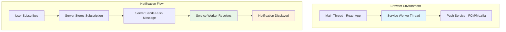

# Service Worker Implementation

## 🔧 Service Worker Overview

Service Workers are the backbone of push notifications in the IPL Play-Along application. They run in the background, independent of the main application thread, enabling real-time notifications even when the app is closed.

## 📁 Service Worker Architecture



## 🛠️ Service Worker Registration

### Client-Side Registration
**Location:** `src/components/NotificationComponent.js`

```javascript
export class NotificationComponent {
    constructor() {
        this.registration = null;
        this.subscription = null;
        this.isSupported = this.checkSupport();
    }

    checkSupport() {
        const hasServiceWorker = 'serviceWorker' in navigator;
        const hasPushManager = 'PushManager' in window;
        const hasNotification = 'Notification' in window;
        
        return hasServiceWorker && hasPushManager && hasNotification;
    }

    async initialize() {
        if (!this.isSupported) {
            throw new Error('Push notifications not supported in this browser');
        }

        try {
            // Register service worker
            this.registration = await navigator.serviceWorker.register('/service-worker.js', {
                scope: '/'
            });

            console.log('✅ Service Worker registered:', {
                scope: this.registration.scope,
                state: this.registration.installing ? 'installing' : 
                       this.registration.waiting ? 'waiting' : 
                       this.registration.active ? 'active' : 'unknown'
            });

            // Wait for service worker to be ready
            const swRegistration = await navigator.serviceWorker.ready;
            console.log('✅ Service Worker ready:', swRegistration.scope);
            
            return this.registration;
        } catch (error) {
            console.error('❌ Service Worker registration failed:', error);
            throw new Error(`Service Worker registration failed: ${error.message}`);
        }
    }

    async updateServiceWorker() {
        if (this.registration) {
            try {
                const newRegistration = await this.registration.update();
                console.log('🔄 Service Worker updated:', newRegistration);
                return newRegistration;
            } catch (error) {
                console.error('❌ Service Worker update failed:', error);
                throw error;
            }
        }
    }
}
```

### Advanced Registration with Error Handling

```javascript
class ServiceWorkerManager {
    constructor() {
        this.registration = null;
        this.updateFound = false;
    }

    async register() {
        if (!('serviceWorker' in navigator)) {
            throw new Error('Service workers not supported');
        }

        try {
            const registration = await navigator.serviceWorker.register('/service-worker.js', {
                scope: '/',
                updateViaCache: 'none' // Always check for updates
            });

            this.registration = registration;

            // Handle different states
            if (registration.installing) {
                console.log('🔄 Service Worker installing...');
                this.trackInstalling(registration.installing);
            }

            if (registration.waiting) {
                console.log('⏳ Service Worker waiting to activate...');
                this.showUpdateAvailable();
            }

            if (registration.active) {
                console.log('✅ Service Worker active');
            }

            // Listen for updates
            registration.addEventListener('updatefound', () => {
                console.log('🆕 Service Worker update found');
                this.updateFound = true;
                this.trackInstalling(registration.installing);
            });

            return registration;
        } catch (error) {
            console.error('❌ Service Worker registration failed:', error);
            throw error;
        }
    }

    trackInstalling(worker) {
        worker.addEventListener('statechange', () => {
            switch (worker.state) {
                case 'installed':
                    if (navigator.serviceWorker.controller) {
                        // New update available
                        this.showUpdateAvailable();
                    } else {
                        // First time install
                        console.log('✅ Service Worker installed for the first time');
                    }
                    break;
                case 'activated':
                    console.log('✅ Service Worker activated');
                    break;
                case 'redundant':
                    console.log('❌ Service Worker became redundant');
                    break;
            }
        });
    }

    showUpdateAvailable() {
        // Show update notification to user
        if (confirm('New version available! Refresh to update?')) {
            window.location.reload();
        }
    }
}
```

## 📝 Service Worker Implementation

### Complete Service Worker File
**Location:** `public/service-worker.js`

```javascript
// Service Worker for IPL Play-Along App
const CACHE_NAME = 'ipl-app-v1.2.0';
const RUNTIME_CACHE = 'ipl-runtime-v1';

// Resources to cache on install
const urlsToCache = [
    '/',
    '/static/css/main.css',
    '/static/js/main.js',
    '/manifest.json',
    '/favicon.ico',
    '/static/media/ipl1.gif',
    '/static/media/ipl2.gif',
    '/static/media/guide.png'
];

// Install event - cache essential resources
self.addEventListener('install', (event) => {
    console.log('🔧 Service Worker installing...');
    
    event.waitUntil(
        caches.open(CACHE_NAME)
            .then((cache) => {
                console.log('📦 Caching essential resources');
                return cache.addAll(urlsToCache);
            })
            .then(() => {
                console.log('✅ Cache populated, skipping waiting');
                return self.skipWaiting();
            })
            .catch((error) => {
                console.error('❌ Cache population failed:', error);
                throw error;
            })
    );
});

// Activate event - clean old caches
self.addEventListener('activate', (event) => {
    console.log('🚀 Service Worker activating...');
    
    event.waitUntil(
        Promise.all([
            // Clean old caches
            caches.keys().then((cacheNames) => {
                return Promise.all(
                    cacheNames.map((cacheName) => {
                        if (cacheName !== CACHE_NAME && cacheName !== RUNTIME_CACHE) {
                            console.log('🗑️ Deleting old cache:', cacheName);
                            return caches.delete(cacheName);
                        }
                    })
                );
            }),
            // Claim all clients
            self.clients.claim()
        ]).then(() => {
            console.log('✅ Service Worker activated and ready');
        })
    );
});

// Fetch event - serve from cache with network fallback
self.addEventListener('fetch', (event) => {
    const { request } = event;
    const url = new URL(request.url);

    // Handle different request types
    if (request.method === 'GET') {
        if (url.origin === self.location.origin) {
            // Same origin requests
            event.respondWith(cacheFirstStrategy(request));
        } else {
            // Cross-origin requests (APIs, CDNs)
            event.respondWith(networkFirstStrategy(request));
        }
    }
});

// Cache strategies
async function cacheFirstStrategy(request) {
    try {
        const cachedResponse = await caches.match(request);
        if (cachedResponse) {
            console.log('📦 Served from cache:', request.url);
            return cachedResponse;
        }

        const networkResponse = await fetch(request);
        if (networkResponse.ok) {
            const cache = await caches.open(RUNTIME_CACHE);
            cache.put(request, networkResponse.clone());
            console.log('🌐 Served from network and cached:', request.url);
        }
        return networkResponse;
    } catch (error) {
        console.error('❌ Cache-first strategy failed:', error);
        return new Response('Offline content not available', { status: 503 });
    }
}

async function networkFirstStrategy(request) {
    try {
        const networkResponse = await fetch(request);
        if (networkResponse.ok) {
            const cache = await caches.open(RUNTIME_CACHE);
            cache.put(request, networkResponse.clone());
            console.log('🌐 Served from network:', request.url);
        }
        return networkResponse;
    } catch (error) {
        const cachedResponse = await caches.match(request);
        if (cachedResponse) {
            console.log('📦 Network failed, served from cache:', request.url);
            return cachedResponse;
        }
        throw error;
    }
}
```

## 🔔 Push Event Handling

### Push Message Reception

```javascript
// Push event - handle incoming push messages
self.addEventListener('push', (event) => {
    console.log('📨 Push message received:', event);

    let notificationData = {
        title: 'IPL Play-Along',
        body: 'New notification!',
        icon: '/static/media/logo192.png',
        badge: '/static/media/logo192.png',
        tag: 'ipl-notification',
        requireInteraction: false,
        data: {}
    };

    // Parse push data
    if (event.data) {
        try {
            const payload = event.data.json();
            notificationData = {
                ...notificationData,
                title: payload.title || notificationData.title,
                body: payload.body || notificationData.body,
                icon: payload.icon || notificationData.icon,
                data: payload.data || {},
                tag: payload.tag || notificationData.tag,
                requireInteraction: payload.requireInteraction || false,
                actions: payload.actions || []
            };
        } catch (error) {
            console.error('❌ Failed to parse push data:', error);
            notificationData.body = event.data.text();
        }
    }

    // Show notification
    event.waitUntil(
        self.registration.showNotification(notificationData.title, {
            body: notificationData.body,
            icon: notificationData.icon,
            badge: notificationData.badge,
            tag: notificationData.tag,
            requireInteraction: notificationData.requireInteraction,
            data: notificationData.data,
            actions: notificationData.actions,
            timestamp: Date.now(),
            vibrate: [200, 100, 200], // Vibration pattern
            silent: false,
            renotify: true
        }).then(() => {
            console.log('✅ Notification displayed:', notificationData.title);
            
            // Track notification display
            return fetch('/api/notifications/track', {
                method: 'POST',
                headers: { 'Content-Type': 'application/json' },
                body: JSON.stringify({
                    type: 'displayed',
                    notification: notificationData,
                    timestamp: Date.now()
                })
            });
        }).catch(error => {
            console.error('❌ Notification display failed:', error);
        })
    );
});
```

### Notification Click Handling

```javascript
// Notification click event
self.addEventListener('notificationclick', (event) => {
    console.log('👆 Notification clicked:', event.notification);

    const notification = event.notification;
    const action = event.action;
    const data = notification.data || {};

    notification.close();

    // Handle different actions
    event.waitUntil(
        handleNotificationClick(action, data)
    );
});

async function handleNotificationClick(action, data) {
    const clients = await self.clients.matchAll({ 
        type: 'window', 
        includeUncontrolled: true 
    });

    // Determine target URL
    let targetUrl = '/';
    
    switch (action) {
        case 'view-match':
            targetUrl = data.matchUrl || '/';
            break;
        case 'vote-now':
            targetUrl = data.voteUrl || '/vote';
            break;
        case 'leaderboard':
            targetUrl = '/leaderboard';
            break;
        default:
            targetUrl = data.url || '/';
    }

    // Check if app is already open
    const existingClient = clients.find(client => 
        client.url.includes(self.location.origin)
    );

    if (existingClient) {
        // Focus existing window and navigate
        await existingClient.focus();
        return existingClient.navigate(targetUrl);
    } else {
        // Open new window
        return self.clients.openWindow(targetUrl);
    }
}

// Notification close event
self.addEventListener('notificationclose', (event) => {
    console.log('✖️ Notification closed:', event.notification);
    
    // Track notification closure
    event.waitUntil(
        fetch('/api/notifications/track', {
            method: 'POST',
            headers: { 'Content-Type': 'application/json' },
            body: JSON.stringify({
                type: 'closed',
                notification: event.notification.data,
                timestamp: Date.now()
            })
        }).catch(error => {
            console.error('❌ Notification tracking failed:', error);
        })
    );
});
```

## 🧪 Service Worker Testing & Debugging

### Development Tools

```javascript
// Debug utilities for development
class ServiceWorkerDebugger {
    static async getRegistration() {
        const registration = await navigator.serviceWorker.getRegistration();
        console.log('Service Worker Registration:', {
            scope: registration?.scope,
            active: registration?.active?.state,
            installing: registration?.installing?.state,
            waiting: registration?.waiting?.state
        });
        return registration;
    }

    static async getCacheContents() {
        const cacheNames = await caches.keys();
        for (const cacheName of cacheNames) {
            const cache = await caches.open(cacheName);
            const requests = await cache.keys();
            console.log(`Cache ${cacheName}:`, requests.map(req => req.url));
        }
    }

    static async clearAllCaches() {
        const cacheNames = await caches.keys();
        await Promise.all(cacheNames.map(name => caches.delete(name)));
        console.log('All caches cleared');
    }

    static async unregisterServiceWorker() {
        const registration = await navigator.serviceWorker.getRegistration();
        if (registration) {
            await registration.unregister();
            console.log('Service Worker unregistered');
        }
    }

    static async testPushSubscription() {
        const registration = await navigator.serviceWorker.getRegistration();
        if (registration) {
            const subscription = await registration.pushManager.getSubscription();
            console.log('Push Subscription:', subscription);
            return subscription;
        }
    }
}

// Make available in development
if (process.env.NODE_ENV === 'development') {
    window.SWDebugger = ServiceWorkerDebugger;
}
```

### Service Worker Lifecycle Monitoring

```javascript
// Monitor service worker lifecycle
function monitorServiceWorkerLifecycle() {
    if ('serviceWorker' in navigator) {
        navigator.serviceWorker.addEventListener('message', (event) => {
            console.log('📱 Message from Service Worker:', event.data);
        });

        navigator.serviceWorker.addEventListener('controllerchange', () => {
            console.log('🔄 Service Worker controller changed');
            // Optionally reload the page
            if (confirm('App has been updated. Reload to get the latest version?')) {
                window.location.reload();
            }
        });

        // Check for waiting service worker
        navigator.serviceWorker.ready.then((registration) => {
            if (registration.waiting) {
                console.log('⏳ New Service Worker is waiting');
                // Prompt user to update
            }
        });
    }
}
```

## 🚀 Performance Optimization

### Service Worker Best Practices

```javascript
// Optimized service worker with performance considerations
const CACHE_STRATEGIES = {
    // Critical resources - cache first
    CRITICAL: ['/static/css/', '/static/js/'],
    
    // API calls - network first with cache fallback
    API: ['/api/'],
    
    // Images - cache with stale-while-revalidate
    IMAGES: ['/static/media/', '.jpg', '.png', '.gif']
};

self.addEventListener('fetch', (event) => {
    const { request } = event;
    const url = request.url;

    // Apply appropriate strategy based on request type
    if (CACHE_STRATEGIES.CRITICAL.some(pattern => url.includes(pattern))) {
        event.respondWith(cacheFirst(request));
    } else if (CACHE_STRATEGIES.API.some(pattern => url.includes(pattern))) {
        event.respondWith(networkFirst(request));
    } else if (CACHE_STRATEGIES.IMAGES.some(pattern => url.includes(pattern))) {
        event.respondWith(staleWhileRevalidate(request));
    }
});

async function staleWhileRevalidate(request) {
    const cache = await caches.open(RUNTIME_CACHE);
    const cachedResponse = await cache.match(request);
    
    // Serve stale content immediately
    const fetchPromise = fetch(request).then((networkResponse) => {
        if (networkResponse.ok) {
            cache.put(request, networkResponse.clone());
        }
        return networkResponse;
    });

    // Return cached version immediately, update cache in background
    return cachedResponse || fetchPromise;
}
```

---

> 📌 **Note:** Service Workers are powerful but require careful implementation. Always test thoroughly across different browsers and scenarios, especially offline functionality and update mechanisms.