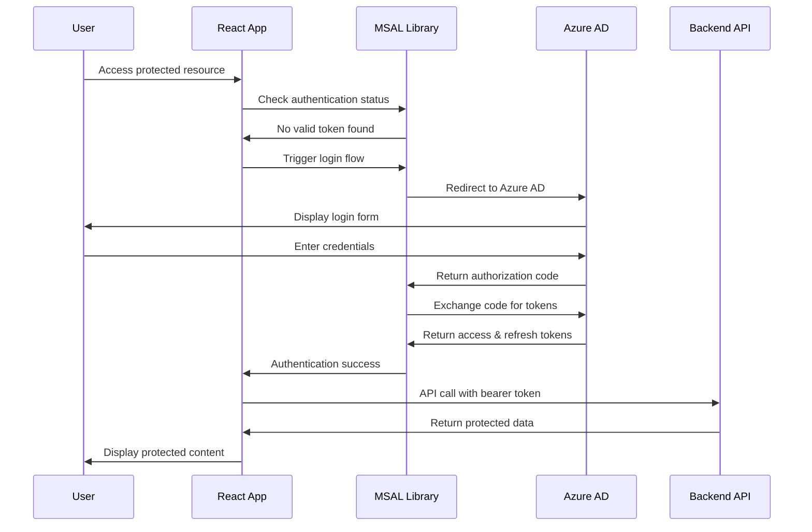

# Authentication & Authorization

## Overview
The IPL Play-Along application implements comprehensive authentication and authorization using Azure Active Directory (Azure AD) with Microsoft Authentication Library (MSAL).

## Azure AD Integration

### Configuration
```javascript
// MSAL Configuration
const msalConfig = {
  auth: {
    clientId: process.env.REACT_APP_AZURE_CLIENT_ID,
    authority: `https://login.microsoftonline.com/${process.env.REACT_APP_AZURE_TENANT_ID}`,
    redirectUri: window.location.origin,
    postLogoutRedirectUri: window.location.origin
  },
  cache: {
    cacheLocation: "sessionStorage", // Session storage for security
    storeAuthStateInCookie: false // Set to true for IE 11 or Edge
  }
};
```

### Authentication Flow



## Token Management

### Access Token Security
```javascript
// Token acquisition with automatic refresh
const TokenManager = {
  async getAccessToken(scopes = ['User.Read']) {
    const { instance, accounts } = useMsal();
    
    if (accounts.length === 0) {
      throw new Error('No authenticated account found');
    }

    try {
      // Try silent token acquisition first
      const response = await instance.acquireTokenSilent({
        scopes: scopes,
        account: accounts[0]
      });
      
      return response.accessToken;
    } catch (error) {
      // Fallback to interactive authentication
      if (error instanceof InteractionRequiredAuthError) {
        const response = await instance.acquireTokenPopup({
          scopes: scopes,
          account: accounts[0]
        });
        
        return response.accessToken;
      }
      
      throw error;
    }
  },

  // Token validation
  isTokenValid(token) {
    if (!token) return false;
    
    try {
      const payload = JSON.parse(atob(token.split('.')[1]));
      const currentTime = Math.floor(Date.now() / 1000);
      
      return payload.exp > currentTime;
    } catch (error) {
      console.error('Token validation error:', error);
      return false;
    }
  },

  // Automatic token refresh
  async refreshTokenIfNeeded(token) {
    if (!this.isTokenValid(token) || this.isTokenExpiringSoon(token)) {
      return await this.getAccessToken();
    }
    return token;
  },

  isTokenExpiringSoon(token, bufferMinutes = 5) {
    try {
      const payload = JSON.parse(atob(token.split('.')[1]));
      const expiryTime = payload.exp * 1000;
      const bufferTime = bufferMinutes * 60 * 1000;
      
      return Date.now() + bufferTime > expiryTime;
    } catch {
      return true; // Treat parsing errors as expired
    }
  }
};
```

### Token Storage Security
```javascript
// Secure token storage strategy
class SecureTokenStorage {
  constructor() {
    this.tokenCache = new Map();
    this.setupSecurityListeners();
  }

  // Store tokens in memory only (not localStorage)
  storeToken(key, token) {
    this.tokenCache.set(key, {
      token,
      timestamp: Date.now(),
      expires: this.extractExpiry(token)
    });
  }

  getToken(key) {
    const tokenData = this.tokenCache.get(key);
    
    if (!tokenData) return null;
    
    // Check if token is expired
    if (Date.now() > tokenData.expires) {
      this.tokenCache.delete(key);
      return null;
    }
    
    return tokenData.token;
  }

  clearTokens() {
    this.tokenCache.clear();
  }

  // Security event listeners
  setupSecurityListeners() {
    // Clear tokens on visibility change (tab switching)
    document.addEventListener('visibilitychange', () => {
      if (document.visibilityState === 'hidden') {
        this.handleSecurityEvent('visibility_hidden');
      }
    });

    // Clear tokens on beforeunload
    window.addEventListener('beforeunload', () => {
      this.clearTokens();
    });

    // Clear tokens on storage events (multiple tabs)
    window.addEventListener('storage', (event) => {
      if (event.key === 'msal.token.keys') {
        this.handleSecurityEvent('storage_changed');
      }
    });
  }

  handleSecurityEvent(eventType) {
    console.log(`Security event detected: ${eventType}`);
    
    // Implement security policies based on event type
    switch (eventType) {
      case 'visibility_hidden':
        // Optional: Clear tokens when tab is hidden
        break;
      case 'storage_changed':
        // Handle cross-tab logout
        this.clearTokens();
        break;
    }
  }

  extractExpiry(token) {
    try {
      const payload = JSON.parse(atob(token.split('.')[1]));
      return payload.exp * 1000;
    } catch {
      return Date.now(); // Treat as immediately expired
    }
  }
}
```

## Authorization Patterns

### Role-Based Access Control (RBAC)
```javascript
// User roles and permissions
const UserRoles = {
  ADMIN: 'admin',
  MODERATOR: 'moderator',
  USER: 'user',
  GUEST: 'guest'
};

const Permissions = {
  VIEW_MATCHES: 'view_matches',
  VOTE: 'vote',
  VIEW_RESULTS: 'view_results',
  MODERATE_CHAT: 'moderate_chat',
  ADMIN_PANEL: 'admin_panel'
};

// Role-permission mapping
const RolePermissions = {
  [UserRoles.ADMIN]: [
    Permissions.VIEW_MATCHES,
    Permissions.VOTE,
    Permissions.VIEW_RESULTS,
    Permissions.MODERATE_CHAT,
    Permissions.ADMIN_PANEL
  ],
  [UserRoles.MODERATOR]: [
    Permissions.VIEW_MATCHES,
    Permissions.VOTE,
    Permissions.VIEW_RESULTS,
    Permissions.MODERATE_CHAT
  ],
  [UserRoles.USER]: [
    Permissions.VIEW_MATCHES,
    Permissions.VOTE,
    Permissions.VIEW_RESULTS
  ],
  [UserRoles.GUEST]: [
    Permissions.VIEW_MATCHES,
    Permissions.VIEW_RESULTS
  ]
};

// Authorization hooks
const useAuthorization = () => {
  const { accounts } = useMsal();
  const [userRole, setUserRole] = useState(UserRoles.GUEST);

  useEffect(() => {
    if (accounts.length > 0) {
      fetchUserRole(accounts[0].localAccountId);
    }
  }, [accounts]);

  const fetchUserRole = async (userId) => {
    try {
      const response = await fetch(`/api/users/${userId}/role`, {
        headers: {
          'Authorization': `Bearer ${await TokenManager.getAccessToken()}`
        }
      });
      
      const { role } = await response.json();
      setUserRole(role);
    } catch (error) {
      console.error('Failed to fetch user role:', error);
      setUserRole(UserRoles.GUEST);
    }
  };

  const hasPermission = (permission) => {
    const permissions = RolePermissions[userRole] || [];
    return permissions.includes(permission);
  };

  const hasAnyPermission = (permissionList) => {
    return permissionList.some(permission => hasPermission(permission));
  };

  const requirePermission = (permission) => {
    if (!hasPermission(permission)) {
      throw new Error(`Access denied. Required permission: ${permission}`);
    }
  };

  return {
    userRole,
    hasPermission,
    hasAnyPermission,
    requirePermission
  };
};
```

### Protected Routes
```javascript
// Route protection component
const ProtectedRoute = ({ 
  children, 
  requiredPermission, 
  fallback = <UnauthorizedAccess /> 
}) => {
  const { hasPermission } = useAuthorization();
  const { accounts } = useMsal();

  // Check if user is authenticated
  if (accounts.length === 0) {
    return <LoginRequired />;
  }

  // Check if user has required permission
  if (requiredPermission && !hasPermission(requiredPermission)) {
    return fallback;
  }

  return children;
};

// Usage in routing
const AppRoutes = () => (
  <Routes>
    <Route path="/" element={<HomePage />} />
    
    <Route path="/vote" element={
      <ProtectedRoute requiredPermission={Permissions.VOTE}>
        <VotingPage />
      </ProtectedRoute>
    } />
    
    <Route path="/admin" element={
      <ProtectedRoute requiredPermission={Permissions.ADMIN_PANEL}>
        <AdminPanel />
      </ProtectedRoute>
    } />
    
    <Route path="/moderate" element={
      <ProtectedRoute requiredPermission={Permissions.MODERATE_CHAT}>
        <ModerationPanel />
      </ProtectedRoute>
    } />
  </Routes>
);
```

## Session Management

### Session Security
```javascript
class SessionManager {
  constructor() {
    this.sessionTimeout = 30 * 60 * 1000; // 30 minutes
    this.warningTimeout = 25 * 60 * 1000; // 25 minutes
    this.checkInterval = 60 * 1000; // 1 minute
    
    this.setupSessionMonitoring();
  }

  setupSessionMonitoring() {
    // Track user activity
    const activityEvents = ['mousedown', 'keydown', 'scroll', 'touchstart'];
    
    activityEvents.forEach(event => {
      document.addEventListener(event, () => {
        this.updateLastActivity();
      }, true);
    });

    // Periodic session checks
    setInterval(() => {
      this.checkSession();
    }, this.checkInterval);

    // Cross-tab session sync
    window.addEventListener('storage', (event) => {
      if (event.key === 'sessionActivity') {
        this.handleCrossTabActivity();
      }
    });
  }

  updateLastActivity() {
    const now = Date.now();
    localStorage.setItem('sessionActivity', now.toString());
    
    if (this.warningTimer) {
      clearTimeout(this.warningTimer);
    }
    
    if (this.logoutTimer) {
      clearTimeout(this.logoutTimer);
    }
    
    this.scheduleWarning();
  }

  scheduleWarning() {
    this.warningTimer = setTimeout(() => {
      this.showSessionWarning();
    }, this.warningTimeout);

    this.logoutTimer = setTimeout(() => {
      this.forceLogout();
    }, this.sessionTimeout);
  }

  checkSession() {
    const lastActivity = parseInt(localStorage.getItem('sessionActivity') || '0');
    const now = Date.now();
    
    if (now - lastActivity > this.sessionTimeout) {
      this.forceLogout();
    } else if (now - lastActivity > this.warningTimeout) {
      this.showSessionWarning();
    }
  }

  showSessionWarning() {
    const timeRemaining = Math.ceil((this.sessionTimeout - (Date.now() - this.getLastActivity())) / 60000);
    
    if (window.confirm(`Your session will expire in ${timeRemaining} minutes. Continue working?`)) {
      this.updateLastActivity();
    }
  }

  forceLogout() {
    console.log('Session expired - forcing logout');
    
    // Clear all tokens and session data
    const { instance } = useMsal();
    instance.logoutPopup();
    
    // Clear local storage
    localStorage.clear();
    sessionStorage.clear();
    
    // Redirect to login
    window.location.href = '/login';
  }

  getLastActivity() {
    return parseInt(localStorage.getItem('sessionActivity') || '0');
  }

  handleCrossTabActivity() {
    // Reset timers when activity is detected in other tabs
    const lastActivity = this.getLastActivity();
    const now = Date.now();
    
    if (now - lastActivity < this.sessionTimeout) {
      if (this.warningTimer) clearTimeout(this.warningTimer);
      if (this.logoutTimer) clearTimeout(this.logoutTimer);
      
      this.scheduleWarning();
    }
  }
}
```

### Cross-Tab Logout
```javascript
// Synchronized logout across browser tabs
class CrossTabLogoutManager {
  constructor() {
    this.setupLogoutSync();
  }

  setupLogoutSync() {
    // Listen for logout events from other tabs
    window.addEventListener('storage', (event) => {
      if (event.key === 'logout-event') {
        this.handleLogoutEvent();
      }
    });

    // Listen for MSAL logout events
    window.addEventListener('msal:logout', () => {
      this.broadcastLogout();
    });
  }

  broadcastLogout() {
    // Notify other tabs about logout
    localStorage.setItem('logout-event', Date.now().toString());
    
    // Clean up the event (will trigger in other tabs)
    setTimeout(() => {
      localStorage.removeItem('logout-event');
    }, 1000);
  }

  handleLogoutEvent() {
    console.log('Logout detected in another tab');
    
    // Clear current tab's authentication state
    const { instance } = useMsal();
    
    // Clear tokens without redirect (already logged out in other tab)
    instance.clearCache();
    
    // Clear application state
    this.clearApplicationState();
    
    // Update UI to show logged out state
    window.location.reload();
  }

  clearApplicationState() {
    // Clear any application-specific storage
    localStorage.removeItem('userVotes');
    localStorage.removeItem('chatHistory');
    sessionStorage.clear();
    
    // Clear any in-memory caches
    TokenManager.clearTokens();
  }
}
```

## API Authentication

### HTTP Client with Authentication
```javascript
class AuthenticatedHttpClient {
  constructor(baseURL = '/api') {
    this.baseURL = baseURL;
    this.requestQueue = [];
    this.isRefreshing = false;
  }

  async request(endpoint, options = {}) {
    const url = `${this.baseURL}${endpoint}`;
    const token = await TokenManager.getAccessToken();
    
    const requestOptions = {
      ...options,
      headers: {
        'Content-Type': 'application/json',
        'Authorization': `Bearer ${token}`,
        ...options.headers
      }
    };

    try {
      const response = await fetch(url, requestOptions);
      
      // Handle token expiry
      if (response.status === 401) {
        return await this.handleUnauthorized(url, requestOptions);
      }
      
      if (!response.ok) {
        throw new Error(`HTTP ${response.status}: ${response.statusText}`);
      }
      
      return await response.json();
    } catch (error) {
      console.error(`API request failed: ${endpoint}`, error);
      throw error;
    }
  }

  async handleUnauthorized(url, originalOptions) {
    if (this.isRefreshing) {
      // Queue the request to retry after token refresh
      return new Promise((resolve, reject) => {
        this.requestQueue.push({ resolve, reject, url, options: originalOptions });
      });
    }

    this.isRefreshing = true;

    try {
      // Refresh the token
      const newToken = await TokenManager.getAccessToken();
      
      // Update the authorization header
      originalOptions.headers['Authorization'] = `Bearer ${newToken}`;
      
      // Retry the original request
      const response = await fetch(url, originalOptions);
      
      if (!response.ok) {
        throw new Error(`HTTP ${response.status}: ${response.statusText}`);
      }
      
      const data = await response.json();
      
      // Process queued requests
      this.processRequestQueue();
      
      return data;
    } catch (error) {
      // Clear queue and force logout
      this.clearRequestQueue();
      this.forceLogout();
      throw error;
    } finally {
      this.isRefreshing = false;
    }
  }

  processRequestQueue() {
    const queue = [...this.requestQueue];
    this.requestQueue = [];
    
    queue.forEach(async ({ resolve, reject, url, options }) => {
      try {
        const result = await this.request(url.replace(this.baseURL, ''), options);
        resolve(result);
      } catch (error) {
        reject(error);
      }
    });
  }

  clearRequestQueue() {
    this.requestQueue.forEach(({ reject }) => {
      reject(new Error('Authentication failed'));
    });
    this.requestQueue = [];
  }

  forceLogout() {
    const { instance } = useMsal();
    instance.logoutPopup();
  }

  // Convenience methods
  get(endpoint) {
    return this.request(endpoint, { method: 'GET' });
  }

  post(endpoint, data) {
    return this.request(endpoint, {
      method: 'POST',
      body: JSON.stringify(data)
    });
  }

  put(endpoint, data) {
    return this.request(endpoint, {
      method: 'PUT',
      body: JSON.stringify(data)
    });
  }

  delete(endpoint) {
    return this.request(endpoint, { method: 'DELETE' });
  }
}

// Global HTTP client instance
export const apiClient = new AuthenticatedHttpClient();
```

## Security Monitoring

### Authentication Analytics
```javascript
class AuthenticationAnalytics {
  constructor() {
    this.events = [];
    this.setupEventTracking();
  }

  setupEventTracking() {
    // Track login attempts
    window.addEventListener('msal:loginStart', () => {
      this.trackEvent('login_attempt', {
        timestamp: Date.now(),
        userAgent: navigator.userAgent,
        referrer: document.referrer
      });
    });

    // Track successful logins
    window.addEventListener('msal:loginSuccess', (event) => {
      this.trackEvent('login_success', {
        timestamp: Date.now(),
        account: event.detail.account.localAccountId,
        sessionId: this.generateSessionId()
      });
    });

    // Track login failures
    window.addEventListener('msal:loginFailure', (event) => {
      this.trackEvent('login_failure', {
        timestamp: Date.now(),
        error: event.detail.error.errorCode,
        errorDescription: event.detail.error.errorMessage
      });
    });

    // Track logout events
    window.addEventListener('msal:logout', () => {
      this.trackEvent('logout', {
        timestamp: Date.now(),
        sessionDuration: this.calculateSessionDuration()
      });
    });
  }

  trackEvent(eventType, data) {
    const event = {
      type: eventType,
      timestamp: Date.now(),
      sessionId: this.getCurrentSessionId(),
      ...data
    };

    this.events.push(event);
    
    // Send to analytics service
    this.sendToAnalytics(event);
    
    // Keep only last 100 events in memory
    if (this.events.length > 100) {
      this.events = this.events.slice(-100);
    }
  }

  async sendToAnalytics(event) {
    try {
      await apiClient.post('/analytics/auth-events', event);
    } catch (error) {
      console.error('Failed to send analytics event:', error);
    }
  }

  generateSessionId() {
    return `session_${Date.now()}_${Math.random().toString(36).substr(2, 9)}`;
  }

  getCurrentSessionId() {
    return sessionStorage.getItem('sessionId') || this.generateSessionId();
  }

  calculateSessionDuration() {
    const sessionStart = parseInt(sessionStorage.getItem('sessionStart') || '0');
    return Date.now() - sessionStart;
  }

  // Security event detection
  detectAnomalousActivity() {
    const recentEvents = this.events.filter(e => 
      Date.now() - e.timestamp < 5 * 60 * 1000 // Last 5 minutes
    );

    // Multiple failed login attempts
    const failedLogins = recentEvents.filter(e => e.type === 'login_failure').length;
    if (failedLogins > 3) {
      this.handleSecurityAlert('multiple_failed_logins', { count: failedLogins });
    }

    // Rapid login/logout cycles
    const loginLogoutCycles = this.detectRapidCycles(recentEvents);
    if (loginLogoutCycles > 2) {
      this.handleSecurityAlert('rapid_login_logout', { cycles: loginLogoutCycles });
    }
  }

  detectRapidCycles(events) {
    let cycles = 0;
    let lastType = null;
    
    events.forEach(event => {
      if (event.type === 'login_success' && lastType === 'logout') {
        cycles++;
      }
      lastType = event.type;
    });
    
    return cycles;
  }

  handleSecurityAlert(alertType, data) {
    console.warn(`Security alert: ${alertType}`, data);
    
    // Send security alert
    this.sendToAnalytics({
      type: 'security_alert',
      alertType,
      data
    });
    
    // Implement security measures based on alert type
    switch (alertType) {
      case 'multiple_failed_logins':
        // Could implement rate limiting or CAPTCHA
        break;
      case 'rapid_login_logout':
        // Could implement session cooling period
        break;
    }
  }
}
```

## Testing Authentication

### Authentication Testing Utilities
```javascript
// Mock MSAL for testing
export const createMockMsalInstance = () => ({
  getAllAccounts: jest.fn(() => []),
  getAccountByLocalId: jest.fn(),
  acquireTokenSilent: jest.fn(),
  acquireTokenPopup: jest.fn(),
  loginPopup: jest.fn(),
  logoutPopup: jest.fn(),
  clearCache: jest.fn(),
  addEventCallback: jest.fn(),
  removeEventCallback: jest.fn()
});

// Test authentication context provider
export const MockAuthProvider = ({ children, mockInstance, accounts = [] }) => {
  const mockMsal = mockInstance || createMockMsalInstance();
  mockMsal.getAllAccounts.mockReturnValue(accounts);
  
  return (
    <MsalProvider instance={mockMsal}>
      {children}
    </MsalProvider>
  );
};

// Authentication test cases
describe('Authentication', () => {
  test('should redirect unauthenticated users', () => {
    render(
      <MockAuthProvider>
        <ProtectedRoute requiredPermission="vote">
          <div>Protected Content</div>
        </ProtectedRoute>
      </MockAuthProvider>
    );
    
    expect(screen.getByText('Login Required')).toBeInTheDocument();
  });

  test('should allow access for users with permission', () => {
    const mockAccount = {
      localAccountId: 'test-user',
      name: 'Test User',
      username: 'test@example.com'
    };
    
    render(
      <MockAuthProvider accounts={[mockAccount]}>
        <ProtectedRoute requiredPermission="vote">
          <div>Protected Content</div>
        </ProtectedRoute>
      </MockAuthProvider>
    );
    
    expect(screen.getByText('Protected Content')).toBeInTheDocument();
  });

  test('should handle token refresh', async () => {
    const mockInstance = createMockMsalInstance();
    mockInstance.acquireTokenSilent
      .mockRejectedValueOnce(new InteractionRequiredAuthError())
      .mockResolvedValueOnce({ accessToken: 'new-token' });
    
    const token = await TokenManager.getAccessToken();
    
    expect(token).toBe('new-token');
    expect(mockInstance.acquireTokenSilent).toHaveBeenCalledTimes(1);
  });
});
```

## Security Best Practices

### Implementation Checklist
- ✅ **Token Security**: Tokens stored in memory only, automatic refresh
- ✅ **Session Management**: Timeout policies, cross-tab synchronization
- ✅ **Authorization**: Role-based access control, protected routes
- ✅ **API Security**: Authenticated HTTP client, request queuing
- ✅ **Monitoring**: Authentication analytics, anomaly detection
- ✅ **Testing**: Comprehensive auth testing, mock utilities

### Security Configurations
```javascript
// Production security configuration
const SECURITY_CONFIG = {
  // Token settings
  TOKEN_REFRESH_BUFFER: 5 * 60 * 1000, // 5 minutes
  TOKEN_STORAGE: 'memory', // Never use localStorage for tokens
  
  // Session settings
  SESSION_TIMEOUT: 30 * 60 * 1000, // 30 minutes
  SESSION_WARNING: 25 * 60 * 1000, // 25 minutes
  
  // Security monitoring
  MAX_FAILED_ATTEMPTS: 3,
  ALERT_THRESHOLD: 5,
  ANALYTICS_ENABLED: true,
  
  // Cross-tab security
  SYNC_LOGOUT: true,
  SYNC_ACTIVITY: true
};
```

### Regular Security Maintenance
1. **Token Validation**: Regular validation of token handling
2. **Permission Audits**: Quarterly review of user permissions
3. **Security Monitoring**: Continuous monitoring of auth events
4. **Dependency Updates**: Regular updates of MSAL and security libraries
5. **Penetration Testing**: Annual security assessments