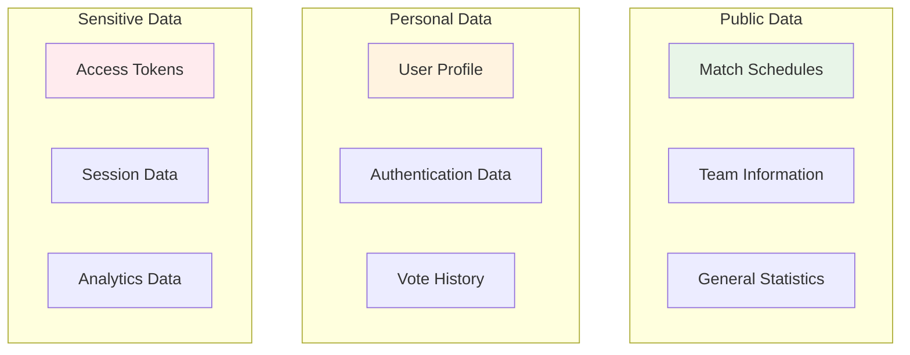

# Data Protection & Privacy

## Overview
The IPL Play-Along application implements comprehensive data protection measures to ensure user privacy, secure data handling, and compliance with privacy regulations.

## Data Classification

### Data Categories



### Data Sensitivity Levels
| Level | Data Type | Examples | Protection Level |
|-------|-----------|----------|------------------|
| **Public** | Non-sensitive | Match schedules, team logos | Standard encryption |
| **Personal** | User-identifiable | Profile data, votes | Enhanced encryption + access controls |
| **Sensitive** | High-risk | Tokens, sessions | Maximum encryption + strict access |

## Personal Data Handling

### User Profile Data
```javascript
// Data minimization principle
const UserProfile = {
  // Only collect necessary data
  essential: {
    id: 'uuid',
    name: 'string', // From Azure AD
    email: 'string', // From Azure AD
    created: 'timestamp'
  },
  
  // Optional data with explicit consent
  optional: {
    preferredTeams: 'array', // User preference
    notificationSettings: 'object', // User controlled
    displayName: 'string' // User provided
  },
  
  // Derived data (not stored permanently)
  derived: {
    sessionId: 'string', // Temporary
    lastActivity: 'timestamp', // Session only
    deviceInfo: 'object' // For security, not stored
  }
};

// Data access patterns
class UserDataManager {
  constructor() {
    this.encryptionKey = process.env.DATA_ENCRYPTION_KEY;
  }

  async getUserData(userId, requiredFields = []) {
    // Implement field-level access control
    const user = await this.validateAccess(userId);
    
    return this.filterUserData(user, requiredFields);
  }

  async updateUserData(userId, updateData) {
    // Validate update permissions
    await this.validateUpdateAccess(userId);
    
    // Sanitize and validate data
    const sanitizedData = this.sanitizeUserData(updateData);
    
    // Encrypt sensitive fields
    const encryptedData = this.encryptSensitiveFields(sanitizedData);
    
    return await this.saveUserData(userId, encryptedData);
  }

  filterUserData(userData, allowedFields) {
    if (allowedFields.length === 0) return userData;
    
    return Object.keys(userData)
      .filter(key => allowedFields.includes(key))
      .reduce((obj, key) => {
        obj[key] = userData[key];
        return obj;
      }, {});
  }

  sanitizeUserData(data) {
    // Remove any potentially harmful data
    const sanitized = { ...data };
    
    // Remove script tags and dangerous content
    Object.keys(sanitized).forEach(key => {
      if (typeof sanitized[key] === 'string') {
        sanitized[key] = this.sanitizeString(sanitized[key]);
      }
    });
    
    return sanitized;
  }

  sanitizeString(str) {
    // Remove script tags and encode HTML entities
    return str
      .replace(/<script\b[^<]*(?:(?!<\/script>)<[^<]*)*<\/script>/gi, '')
      .replace(/[<>]/g, (match) => ({ '<': '&lt;', '>': '&gt;' }[match]));
  }

  encryptSensitiveFields(data) {
    const sensitiveFields = ['email', 'phone', 'personalNotes'];
    const encrypted = { ...data };
    
    sensitiveFields.forEach(field => {
      if (encrypted[field]) {
        encrypted[field] = this.encrypt(encrypted[field]);
      }
    });
    
    return encrypted;
  }

  encrypt(data) {
    // Implement AES encryption
    const crypto = require('crypto');
    const cipher = crypto.createCipher('aes-256-cbc', this.encryptionKey);
    let encrypted = cipher.update(JSON.stringify(data), 'utf8', 'hex');
    encrypted += cipher.final('hex');
    return encrypted;
  }

  decrypt(encryptedData) {
    const crypto = require('crypto');
    const decipher = crypto.createDecipher('aes-256-cbc', this.encryptionKey);
    let decrypted = decipher.update(encryptedData, 'hex', 'utf8');
    decrypted += decipher.final('utf8');
    return JSON.parse(decrypted);
  }
}
```

### Vote Data Privacy
```javascript
// Anonymous voting system
class VotePrivacyManager {
  async submitVote(userId, voteData) {
    // Create anonymous vote record
    const anonymousVote = {
      voteId: this.generateVoteId(),
      matchId: voteData.matchId,
      teamVote: voteData.team,
      confidence: voteData.confidence,
      timestamp: Date.now(),
      // No direct user ID - use hash for analytics
      userHash: this.hashUserId(userId)
    };

    // Store user-vote mapping separately (for user's own history)
    const userVoteMapping = {
      userId: userId,
      voteId: anonymousVote.voteId,
      matchId: voteData.matchId,
      timestamp: anonymousVote.timestamp
    };

    // Save both records
    await Promise.all([
      this.saveAnonymousVote(anonymousVote),
      this.saveUserVoteMapping(userVoteMapping)
    ]);

    return {
      success: true,
      voteId: anonymousVote.voteId
    };
  }

  hashUserId(userId) {
    const crypto = require('crypto');
    return crypto.createHash('sha256')
      .update(userId + process.env.VOTE_SALT)
      .digest('hex');
  }

  async getUserVoteHistory(userId) {
    // Get user's vote mappings
    const voteMappings = await this.getUserVoteMappings(userId);
    
    // Fetch vote details without exposing other users' data
    const voteHistory = await Promise.all(
      voteMappings.map(mapping => this.getVoteDetails(mapping.voteId))
    );

    return voteHistory.map(vote => ({
      matchId: vote.matchId,
      teamVote: vote.teamVote,
      confidence: vote.confidence,
      timestamp: vote.timestamp
    }));
  }

  // Data aggregation without user identification
  async getVotingStatistics(matchId) {
    const votes = await this.getAnonymousVotes(matchId);
    
    return {
      totalVotes: votes.length,
      teamBreakdown: this.aggregateByTeam(votes),
      confidenceAverage: this.calculateAverageConfidence(votes),
      // No user-identifiable information
    };
  }
}
```

## Data Encryption

### Encryption Strategy
```javascript
// Multi-layer encryption implementation
class DataEncryption {
  constructor() {
    this.algorithms = {
      symmetric: 'aes-256-gcm',
      asymmetric: 'rsa-4096',
      hashing: 'sha256'
    };
  }

  // Field-level encryption for database storage
  encryptField(data, fieldName) {
    const crypto = require('crypto');
    const algorithm = this.algorithms.symmetric;
    const key = this.getFieldEncryptionKey(fieldName);
    
    const iv = crypto.randomBytes(16);
    const cipher = crypto.createCipher(algorithm, key, iv);
    
    let encrypted = cipher.update(JSON.stringify(data), 'utf8', 'hex');
    encrypted += cipher.final('hex');
    
    return {
      encrypted,
      iv: iv.toString('hex'),
      algorithm
    };
  }

  decryptField(encryptedData, fieldName) {
    const crypto = require('crypto');
    const key = this.getFieldEncryptionKey(fieldName);
    
    const decipher = crypto.createDecipher(
      encryptedData.algorithm,
      key,
      Buffer.from(encryptedData.iv, 'hex')
    );
    
    let decrypted = decipher.update(encryptedData.encrypted, 'hex', 'utf8');
    decrypted += decipher.final('utf8');
    
    return JSON.parse(decrypted);
  }

  // Key derivation for field-specific encryption
  getFieldEncryptionKey(fieldName) {
    const crypto = require('crypto');
    const masterKey = process.env.MASTER_ENCRYPTION_KEY;
    
    return crypto.pbkdf2Sync(
      masterKey + fieldName,
      process.env.ENCRYPTION_SALT,
      100000,
      32,
      'sha256'
    );
  }

  // Transport encryption (HTTPS enforcement)
  enforceHTTPS() {
    return (req, res, next) => {
      if (process.env.NODE_ENV === 'production' && !req.secure) {
        return res.redirect('https://' + req.headers.host + req.url);
      }
      next();
    };
  }

  // Client-side encryption for sensitive operations
  clientSideEncrypt(data, publicKey) {
    const crypto = require('crypto');
    
    // Use RSA public key encryption for key exchange
    const encrypted = crypto.publicEncrypt(
      {
        key: publicKey,
        padding: crypto.constants.RSA_PKCS1_OAEP_PADDING,
        oaepHash: 'sha256',
      },
      Buffer.from(JSON.stringify(data))
    );
    
    return encrypted.toString('base64');
  }
}
```

## GDPR Compliance

### GDPR Rights Implementation
```javascript
// GDPR compliance implementation
class GDPRCompliance {
  constructor() {
    this.dataRetentionPeriods = {
      votes: 365 * 24 * 60 * 60 * 1000, // 1 year
      userProfiles: 2 * 365 * 24 * 60 * 60 * 1000, // 2 years
      sessionLogs: 30 * 24 * 60 * 60 * 1000, // 30 days
      auditLogs: 7 * 365 * 24 * 60 * 60 * 1000 // 7 years
    };
  }

  // Right to be informed
  async getPrivacyNotice() {
    return {
      dataController: 'IPL Play-Along App',
      contact: 'privacy@iplplayalong.com',
      dataProcessed: [
        'Profile information from Azure AD',
        'Voting preferences and history',
        'Usage analytics (anonymized)',
        'Technical data for notifications'
      ],
      legalBasis: 'Legitimate interest and consent',
      retentionPeriods: this.dataRetentionPeriods,
      rights: [
        'Right of access',
        'Right to rectification',
        'Right to erasure',
        'Right to restrict processing',
        'Right to data portability',
        'Right to object'
      ]
    };
  }

  // Right of access
  async exportUserData(userId) {
    const userData = {
      profile: await this.getUserProfile(userId),
      votes: await this.getUserVotes(userId),
      preferences: await this.getUserPreferences(userId),
      activityLog: await this.getUserActivity(userId)
    };

    // Remove internal IDs and technical data
    return this.sanitizeForExport(userData);
  }

  // Right to rectification
  async updateUserData(userId, corrections) {
    const allowedFields = [
      'displayName',
      'preferences.notifications',
      'preferences.teams'
    ];

    const updates = {};
    Object.keys(corrections).forEach(field => {
      if (allowedFields.includes(field)) {
        updates[field] = corrections[field];
      }
    });

    await this.updateUser(userId, updates);
    
    // Log the correction for audit purposes
    await this.logDataCorrection(userId, updates);
  }

  // Right to erasure (Right to be forgotten)
  async deleteUserData(userId, reason = 'user_request') {
    console.log(`Processing data deletion for user ${userId}, reason: ${reason}`);

    try {
      // Step 1: Anonymize votes (preserve aggregate data)
      await this.anonymizeUserVotes(userId);

      // Step 2: Delete personal profile data
      await this.deleteUserProfile(userId);

      // Step 3: Remove from notification subscriptions
      await this.removeNotificationSubscriptions(userId);

      // Step 4: Clear session data
      await this.clearUserSessions(userId);

      // Step 5: Update audit logs (mark as deleted, don't remove)
      await this.markUserAsDeleted(userId, reason);

      // Step 6: Send confirmation
      await this.sendDeletionConfirmation(userId);

      return {
        success: true,
        deletedAt: new Date().toISOString(),
        retainedData: ['anonymized votes', 'audit logs']
      };
    } catch (error) {
      console.error('Data deletion failed:', error);
      throw new Error('Data deletion process failed');
    }
  }

  async anonymizeUserVotes(userId) {
    // Replace user ID with anonymous hash
    const anonymousId = this.generateAnonymousId(userId);
    
    await this.updateVoteRecords({
      userId: userId
    }, {
      userId: anonymousId,
      anonymized: true,
      anonymizedAt: new Date()
    });
  }

  // Right to data portability
  async generateDataExport(userId, format = 'json') {
    const userData = await this.exportUserData(userId);
    
    switch (format) {
      case 'json':
        return JSON.stringify(userData, null, 2);
      case 'csv':
        return this.convertToCSV(userData);
      case 'xml':
        return this.convertToXML(userData);
      default:
        throw new Error('Unsupported export format');
    }
  }

  // Right to restrict processing
  async restrictDataProcessing(userId, restrictions) {
    const validRestrictions = [
      'no_analytics',
      'no_notifications',
      'no_data_sharing',
      'minimal_processing'
    ];

    const appliedRestrictions = restrictions.filter(r => 
      validRestrictions.includes(r)
    );

    await this.updateUserRestrictions(userId, appliedRestrictions);
    
    // Apply restrictions immediately
    await this.enforceProcessingRestrictions(userId, appliedRestrictions);
  }

  // Consent management
  async updateConsent(userId, consentData) {
    const consentRecord = {
      userId,
      timestamp: new Date(),
      ipAddress: consentData.ipAddress,
      userAgent: consentData.userAgent,
      consents: {
        dataProcessing: consentData.dataProcessing || false,
        analytics: consentData.analytics || false,
        notifications: consentData.notifications || false,
        dataSharing: consentData.dataSharing || false
      }
    };

    await this.saveConsentRecord(consentRecord);
    
    // Apply consent preferences
    await this.applyConsentPreferences(userId, consentRecord.consents);
  }

  // Data retention and automatic cleanup
  async performDataCleanup() {
    console.log('Starting automated data cleanup...');

    for (const [dataType, retentionPeriod] of Object.entries(this.dataRetentionPeriods)) {
      await this.cleanupExpiredData(dataType, retentionPeriod);
    }
  }

  async cleanupExpiredData(dataType, retentionPeriod) {
    const cutoffDate = new Date(Date.now() - retentionPeriod);
    
    switch (dataType) {
      case 'votes':
        await this.archiveOldVotes(cutoffDate);
        break;
      case 'userProfiles':
        await this.removeInactiveProfiles(cutoffDate);
        break;
      case 'sessionLogs':
        await this.deleteOldSessions(cutoffDate);
        break;
      case 'auditLogs':
        await this.archiveOldAuditLogs(cutoffDate);
        break;
    }
  }
}
```

## Data Breach Response

### Incident Response Plan
```javascript
// Data breach detection and response
class DataBreachResponse {
  constructor() {
    this.alertThresholds = {
      unauthorizedAccess: 3, // 3 failed access attempts
      dataExfiltration: 100, // 100 records accessed
      systemIntrusion: 1, // Any unauthorized system access
      dataCorruption: 10 // 10 corrupted records
    };

    this.setupMonitoring();
  }

  async detectBreach(securityEvent) {
    const riskLevel = this.assessRiskLevel(securityEvent);
    
    if (riskLevel >= 0.7) { // High risk threshold
      await this.initiateBreachResponse(securityEvent, riskLevel);
    }
  }

  async initiateBreachResponse(event, riskLevel) {
    console.error('SECURITY BREACH DETECTED', { event, riskLevel });

    const incident = {
      id: this.generateIncidentId(),
      timestamp: new Date(),
      event: event,
      riskLevel: riskLevel,
      status: 'active',
      containmentActions: []
    };

    // Step 1: Immediate containment
    await this.immediateContainment(incident);

    // Step 2: Assessment and documentation
    await this.assessBreach(incident);

    // Step 3: Notification (within 72 hours for GDPR)
    await this.scheduleNotifications(incident);

    // Step 4: Remediation
    await this.implementRemediation(incident);

    return incident;
  }

  async immediateContainment(incident) {
    const containmentActions = [];

    // Isolate affected systems
    if (incident.event.type === 'system_intrusion') {
      await this.isolateAffectedSystems(incident.event.systems);
      containmentActions.push('systems_isolated');
    }

    // Revoke compromised credentials
    if (incident.event.compromisedCredentials) {
      await this.revokeCredentials(incident.event.compromisedCredentials);
      containmentActions.push('credentials_revoked');
    }

    // Block suspicious IP addresses
    if (incident.event.sourceIPs) {
      await this.blockIPAddresses(incident.event.sourceIPs);
      containmentActions.push('ips_blocked');
    }

    // Disable affected user accounts
    if (incident.event.affectedUsers) {
      await this.disableUserAccounts(incident.event.affectedUsers);
      containmentActions.push('accounts_disabled');
    }

    incident.containmentActions = containmentActions;
    await this.updateIncident(incident);
  }

  async notifyAffectedIndividuals(incident) {
    const affectedUsers = incident.assessment.dataAffected.users;
    
    for (const userId of affectedUsers) {
      const user = await this.getUser(userId);
      
      const notification = {
        to: user.email,
        subject: 'Important Security Notice - IPL Play-Along',
        body: this.generateUserNotificationBody(incident, user),
        timestamp: new Date()
      };
      
      await this.sendSecurityNotification(notification);
      await this.logNotificationSent(userId, incident.id);
    }
  }

  generateUserNotificationBody(incident, user) {
    return `
Dear ${user.name},

We are writing to inform you of a security incident that may have affected your personal information on the IPL Play-Along platform.

WHAT HAPPENED:
${incident.assessment.description}

INFORMATION INVOLVED:
${incident.assessment.dataClassification.join(', ')}

WHAT WE ARE DOING:
- We have contained the incident and secured our systems
- We are working with security experts to investigate
- We have notified relevant authorities
- We are implementing additional security measures

WHAT YOU CAN DO:
- Monitor your accounts for any suspicious activity
- Consider changing your password if advised
- Contact us if you notice any unusual activity

We sincerely apologize for this incident and any inconvenience it may cause.

Contact us at: security@iplplayalong.com

IPL Play-Along Security Team
    `.trim();
  }
}
```

## Security Best Practices

### Implementation Checklist
- ✅ **Data Classification**: All data categorized by sensitivity level
- ✅ **Encryption**: Multi-layer encryption for data at rest and in transit  
- ✅ **Access Controls**: Role-based access with principle of least privilege
- ✅ **Privacy Rights**: Full GDPR compliance implementation
- ✅ **Breach Response**: Comprehensive incident response plan
- ✅ **Audit Trail**: Complete security monitoring and logging
- ✅ **Data Retention**: Automated cleanup of expired data
- ✅ **Consent Management**: Granular user consent controls

### Regular Security Reviews
1. **Quarterly Privacy Audits** - Review data collection and processing
2. **Annual Penetration Testing** - Third-party security assessments
3. **Monthly Access Reviews** - Validate user permissions and access
4. **Weekly Vulnerability Scans** - Automated security scanning
5. **Daily Monitoring** - Real-time security event monitoring

### Privacy-by-Design Principles
- **Data Minimization** - Collect only necessary data
- **Purpose Limitation** - Use data only for stated purposes
- **Storage Limitation** - Retain data only as long as needed
- **Transparency** - Clear privacy notices and controls
- **User Control** - Easy access to privacy settings and data management